# Keyestudio 48-in-1 Sensor Kit: Descripción del curso y configuración

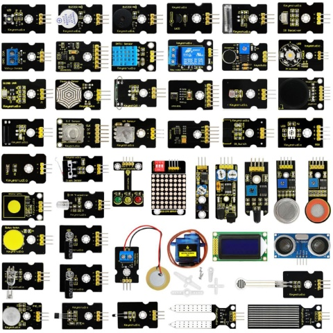

## Descripción del curso

Este kit de sensores, compatible con varios microcontroladores y Raspberry Pi, contiene 48 sensores y módulos de uso común que incluyen un módulo de zumbador activo, un módulo relé de 5V, un módulo de temperatura y humedad, entre otros.

Al mismo tiempo, también se proporcionan algunos proyectos detallados para cada sensor basados en la placa de desarrollo, como métodos de cableado y código de prueba. Con la ayuda de este kit, no solo podrás obtener conocimientos interesantes sobre ellos, sino también realizar proyectos interactivos sustanciales.

Tenga en cuenta que en los proyectos siguientes, la placa principal y otros cables no están incluidos en este kit.

> **Recursos y descarga de código:** [Tutorial KS0522](./Resources.7z)

## Lista de componentes

| **No.** |                   **Componentes**                    | **Cantidad** |                         **Imagen**                          |
| :-----: | :-------------------------------------------------: | :----------: | :----------------------------------------------------------: |
|    1    |                  Módulo LED blanco                   |      1       |       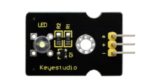        |
|    2    |                   Módulo LED RGB                     |      1       |       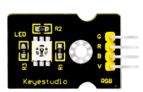        |
|    3    |                    Módulo LED 3W                     |      1       |       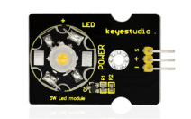        |
|    4    |                  Módulo semáforo                     |      1       |       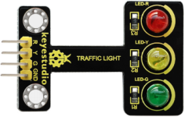        |
|    5    |               Módulo zumbador activo                 |      1       |       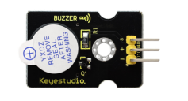        |
|    6    |               Módulo zumbador pasivo                 |      1       |       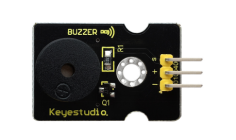        |
|    7    |            Módulo botón pulsador digital             |      1       |       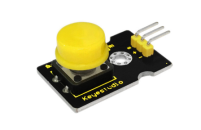        |
|    8    |                  Sensor de colisión                  |      1       |       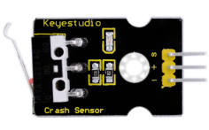        |
|    9    |               Sensor de seguimiento de línea        |      1       |       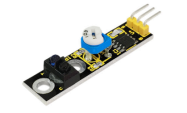        |
|   10    |         Sensor infrarrojo de evitación de obstáculos |      1       |       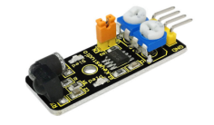        |
|   11    |        Módulo interrumpor óptico (interrupción fotoeléctrica)        |      1       |       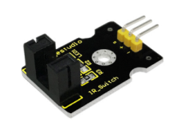        |
|   12    |                Sensor magnético Hall                 |      1       |       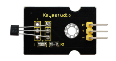        |
|   13    |                 Módulo sensor de golpes              |      1       |       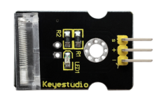        |
|   14    |                 Sensor de inclinación digital        |      1       |       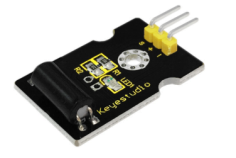        |
|   15    |               Sensor de tacto capacitivo             |      1       |       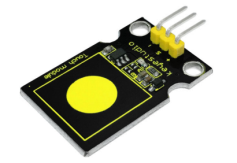        |
|   16    |                    Sensor de llama                   |      1       |       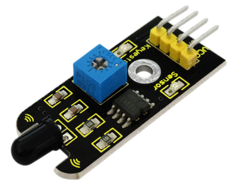        |
|   17    |                 Módulo interruptor de láminas        |      1       |               |
|   18    |                  Sensor de movimiento PIR           |      1       |       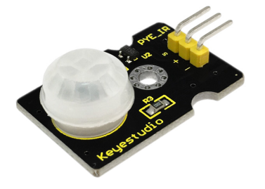        |
|   19    |              Sensor de temperatura analógico        |      1       |       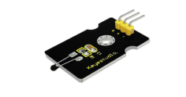        |
|   20    |               Sensor de rotación analógico          |      1       |       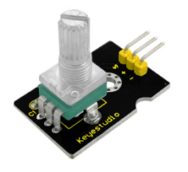        |
|   21    |                  Sensor fotoeléctrico               |      1       |       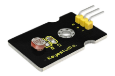        |
|   22    |                 Sensor de sonido analógico          |      1       |       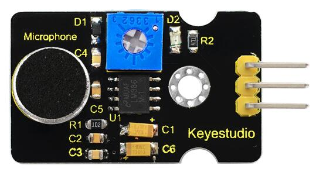       |
|   23    |                    Sensor de agua                   |      1       |       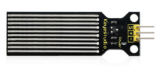        |
|   24    |                Sensor de humedad del suelo          |      1       |       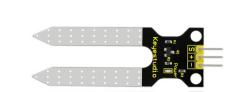       |
|   25    |                  Sensor de gas analógico            |      1       |       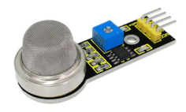        |
|   26    |                Sensor de alcohol analógico          |      1       |       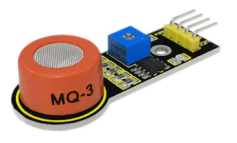        |
|   27    |                    Sensor de vapor                  |      1       |       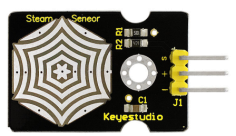        |
|   28    |    Sensor de vibración piezoeléctrico analógico     |      1       |       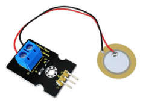        |
|   29    |                   Sensor de voltaje                 |      1       |       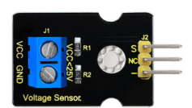        |
|   30    |              Sensor de presión de película delgada  |      1       |       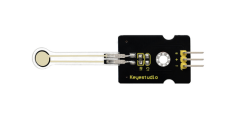        |
|   31    |            Sensor de luz ambiente TEMT6000          |      1       |       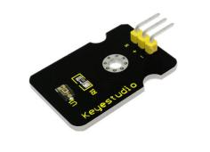       |
|   32    |         Sensor de radiación ultravioleta GUVA-S12SD 3528          |      1       |       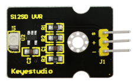        |
|   33    |             Módulo receptor IR digital               |      1       |       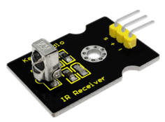        |
|   34    |            Módulo transmisor IR digital              |      1       |       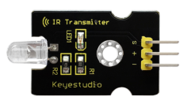        |
|   35    |              Módulo monitor de pulso                |      1       |       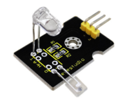        |
|   36    |                   Módulo joystick                    |      1       |       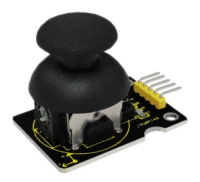        |
|   37    |                Módulo codificador rotatorio          |      1       |       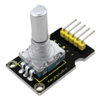        |
|   38    |              Módulo relé 5V 1 canal                  |      1       |       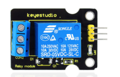        |
|   39    |           Sensor de temperatura lineal LM35         |      1       |       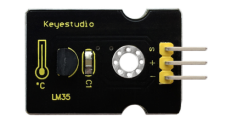        |
|   40    |        Sensor de temperatura y humedad DHT11        |      1       |       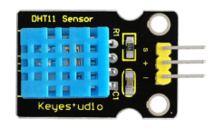        |
|   41    |              Módulo copa de luz mágica              |      2       |       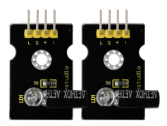        |
|   42    |          Módulo sensor de actitud APDS-9930         |      1       |       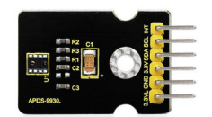        |
|   43    | Módulo de detección de proximidad óptica con LED infrarrojo ALS |      1       |       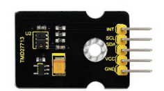        |
|   44    | Sensor de aceleración triaxial y orientación MMA8452Q |      1       |       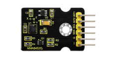        |
|   45    |                   Servo motor 9G                     |      1       |       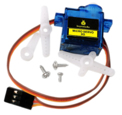        |
|   46    |           Sensor ultrasónico HC-SR04 azul            |      1       |       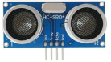        |
|   47    |  Módulo LCD 0802 5V pantalla azul（con retroiluminación）   |      1       |              |
|   48    |        Módulo matriz LED 8x8 con selección de dirección         |      1       |              |

## Placa de desarrollo Keyestudio V4.0

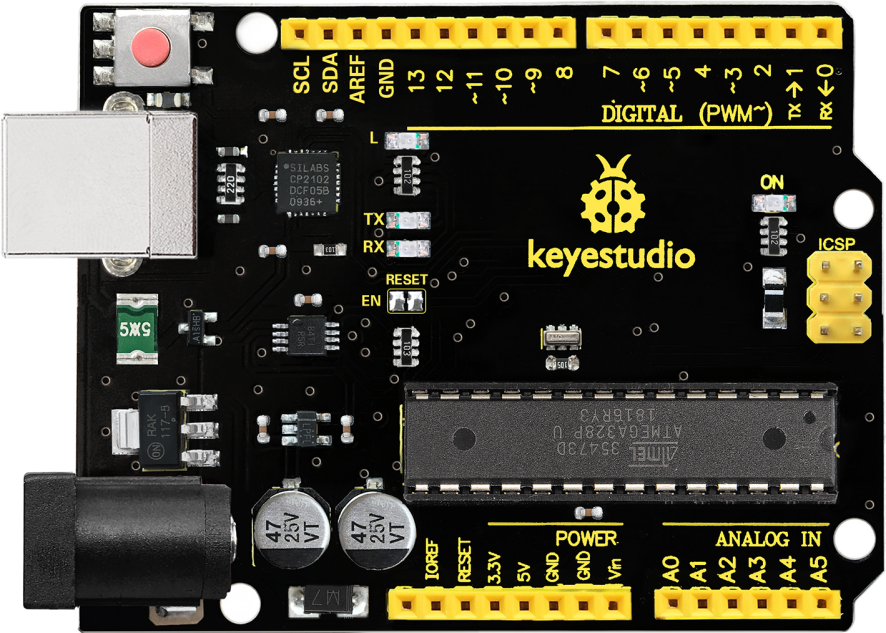

La placa de desarrollo Keyestudio V4.0 es una placa compatible con Arduino Uno, basada en el MCU ATmega328P, y con un chip cp2102 como convertidor UART a USB.

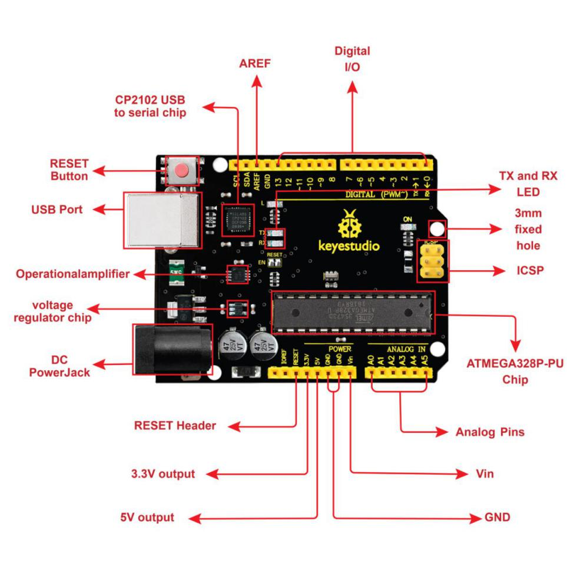
Tiene 14 pines de entrada/salida digital (de los cuales 6 pueden usarse como salidas PWM), 6 entradas analógicas, un cristal de 16 MHz, una conexión USB, una toma de alimentación, 2 cabeceras ICSP y un botón de reset.

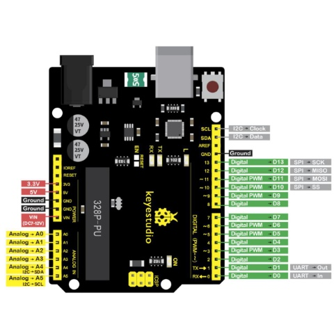
Contiene todo lo necesario para soportar el microcontrolador; simplemente conéctela a un ordenador con un cable USB o aliméntela mediante una fuente de alimentación de CC externa (DC 7-12V) o mediante los pines hembra Vin/GND (DC 7-12V) para comenzar.

| Microcontrolador             | ATmega328P-PU                                            |
|-----------------------------|----------------------------------------------------------|
| Voltaje de operación        | 5V                                                       |
| Voltaje de entrada (recomendado) | DC7-12V                                                  |
| Pines digitales E/S         | 14 (D0-D13)  (de los cuales 6 proporcionan salida PWM)   |
| Pines digitales PWM         | 6 (D3, D5, D6, D9, D10, D11)                             |
| Pines de entrada analógica  | 6 (A0-A5)                                                |
| Corriente DC por pin E/S    | 20 mA                                                    |
| Corriente DC para pin 3.3V  | 50 mA                                                    |
| Memoria Flash               | 32 KB (ATmega328P-PU) de los cuales 0.5 KB son usados por el cargador de arranque |
| SRAM                        | 2 KB (ATmega328P-PU)                                     |
| EEPROM                      | 1 KB (ATmega328P-PU)                                     |
| Velocidad del reloj         | 16 MHz                                                   |
| LED_BUILTIN                 | D13                                                      |

## Instalación del Arduino IDE y del driver

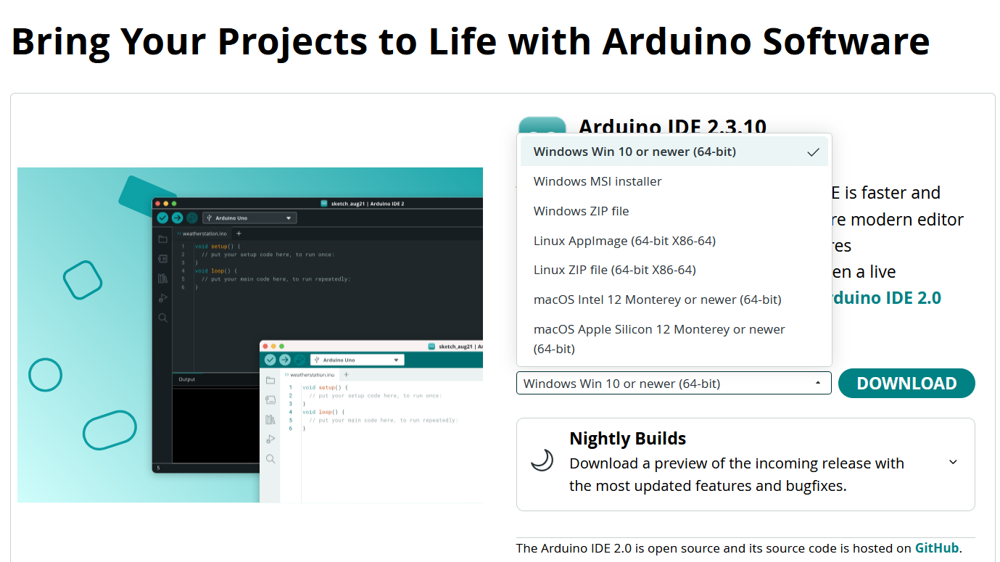

> **Guía de configuración:** [Instalar el Arduino IDE, controladores, bibliotecas y el primer sketch](https://getting-started-with-arduino.readthedocs.io/en/latest/Arduino%20IDE%20Tutorial.html).

## Requisitos de bibliotecas

> **Seguridad y configuración.** Desconecte la alimentación antes de cambiar el cableado. Utilice el proyecto del relé solo con cargas de bajo voltaje a menos que disponga de aislamiento adecuado, una caja protectora y prácticas de seguridad para redes eléctricas. Seleccione **Arduino Uno** en el Arduino IDE antes de compilar los ejemplos para la placa V4.0.

La mayoría de los ejemplos usan solo el núcleo estándar de Arduino. Instale las siguientes bibliotecas antes de compilar los proyectos correspondientes. El paquete también contiene copias heredadas bajo `Resources/02. libraries/` para proyectos cuyo código apunta a APIs de bibliotecas antiguas.

| Proyectos | Biblioteca requerida | Guía de instalación |
| --- | --- | --- |
| 33–34 | `IRremote` | Instale **IRremote** desde el Administrador de Bibliotecas del Arduino IDE. |
| 40 | `DHTlib` | Instale **DHTlib** desde el Administrador de Bibliotecas del Arduino IDE. El ejemplo abajo usa su API actual `dht.h`. |
| 42 | `SparkFun_APDS9960` | Utilice la biblioteca incluida `Resources/02. libraries/SparkFun_APDS9960` después de confirmar que el hardware es APDS-9960. |
| 43 | `APDS9930` | Utilice la biblioteca incluida `Resources/02. libraries/APDS9930_` después de confirmar que el hardware es APDS-9930. |
| 44 | `SparkFun_MMA8452Q` | Utilice la biblioteca incluida `Resources/02. libraries/SparkFun_MMA8452Q_Arduino_Library_master`. |
| 48 | `Adafruit LED Backpack Library` y `Adafruit GFX Library` | Instale ambas bibliotecas desde el Administrador de Bibliotecas del Arduino IDE. |
