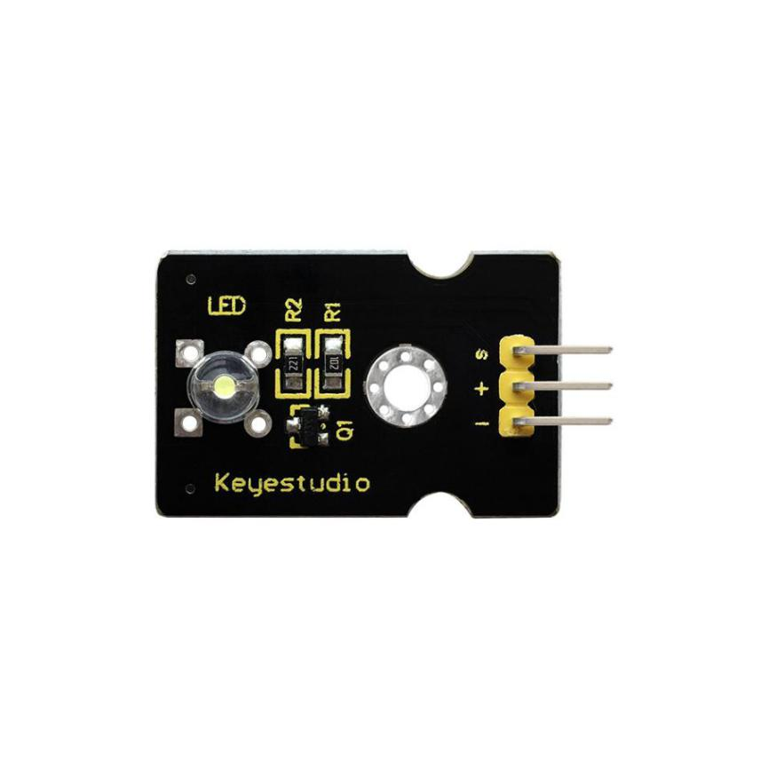
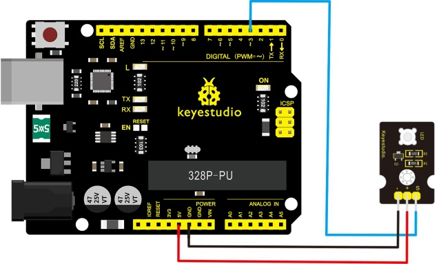
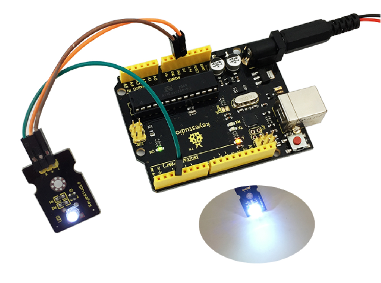

# Leçon 01 : LED blanche

> **Kit :** Kit de capteurs Keyestudio 48-en-1  
> **Carte :** Keyestudio V4.0 / carte ATmega328P compatible Arduino Uno



## Description

Ce module LED blanche est idéal pour les débutants Arduino. Il peut être facilement connecté au shield IO/Sensor. Il permet des interactions liées à la lumière.

Remarque : Vous pouvez choisir d'autres modules LED pour émettre d'autres couleurs comme le jaune, le rouge, le vert et le bleu.

## Spécifications

- Module LED blanc

- Type : Numérique

- Connecteur PH2.54

- Taille : 30\*20mm

- Poids : 3g

## Schéma de connexion

Avant la connexion, préparez les éléments suivants :

- Carte V4.0\*1

- Module LED blanc \*1

- Câble USB\*1

- Câble jumper\*3

Connectez la broche S du module au Digital 3 de la carte V4.0, la broche négative au port GND, et la broche positive au port 5V.



## Exemple de code

Copiez et collez le code ci-dessous dans le logiciel Arduino.

```c
const uint8_t ledPin = 3;

void setup() {
  pinMode(ledPin, OUTPUT);
}

void loop() {
  digitalWrite(ledPin, HIGH);
  delay(1000);
  digitalWrite(ledPin, LOW);
  delay(1000);
}
```

## Résultat

Après avoir réalisé le câblage, alimenté la carte et téléversé correctement le code, vous verrez le module LED émettre une lumière blanche.



---
