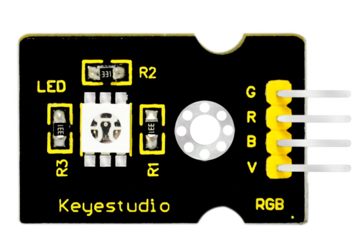
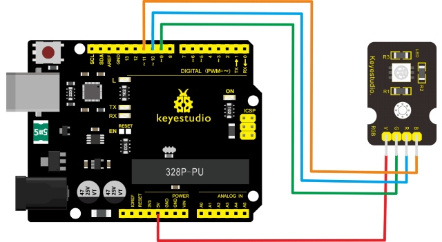
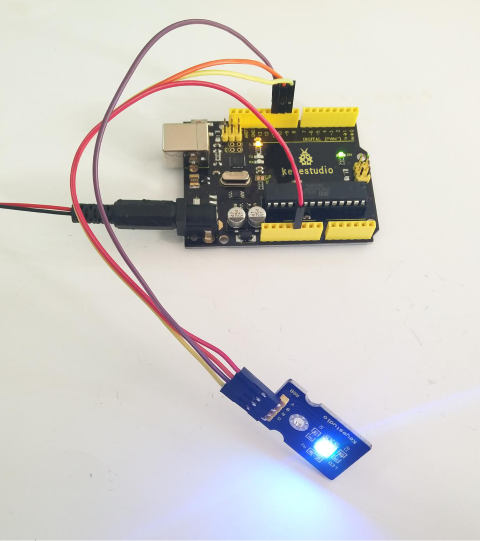

# Leçon 02 : LED RVB

> **Kit :** Kit de capteurs Keyestudio 48-en-1  
> **Carte :** Carte Keyestudio V4.0 / compatible Arduino Uno ATmega328P



## Description

Il s'agit d'un module LED multicolore, qui contient 3 couleurs de base－rouge, vert et bleu. Elles peuvent être considérées comme des LED séparées.

Après programmation, vous pouvez les allumer et les éteindre en séquence ou utiliser la sortie analogique PWM pour mélanger les trois couleurs et générer différentes teintes.

## Spécifications

- Couleur : rouge, vert et bleu

- Luminosité : élevée

- Tension : 5V

- Entrée : niveau numérique

- Taille : 30 \*20mm

- Poids : 3g

## Schéma de connexion

Préparez d'abord les composants suivants avant la connexion :

- Carte V4.0\*1

- module LED RVB \*1

- Câble USB\*1

- Fils de connexion\*4

Connectez la broche V du module au port 5V de la carte V4.0, connectez la broche B à Digital 11, la broche R à Digital 10, et la broche G à Digital 9.



## Exemple de code

Copiez et collez le code ci-dessous dans le logiciel Arduino.

```c
const uint8_t redPin = 11;
const uint8_t bluePin = 10;
const uint8_t greenPin = 9;

void setup() {
  pinMode(redPin, OUTPUT);
  pinMode(bluePin, OUTPUT);
  pinMode(greenPin, OUTPUT);
}

void loop() {
  for (int value = 255; value >= 0; --value) {
    analogWrite(redPin, value);
    analogWrite(bluePin, 255 - value);
    analogWrite(greenPin, 128 - value);
    delay(1);
  }
  for (int value = 0; value < 255; ++value) {
    analogWrite(redPin, value);
    analogWrite(bluePin, 255 - value);
    analogWrite(greenPin, 128 - value);
    delay(1);
  }
}
```

## Exemple de résultat

Après le câblage et la mise sous tension, une fois le code correctement téléversé, vous verrez le module LED RVB émettre des couleurs brillantes.



---
