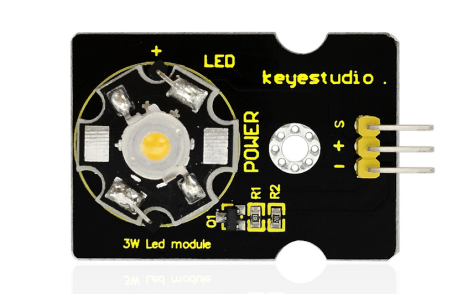
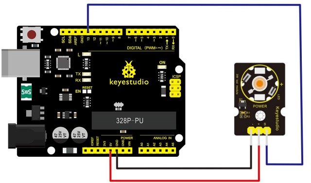
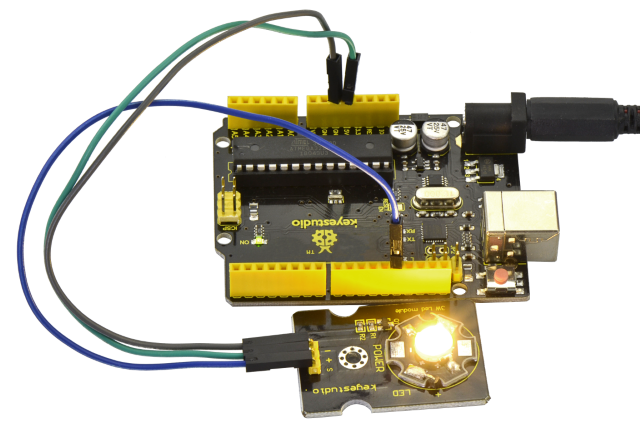

# Leçon 03 : LED 3W

> **Kit :** Keyestudio 48-en-1 Kit de capteurs  
> **Carte :** Keyestudio V4.0 / carte compatible Arduino Uno ATmega328P



## Description

Ce module LED présente une forte luminosité car les puces qu'il contient sont de 3W.  
Vous pouvez utiliser ce module dans des projets Arduino, idéal pour des robots ou des plates-formes de recherche et de sauvetage.

Par exemple, des robots intelligents peuvent utiliser ce module pour l'éclairage.  
Veuillez noter que la lumière de la LED ne doit pas être exposée directement aux yeux humains pour des raisons de sécurité.

## Spécification

- Température de couleur : 6000\~7000K

- Flux lumineux : 180\~210lm

- Courant : 700\~750mA

- Puissance : 3W

- Angle lumineux : 140 degrés

- Température de fonctionnement : -50\~80℃

- Température de stockage : -50\~100℃

- Module LED haute puissance, contrôlé par le port IO du microcontrôleur

- Type IO : Numérique

- Tension d'alimentation : 3.3V à 5V

- Taille : 40x28mm

- Poids : 6g

## Schéma de connexion

Tout d'abord, vous devez préparer les pièces suivantes avant la connexion :

- Carte V4.0\*1

- Module LED 3W \*1

- Câble USB\*1

- Câble de liaison\*3

Connectez la broche S du module à Digital 13 de la carte V4.0, connectez la broche négative au port GND, la broche positive au port 5V.



## Exemple de code

Copiez et collez le code ci-dessous dans le logiciel Arduino.

```c
///////////////////////////////////////////////////////////
// the setup function runs once when you press reset or power the board
void setup() {
  // initialize digital pin 13 as an output.
  pinMode(13, OUTPUT);
}

// the loop function runs over and over again forever
void loop() {
  digitalWrite(13, HIGH);   // turn the LED on (HIGH is the voltage level)
  delay(1000);              // wait for a second
  digitalWrite(13, LOW);    // turn the LED off by making the voltage LOW
  delay(1000);              // wait for a second
}
///////////////////////////////////////////////////////////
```

## Résultat attendu

Une fois le câblage effectué et l'alimentation mise, téléversez correctement le code : la LED D13 et la LED du module clignotent pendant une seconde puis s'éteignent, de manière cyclique.



---
