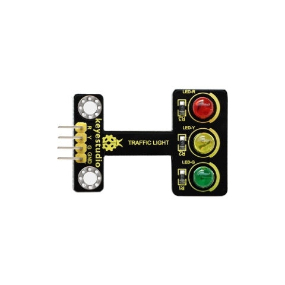
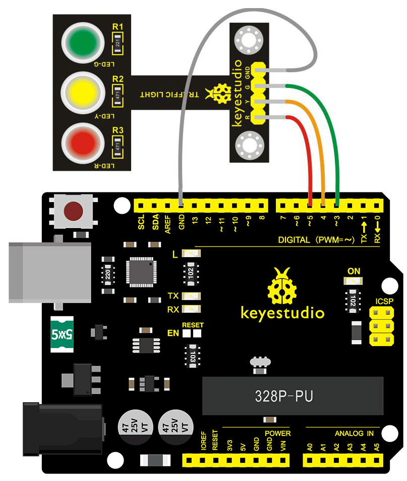
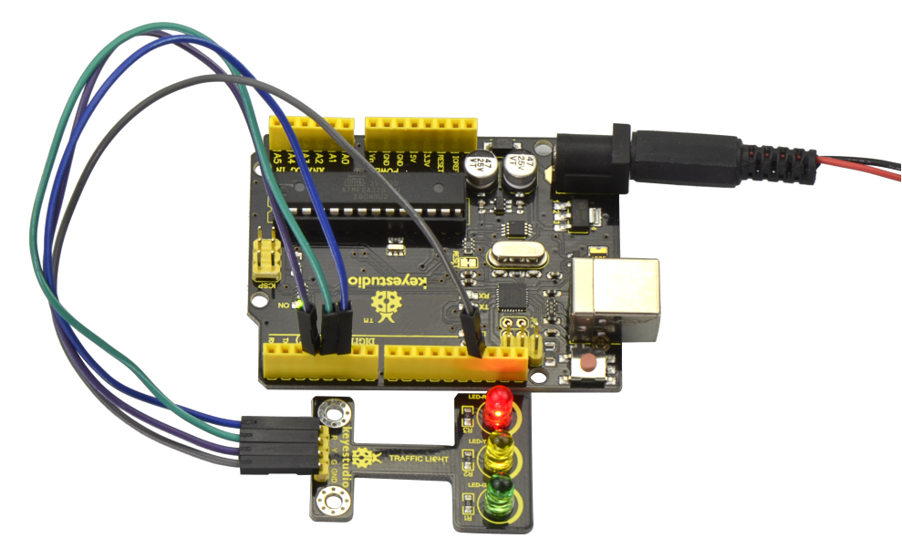

# Lesson 04: Traffic Light

> **Kit:** Keyestudio 48-in-1 Sensor Kit  
> **Board:** Keyestudio V4.0 / Arduino Uno-compatible ATmega328P board

| [← Previous lesson](lesson-03-3w-led.md) | [Course index](../README.md) | [Next lesson →](lesson-05-buzzer-beeps.md) |
| --- | --- | --- |



## Description

When learning the microcontroller, you may usually use three LEDs, namely red, green and yellow lights to simulate the traffic light blinking via external connection.

This time we specially design this module which is very convenient for wiring, and on the module you can see the red, yellow and green LED.

This module is fully compatible with Arduino microcontroller and Raspberry Pi system.

## Specification

- Working Voltage: 3.3-5v

- Interface Type: digital

- PH2.54 Socket

## Connection Diagram

First, you need to prepare the following parts before connection:

- V4.0 Board\*1

- Traffic light module \*1

- USB Cable\*1

- Jumper Wire\*4

Connect the R pin of module to Digital 5 of V4.0 board, connect the Y pin to Digital 4, G pin to Digital 3, GND pin to ground port.



## Sample Code

Copy and paste the below code to Arduino software.

```c
////////////////////////////////////////////////////////////////////
int redled =5; // initialize digital pin 5.
int yellowled =4; // initialize digital pin 4.
int greenled =3; // initialize digital pin 3.
void setup()
{
pinMode(redled, OUTPUT);// set the pin with red LED as “output”
pinMode(yellowled, OUTPUT); // set the pin with yellow LED as “output”
pinMode(greenled, OUTPUT); // set the pin with green LED as “output”
}
void loop()
{
digitalWrite(greenled, HIGH);//// turn on green LED
delay(5000);// wait 5 seconds
digitalWrite(greenled, LOW); // turn off green LED
for(int i=0;i<3;i++)// blinks for 3 times
{
delay(500);// wait 0.5 seconds
digitalWrite(yellowled, HIGH);// turn on yellow LED
delay(500);// wait 0.5 seconds
digitalWrite(yellowled, LOW);// turn off yellow LED
}
delay(500);// wait 0.5 seconds
digitalWrite(redled, HIGH);// turn on red LED
delay(5000);// wait 5 seconds
digitalWrite(redled, LOW);// turn off red LED
}
////////////////////////////////////////////////////////////////////
```

## Example Result

Done uploading the code, powered up, three LEDs on the module will automatically simulate the traffic light on and off, circularly.



---

| [← Previous lesson](lesson-03-3w-led.md) | [Course index](../README.md) | [Next lesson →](lesson-05-buzzer-beeps.md) |
| --- | --- | --- |
