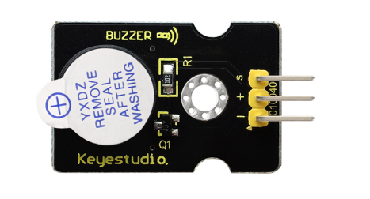
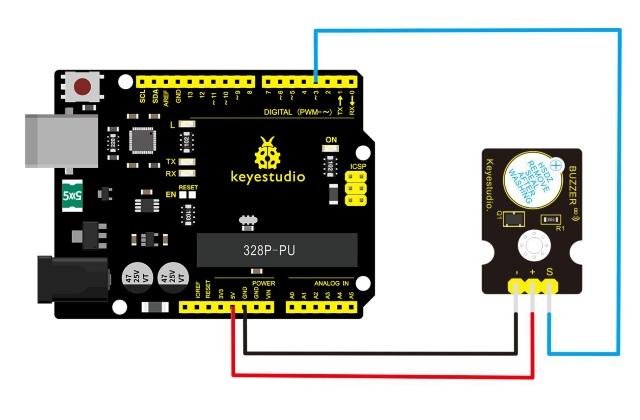
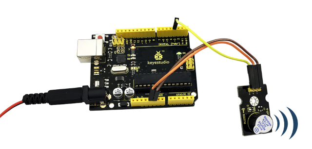

# Leçon 05 : Bips du buzzer

> **Kit :** Keyestudio 48-in-1 Sensor Kit  
> **Carte :** Keyestudio V4.0 / carte compatible Arduino Uno ATmega328P



## Description

Voici le module sonore le plus simple. Vous pouvez le piloter en appliquant un niveau haut/bas. En changeant la fréquence de son bourdonnement, on peut produire des sons différents.

Ce module est largement utilisé dans nos appareils quotidiens tels que PC, réfrigérateur, téléphones, etc.

De plus, vous pouvez créer de nombreux projets interactifs intéressants avec ce petit mais utile module. Essayez-le !! Vous trouverez le son électronique qu'il produit très fascinant.

## Spécification

- Tension de fonctionnement : 3.3-5v

- Type d'interface : numérique

- Taille : 30*20mm

- Poids : 4g

## Schéma de connexion

Reliez la broche S du module au Digital 3 de la carte V4.0, la broche négative au port GND, la broche positive au port 5V.



## Exemple de code

Copiez-collez le code ci-dessous dans le logiciel Arduino.

```c
////////////////////////////////////////////////////////////////////
int buzzPin =3;    //Connect Buzzer on Digital Pin3
 void setup()
 {
  pinMode(buzzPin, OUTPUT);
}
 void loop()
{
  digitalWrite(buzzPin, HIGH);
  delay(1);
  digitalWrite(buzzPin, LOW);
  delay(1);
}
////////////////////////////////////////////////////////////////////
```

## Résultat d'exemple

Une fois le code téléversé sur la carte, le buzzer émettra un son.



---
