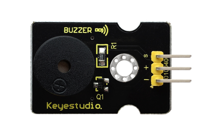
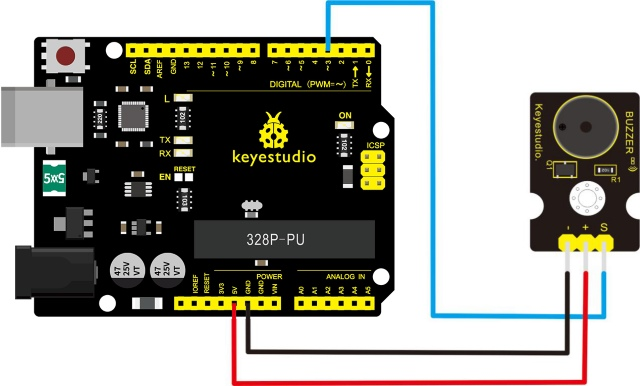
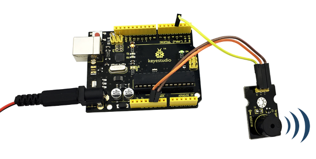

# Les 06: Passieve zoemer

> **Kit:** Keyestudio 48-in-1 Sensor Kit  
> **Bord:** Keyestudio V4.0 / Arduino Uno-compatibel ATmega328P-bord



## Beschrijving

We kunnen Arduino gebruiken om veel interactieve projecten te maken, waarvan de meest gebruikte de akoestisch-visuele weergave is. Het circuit in dit experiment kan geluid produceren.

Normaal kan het experiment worden uitgevoerd met een zoemer of een luidspreker, waarbij een zoemer eenvoudiger en makkelijker in gebruik is.

De zoemer die hier wordt geïntroduceerd is een passieve zoemer. Deze kan niet zelfstandig worden aangestuurd, maar door externe pulsfrequenties. Verschillende frequenties produceren verschillende geluiden. Je kunt Arduino gebruiken om de melodie van een liedje te programmeren — leuk en eenvoudig.

## Specificaties

- Werkspanning: 3.3-5v

- Interface type: digitaal

- Afmetingen: 30\*20mm

- Gewicht: 4g

## Aansluitschema

Bereid eerst de volgende onderdelen voor voordat je gaat aansluiten:

- V4.0-bord*1

- Passieve zoemer-module*1

- USB-kabel*1

- Jumperdraden*3

Verbind de S-pin van de module met Digital 3 van het V4.0-bord, verbind de negatieve pin met de GND-poort en de positieve pin met de 5V-poort.



## Voorbeeldcode

Kopieer en plak de onderstaande code in de Arduino-software.

```c
////////////////////////////////////////////////////////////////////
int buzzer=3;//set digital IO pin of the buzzer
void setup()
{
pinMode(buzzer,OUTPUT);// set digital IO pin pattern, OUTPUT to be output
}
void loop()
{ unsigned char i,j;//define variable
while(1)
{ for(i=0;i<80;i++)// output a frequency sound
{ digitalWrite(buzzer,HIGH);// sound
delay(1);//delay1ms
digitalWrite(buzzer,LOW);//not sound
delay(1);//ms delay
}
for(i=0;i<100;i++)// output a frequency sound
{
digitalWrite(buzzer,HIGH);// sound
digitalWrite(buzzer,LOW);//not sound
delay(2);//2ms delay
}
}
}
////////////////////////////////////////////////////////////////////
```

## Voorbeeldresultaat

Na het uploaden van de code naar het bord zal de zoemer geluid maken.



---
