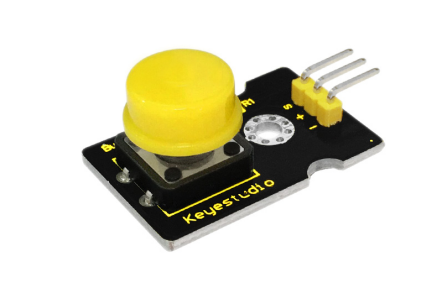
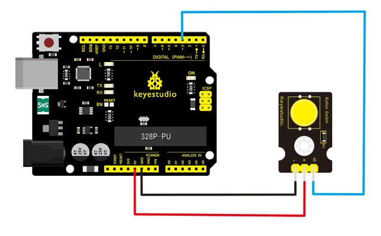
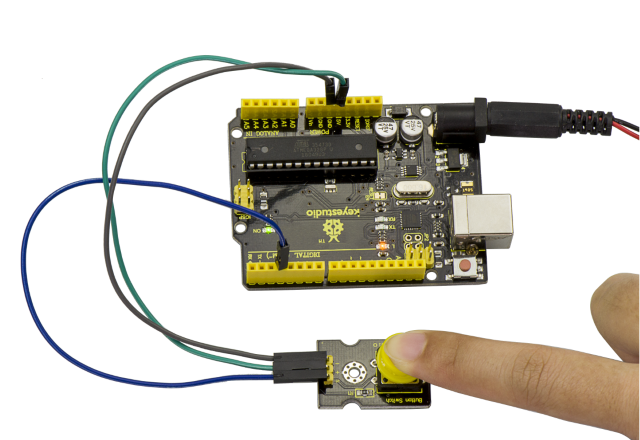

# Lesson 07: Digital Push Button

> **Kit:** Keyestudio 48-in-1 Sensor Kit  
> **Board:** Keyestudio V4.0 / Arduino Uno-compatible ATmega328P board



## Description

This is a basic button module. You can simply plug it into an IO shield to have your first try of Arduino.

## Features

- Wide voltage range from 3.3V to 5V

- Easily recognizable interfaces of sensors ("A" for Analog and "D" for Digital)

- Standard assembled hole

- Clear icons illustration

- High quality connector

- Easy to plug and operate

- Large button and high-quality cap

- To achieve interesting and interactive works

## Specification

- Supply Voltage: 3.3V to 5V

- Interface: Digital

- Dimensions: 30*20mm

- Weight: 4g

## Connection Diagram

First, you need to prepare the following parts before connection:

- V4.0 Board*1

- Push button module*1

- USB Cable*1

- Jumper Wire*3

Connect the S pin of module to Digital 3 of V4.0 board, connect the negative pin to GND port, positive pin to 5V port.



## Sample Code

Copy and paste the below code to Arduino software.

```c
////////////////////////////////////////////////////////////////////
/* # When you push the digital button, the Led 13 on the board will be turned on. Otherwise,the led is turned off.
*/
int ledPin = 13;                // choose the pin for the LED
int inputPin = 3;               // Connect sensor to input pin 3
void setup() {
  pinMode(ledPin, OUTPUT);      // set LED as output
  pinMode(inputPin, INPUT);     // set pushbutton as input
}
void loop(){
  int val = digitalRead(inputPin);  // read input value
  if (val == HIGH) {            // check if the input is HIGH
    digitalWrite(ledPin, LOW);  // turn LED OFF
  } else {
    digitalWrite(ledPin, HIGH); // turn LED ON
  }
}
////////////////////////////////////////////////////////////////////
```

## Example Result

Wire it up well as the figure shown below, and then upload the code to the board.

When you push the digital button, the Led 13 on V4.0 board will be on. When release the button, the led is off. Shown as below.



---
