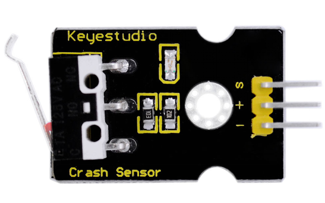
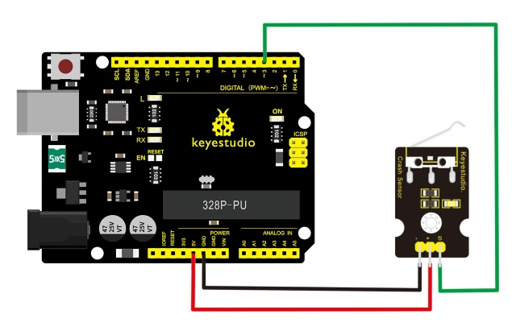

# Lección 08: Destello por Colisión

> **Kit:** Keyestudio Kit de Sensores 48 en 1  
> **Placa:** Keyestudio V4.0 / placa compatible con Arduino Uno ATmega328P



## Descripción

El sensor de choque, también conocido como interruptor electrónico, es un módulo de entrada digital de encendido/apagado necesario para el aprendizaje básico de electrónica.

Mediante programación, puede controlar luces, dispositivos sonoros, la función de selección por teclas de una pantalla LCD, etc.

Usando un cable sensor 3P para conectarlo a la placa de sensores, puede instalarse en una plataforma de robot móvil 4WD de aleación AL para realizar la función de detección de colisiones. Es a la vez conveniente y eficiente.

Puede crear un intermitente de colisión usando el módulo de choque y el LED incorporado en el interfaz 13. Conecte el sensor de choque al pin 3. Cuando el sensor detecte una señal de colisión, los LEDs tanto de la placa principal como del módulo se encenderán simultáneamente.

## Parámetros

1. Si ocurre una colisión en la parte frontal donde está instalado el módulo de choque, el módulo emite una señal de nivel bajo; sin colisión, emite señal de nivel alto.

2. El módulo tiene reservado un orificio de montaje M3, conveniente para fijarlo en un vehículo.

3. Con luz indicadora del interruptor: si hay colisión, la luz se enciende; sin colisión, la luz está apagada.

## Definición de pines

1. Pin positivo (+): conectar a fuente de alimentación 3v-12v

2. Pin negativo (-): conectar a GND

3. Pin de señal (S): salida de nivel alto-bajo

## Diagrama de conexión

Primero, necesita preparar las siguientes piezas antes de la conexión:

- Placa V4.0\*1

- Módulo de choque \*1

- Cable USB\*1

- Cable jumper\*3

Conecte el pin S del módulo a Digital 3 de la placa V4.0, conecte el pin negativo al puerto GND, y el pin positivo al puerto 5V.



## Código de ejemplo

Copie y pegue el código siguiente en el software Arduino.

```c
const uint8_t ledPin = 13;
const uint8_t collisionPin = 3;

void setup() {
  pinMode(ledPin, OUTPUT);
  pinMode(collisionPin, INPUT);
}

void loop() {
  const int state = digitalRead(collisionPin);
  digitalWrite(ledPin, state == HIGH ? LOW : HIGH);
}
```

## Resultado de ejemplo

Conéctelo todo correctamente y luego cargue el código en la placa.

Cuando el objeto acciona el interruptor del sensor, tanto el LED del sensor como el LED 13 en la placa se encenderán.

---
