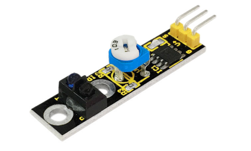
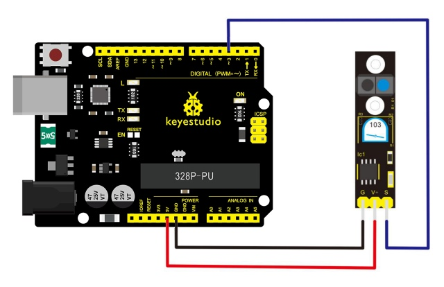
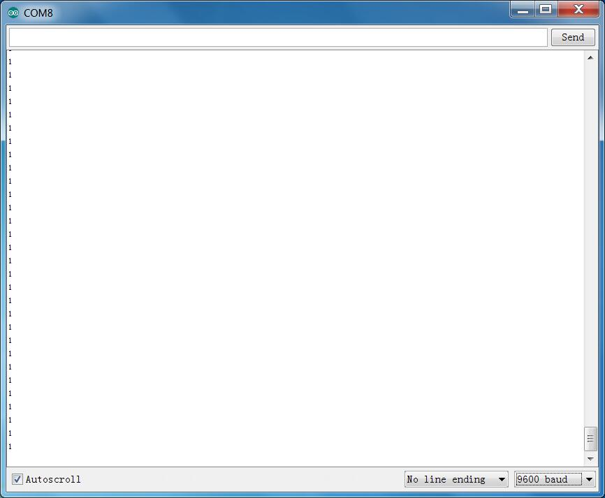

# Leçon 09 : Capteur de suivi de ligne

> **Kit :** Kit de capteurs Keyestudio 48-en-1  
> **Carte :** Keyestudio V4.0 / Carte compatible Arduino Uno ATmega328P



## Description

Ce capteur de suivi de ligne peut détecter une ligne blanche sur fond noir ou une ligne noire sur fond blanc.

Le signal unique de suivi de ligne fournit une sortie stable au niveau TTL pour un suivi plus précis et plus stable. Une option multi-canaux peut être facilement mise en œuvre en installant les capteurs de suivi de ligne nécessaires pour le robot.

## Spécifications

1. Alimentation : +5V

2. Courant de fonctionnement : \<10mA

3. Plage de température de fonctionnement : 0°C \~ + 50°C

4. Interface de sortie : interface 3 fils (1 - signal, 2 - alimentation, 3 - négatif de l'alimentation)

5. Niveau de sortie : niveau TTL

## Schéma de connexion

Tout d'abord, préparez les pièces suivantes avant la connexion :

- Carte V4.0\*1

- Module de suivi de ligne \*1

- Câble USB\*1

- Fils de connexion\*3

Connectez la broche S du module au Digital 3 de la carte V4.0, connectez la broche GND au port GND, et la broche V+ au port 5V.



## Exemple de code

Copiez et collez le code ci-dessous dans le logiciel Arduino.

```c
////////////////////////////////////////////////////////////////////
//Arduino Sample Code
void setup()
{
  Serial.begin(9600);
}
void loop()
{
  Serial.println(digitalRead(3)); // print the data from the sensor
  delay(500);
}
////////////////////////////////////////////////////////////////////
```

## Exemple de résultat



Une fois le code téléchargé sur la carte, ouvrez le moniteur série et réglez le débit (baud) sur 9600, puis vous pourrez voir les données du capteur.

---
