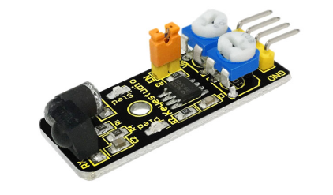
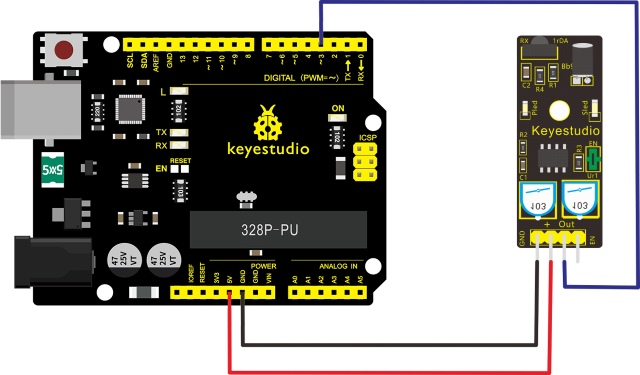
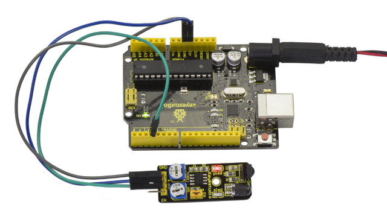
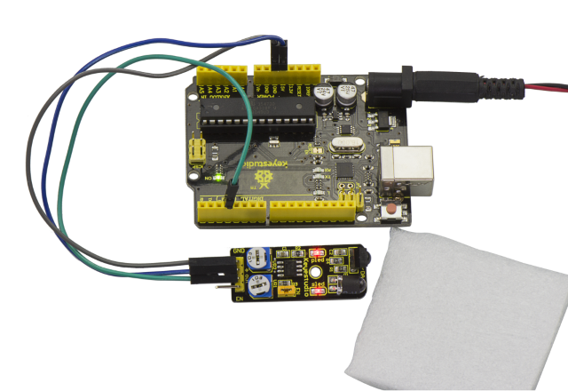

# Lesson 10: 赤外線障害物回避

> **キット：** Keyestudio 48-in-1 Sensor Kit  
> **ボード：** Keyestudio V4.0 / Arduino Uno-compatible ATmega328P board



## 説明

赤外線障害物検出センサーは距離調整機能を備えており、特に車輪型ロボット向けに設計されています。

このセンサーは周囲光への適応性が高く、精度に優れています。

赤外線の送信管と受信管が一対あり、送信管から発せられた赤外線が障害物（その反射体）に当たると、赤外線が受信管に反射され、インジケータが点灯し、信号出力インターフェースがデジタル信号を出力します。

また、可変抵抗のつまみを回すことで検出距離を調整できます（有効距離: 2～40cm、動作電圧: 3.3V-5V）。

広い電圧範囲により、電源電圧が変動しても安定して動作でき、さまざまなマイコン、Arduinoコントローラ、BS2コントローラに適しています。

このセンサーを搭載したロボットは周囲の障害物を感知できます。

## 仕様

- 動作電圧: DC 3.3V-5V

- 動作電流: ≥20mA

- 動作温度: －10℃～＋50℃

- 検出距離: 2-40cm

- IOインターフェース: 4線インターフェース (-/+/S/EN)

- 出力信号: TTL電圧

- 収容方式: 多周抵抗調整

- 有効角度: 35°

## 接続図

接続する前に、以下の部品を用意してください:

- V4.0 ボード\*1

- 障害物検出モジュール \*1

- USBケーブル\*1

- ジャンパー線\*3

モジュールの Out ピンを V4.0 ボードの Digital 2 に接続し、V+ ピンを 5V ポートに、GND ピンを GND ポートに接続します。



## サンプルコード

以下のコードを Arduino ソフトウェアにコピー＆ペーストしてください。

```c
const uint8_t sensorPin = 2;
const uint8_t ledPin = 13;

void setup() {
  pinMode(ledPin, OUTPUT);
  pinMode(sensorPin, INPUT);
}

void loop() {
  const int sensorState = digitalRead(sensorPin);
  digitalWrite(ledPin, sensorState == HIGH ? HIGH : LOW);
}
```

## 実行例

コードをボードにアップロードすると、V4.0 ボードと障害物検出センサーの両方のLEDが点灯しているのが確認できます。



センサーの前に発泡ブロックを置くと、障害物を検出したときにセンサーのLEDが点灯します。



---
