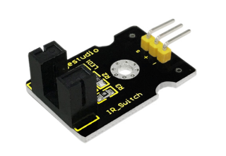
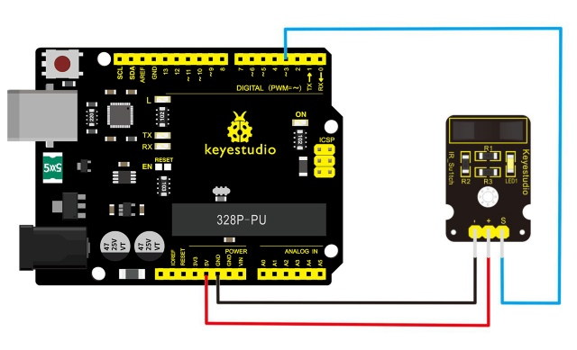
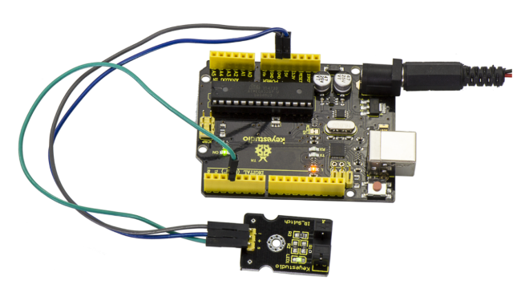
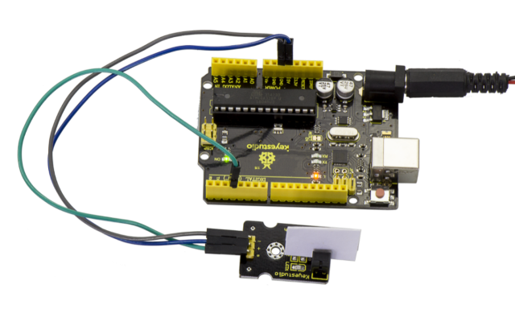

# Les 11: Foto-interrupter

> **Kit:** Keyestudio 48-in-1 Sensor Kit  
> **Bord:** Keyestudio V4.0 / Arduino Uno-compatible ATmega328P board



## Beschrijving

Het verticale deel van deze sensor is een infraroodzender en aan de andere kant zit een afgeschermde infraroodontvanger. Door een infraroodstraal van de ene zijde naar de andere te zenden, kan de sensor een object detecteren wanneer het object de straal passeert.

Hij wordt voor veel toepassingen gebruikt, waaronder optische aanslagschakelaars, pelletdosering, algemene objectdetectie, enz.

## Specificatie

- Voedingsspanning: 3.3V tot 5V

- Interface: Digitaal

- Afmetingen: 30*20mm

- Gewicht: 3g

## Aansluitschema

Bereid eerst de volgende onderdelen voor voordat je gaat aansluiten:

- V4.0 Board\*1

- Foto-interruptermodule \*1

- USB-kabel\*1

- Jumperkabel\*3

Verbind de S-pin van de module met Digital 3 van het V4.0-board, verbind de negatieve pin met de GND-aansluiting en de positieve pin met de 5V-aansluiting.



## Voorbeeldcode

Kopieer en plak onderstaande code in de Arduino-software.

```c
////////////////////////////////////////////////////////////////////
// photo interrupter module
int Led = 13 ;// define LED Interface
int buttonpin = 3; // define the photo interrupter sensor interface
int val ;// define numeric variables val
void setup ()
{
  pinMode (Led, OUTPUT) ;// define LED as output interface
  pinMode (buttonpin, INPUT) ;// define the photo interrupter sensor output interface
}
void loop ()
{
  val = digitalRead (buttonpin) ;// digital interface will be assigned a value of 3 to read val
  if (val == HIGH) // When the light sensor detects a signal is interrupted, LED flashes
  {
    digitalWrite (Led, HIGH);
  }
  else
  {
    digitalWrite (Led, LOW);
  }
}
////////////////////////////////////////////////////////////////////
```

## Voorbeeldresultaat

Na het uploaden van de code naar het board zie je dat zowel de LED op het V4.0-board als op de module zijn ingeschakeld. Zoals hieronder weergegeven.



Wanneer je een papiertje in de groef van de module steekt, wordt het signaal onderbroken en zal led1 op de module uitgaan.



---
