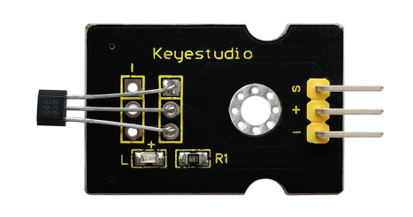
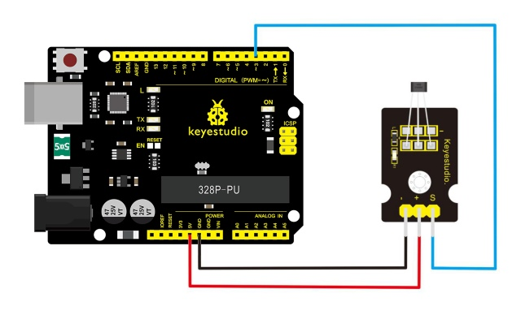
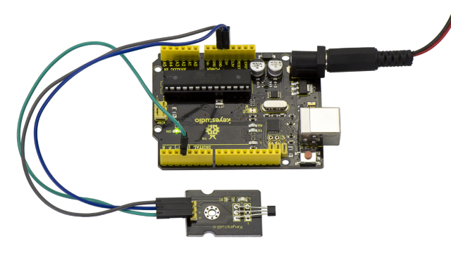
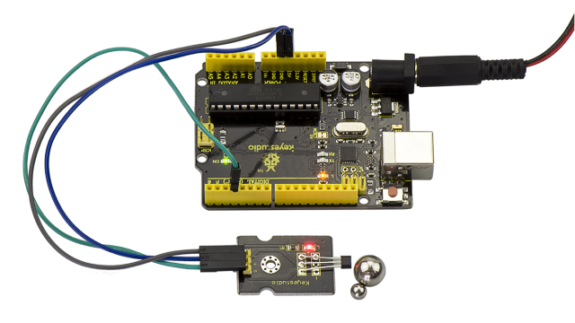

# レッスン12：ホール磁気センサー

> **キット:** Keyestudio 48-in-1 センサーキット  
> **ボード:** Keyestudio V4.0 / Arduino Uno互換 ATmega328P ボード



## 説明

これは磁気誘導センサーです。検出範囲最大約3cm以内の磁性体を感知できます。検出範囲と磁場の強さは比例します。出力はデジタルのオン/オフです。

このセンサーは SFE Reed Switch - Magnetic Field Sensor を使用しています。

## 仕様

- 磁性体の検出

- 検出範囲：最大約3cm

- 出力：デジタル（オン/オフ）

- サイズ：30*20mm

- 重量：3g

## 接続図

接続前に次のパーツを用意してください:

- V4.0ボード\*1

- ホールセンサー\*1

- USBケーブル\*1

- ジャンパーワイヤー\*3

モジュールのSピンを V4.0ボードのDigital 3に接続し、負極ピンをGNDポートに、正極ピンを5Vポートに接続します。



## サンプルコード

下のコードをコピーしてArduinoソフトに貼り付けてください。

```c
////////////////////////////////////////////////////////////////////
int ledPin = 13;                // choose the pin for the LED
int inputPin = 3;               // Connect sensor to input pin 3
int val = 0;                    // variable for reading the pin status

void setup() {
  pinMode(ledPin, OUTPUT);      // declare LED as output
  pinMode(inputPin, INPUT);     // declare push button as input
}

void loop(){
  val = digitalRead(inputPin);  // read input value
  if (val == HIGH) {            // check if the input is HIGH
    digitalWrite(ledPin, LOW);  // turn LED OFF
  } else {
    digitalWrite(ledPin, HIGH); // turn LED ON
  }
}
////////////////////////////////////////////////////////////////////
```

## 実行例

配線を行い、コードをボードに正しくアップロードすると、V4.0ボードのD13インジケーターは消灯し、モジュール上のLEDも消灯しているのが確認できます。



しかし、ホールモジュールに磁石を近づけると、V4.0ボードのD13インジケーターが点灯し、モジュール上のLEDも点灯します。



---
