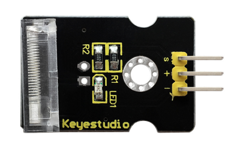
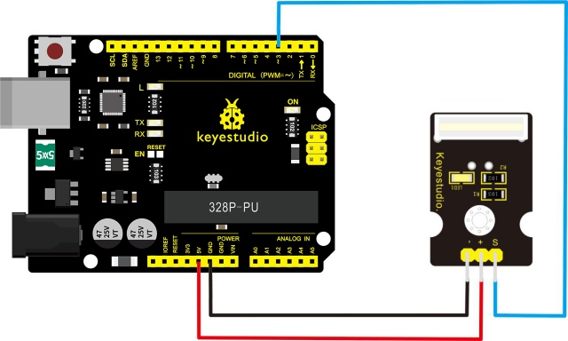
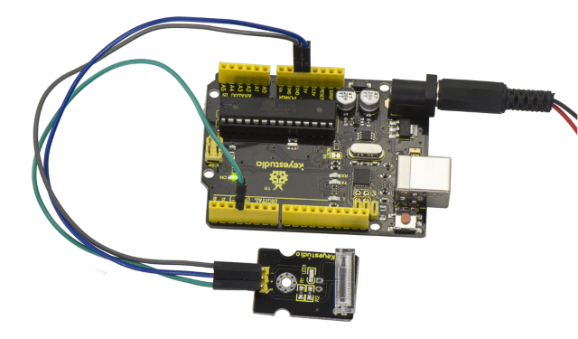

# Lektion 13: Knocksensor

> **Bausatz:** Keyestudio 48-in-1 Sensor Kit  
> **Platine:** Keyestudio V4.0 / Arduino Uno-kompatible ATmega328P-Platine



## Beschreibung

Dieses Modul ist ein Knocksensor. Wenn Sie darauf klopfen, kann er ein momentanes Signal senden.

Sie können ihn mit Arduino kombinieren, um einige interessante Experimente zu machen, z. B. eine elektronische Trommel.

## Technische Daten

- Arbeitsspannung: 5V

- Größe: 30\*20mm

- Gewicht: 3g

## Anschlussdiagramm

Bereiten Sie vor dem Anschließen zunächst die folgenden Teile vor:

- V4.0 Platine\*1

- Knocksensor \*1

- USB-Kabel\*1

- Jumperkabel\*3

Verbinden Sie den S-Pin des Moduls mit Digital 3 der V4.0-Platine, den Minus-Pin mit dem GND-Anschluss und den Plus-Pin mit dem 5V-Anschluss.



## Beispielcode

Kopieren Sie den folgenden Code in die Arduino-Software.

```c
////////////////////////////////////////////////////////////////////
int Led=13;//define LED interface
int Shock=3;//define knock sensor interface
int val;//define digital variable val
void setup()
{
pinMode(Led,OUTPUT);//define LED to be output interface
pinMode(Shock,INPUT);//define knock sensor to be output interface
}
void loop()
{
val=digitalRead(Shock);//read the value of interface3 and evaluate it to val
if(val==HIGH)//when the knock sensor detect a signal, LED will be flashing
{
digitalWrite(Led,LOW);
}
else
{
digitalWrite(Led,HIGH);
}
}
////////////////////////////////////////////////////////////////////
```



## Beispielergebnis

Nachdem die Verkabelung wie oben vorgenommen und die Platine mit Strom versorgt wurde und der Code erfolgreich hochgeladen ist, klopfen Sie auf den Sensor. Sie werden sehen, dass sowohl die D13-LED auf der V4.0-Platine als auch die D1-LED am Sensor aufleuchten.

---
