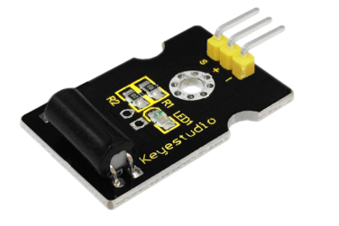
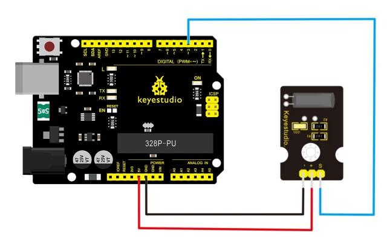
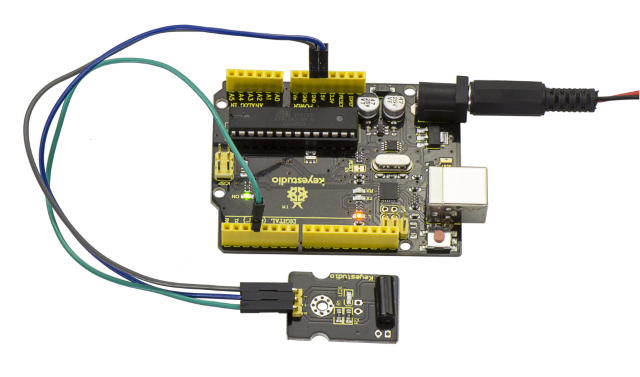
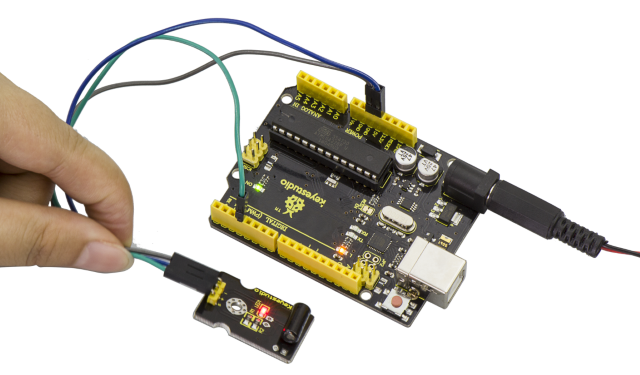

# Lezione 14: Interruttore di inclinazione digitale

> **Kit:** Keyestudio 48-in-1 Kit di sensori  
> **Scheda:** Keyestudio V4.0 / scheda ATmega328P compatibile con Arduino Uno



## Descrizione

Il sensore di inclinazione è un interruttore digitale. Può essere utilizzato come un semplice interruttore di inclinazione.

Semplicemente collegalo al nostro IO/Sensor shield, facile per il collegamento dei fili. Con lo shield dedicato per sensori e Arduino, puoi realizzare molti progetti interessanti e interattivi.

## Specifiche

- Tensione di alimentazione: 3.3V a 5V

- Interfaccia: Digitale

- Dimensioni: 30*20mm

- Peso: 3g

## Schema di collegamento

Collegare il pin S del modulo al pin Digital 3 della scheda V4.0, collegare il pin negativo al connettore GND e il pin positivo al connettore 5V.



## Esempio di codice

Copia e incolla il codice seguente nell'ambiente Arduino.

```c
int Led=13;//define LED interface
int Shock=3;//define knock sensor interface
int val;//define digital variable val
void setup()
{
pinMode(Led,OUTPUT);//define LED to be output interface
pinMode(Shock,INPUT);//define knock sensor to be output interface
}
void loop()
{
val=digitalRead(Shock);//read the value of interface3 and evaluate it to val
if(val==HIGH)//when the knock sensor detect a signal, LED will be flashing
{
digitalWrite(Led,LOW);
}
else
{
digitalWrite(Led,HIGH);
}
}
```

## Risultato di esempio

Dopo aver effettuato i collegamenti e fornito l'alimentazione, carica correttamente il codice sulla scheda V4.0.



Poi inclina il sensore: vedrai che il LED sul sensore si accende, come mostrato di seguito.



---
