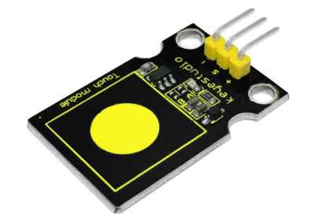
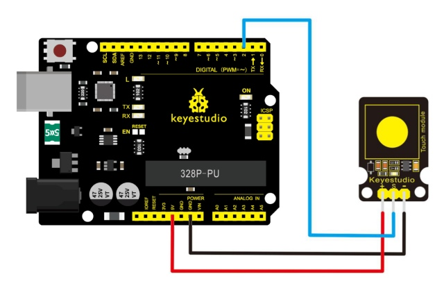
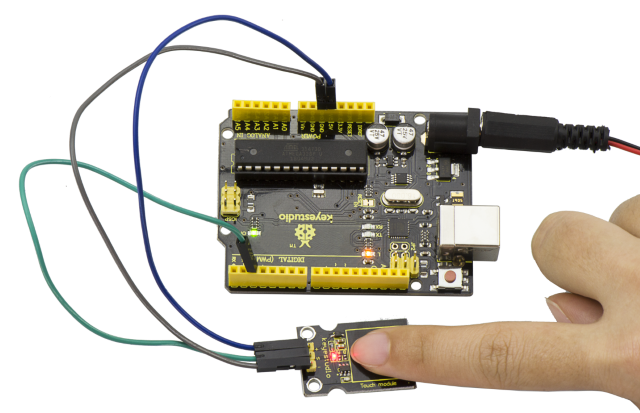

# Lección 15: Tacto capacitivo

> **Kit:** Keyestudio 48-in-1 Sensor Kit  
> **Placa:** Keyestudio V4.0 / Arduino Uno-compatible ATmega328P board



## Descripción

¿Estás cansado de pulsar botones mecánicos? Pues prueba nuestro sensor táctil capacitivo. Encontrarás sensores táctiles mayormente usados en dispositivos electrónicos. Mejora tu proyecto Arduino con este sensor táctil para hacerlo más atractivo.

Este pequeño sensor puede detectar el toque del cuerpo y del metal proporcionando una salida de nivel alto/bajo. Incluso aislado por alguna tela o papel, aún puede detectar el toque. Pero su sensibilidad disminuirá a medida que la capa de aislamiento sea más gruesa.

Hemos mejorado estos módulos de sensor para ofrecerte una mejor experiencia.

## Especificación

- Tensión de alimentación: 3.3V a 5V

- Interfaz: Digital

- Tamaño: 30*20mm

- Peso: 3g

## Diagrama de conexión

Primero, necesitas preparar las siguientes piezas antes de la conexión:

- Placa V4.0*1

- Sensor táctil capacitivo*1

- Cable USB*1

- Cables jumper*3

Conecta el pin S del módulo a Digital 2 de la placa V4.0, conecta el pin negativo al puerto GND y el pin positivo al puerto 5V.



## Código de ejemplo

Copia y pega el siguiente código en el software de Arduino.

```c
const uint8_t ledPin = 13;  // On-board LED.
const uint8_t touchPin = 2;

void setup() {
  pinMode(ledPin, OUTPUT);
  pinMode(touchPin, INPUT);
}

void loop() {
  const int touched = digitalRead(touchPin);
  digitalWrite(ledPin, touched == HIGH ? HIGH : LOW);
}
```

## Resultado de ejemplo

Una vez realizado el cableado y alimentada la placa, sube correctamente el código; luego toca el sensor con el dedo: tanto el LED D2 en el sensor como el indicador D13 en la placa V4.0 se encenderán. De lo contrario, esos dos indicadores permanecerán apagados.



---
