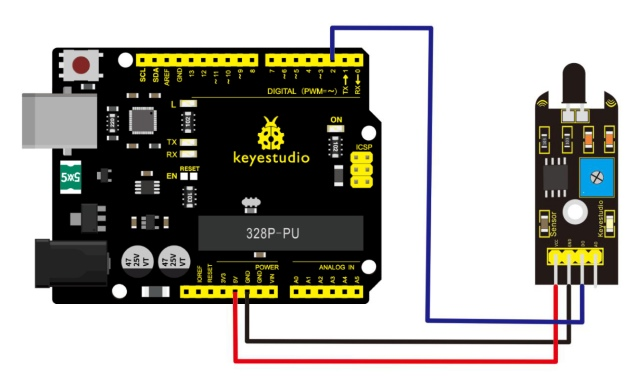
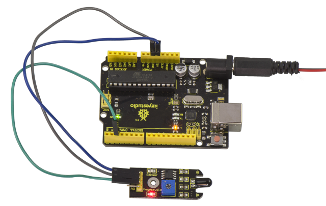
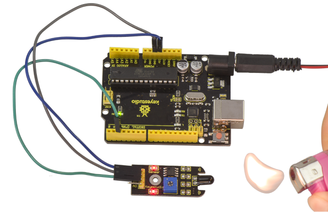

# Lección 16: Alarma de llama

> **Kit:** Keyestudio Kit de sensores 48 en 1  
> **Placa:** Keyestudio V4.0 / placa compatible con Arduino Uno ATmega328P


## Descripción

Este sensor de llama puede usarse para detectar fuego u otras luces con longitud de onda entre 760nm \~ 1100nm.

En el juego del robot contra incendios, la llama desempeña un papel importante en la detección, pudiendo utilizarse como los ojos del robot para encontrar la fuente de fuego.

## Especificaciones

1. Voltaje de alimentación: 3.3V a 5V

2. Rango de detección: 20cm (4.8V) \~ 100cm (1V)

3. Rango de ancho de banda espectral: 760nm a 1100nm

4. Temperatura de funcionamiento: -25℃ a 85℃

5. Interfaz: digital

6. Tamaño: 44*16.7mm

7. Peso: 4g

## Diagrama de conexión

Primero, necesita preparar las siguientes piezas antes de la conexión:

- Placa V4.0*1

- Sensor de llama*1

- Cable USB*1

- Cables jumper*3

Conecte el pin D0 del módulo al Digital 2 de la placa V4.0, conecte el pin GND al puerto GND y el pin VCC al puerto 5V.



## Código de ejemplo

Copie y pegue el siguiente código en el software Arduino.

```c
////////////////////////////////////////////////////////////////////
const int flamePin = 2;     // the number of the flame pin
const int ledPin =  13;      // the number of the LED pin
// variables will change:
int State = 0;         // variable for reading status
void setup() {
  // initialize the LED pin as an output:
  pinMode(ledPin, OUTPUT);
  // initialize the pushbutton pin as an input:
  pinMode(flamePin, INPUT);
}
void loop(){
  // read the state of the value:
State = digitalRead(flamePin);
  if (State == HIGH) {
    // turn LED on:
    digitalWrite(ledPin, HIGH);
  }
  else {
    // turn LED off:
    digitalWrite(ledPin, LOW);
  }
}
////////////////////////////////////////////////////////////////////
```

## Resultado del ejemplo

Con el cableado terminado y la alimentación conectada, cargue correctamente el código en la placa.



Si acerca un encendedor al sensor, cuando el sensor detecte la llama, otro LED del sensor se encenderá.



---
