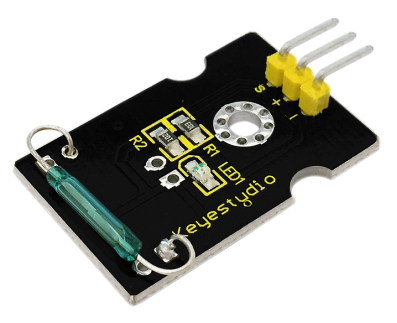
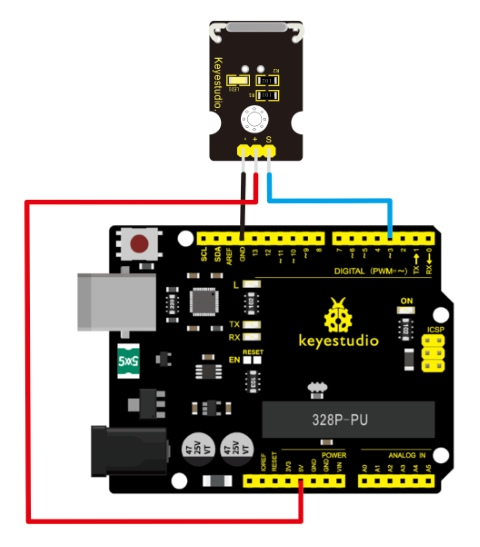
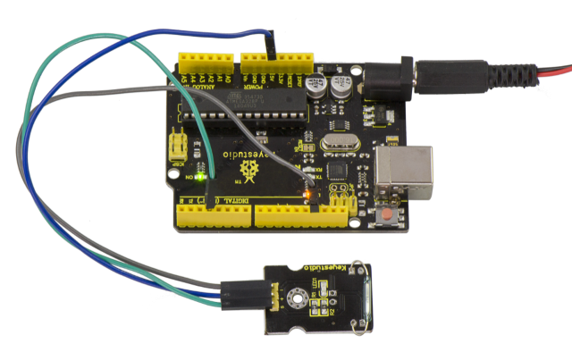
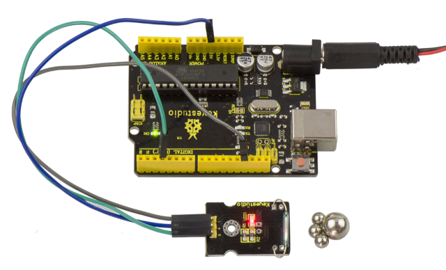

# Lección 17: Interruptor Reed

> **Kit:** Kit Keyestudio 48-en-1 de Sensores  
> **Placa:** Keyestudio V4.0 / placa compatible con Arduino Uno ATmega328P



## Descripción

El Interruptor Reed es un interruptor especial y un componente principal para relés reed y detectores de proximidad.

El interruptor reed suele constar de dos materiales magnéticos blandos y contactos tipo lengüeta metálicos que se abren cuando no hay campo magnético.

Además, algunos interruptores reed también están equipados con otra lengüeta que actúa como el tercer contacto normalmente cerrado. Estos contactos tipo lengüeta están encapsulados en un tubo de vidrio lleno de gases inertes (como nitrógeno y helio) o en un tubo de vidrio al vacío.

Las lengüetas encapsuladas en el tubo de vidrio se colocan en paralelo con los extremos superpuestos. Se reserva cierta cantidad de espacio o contacto mutuo para constituir los contactos normalmente abiertos o normalmente cerrados del interruptor.

El interruptor reed puede utilizarse para conteo, como fin de carrera u otros propósitos.

Por ejemplo, un cuentakilómetros de bicicleta se constituye pegando un imán al neumático y montando el interruptor reed a un lado.

También puedes montar el interruptor reed en una puerta con fines de alarma o como interruptor.

El interruptor reed se ha aplicado ampliamente en electrodomésticos, automóviles, comunicaciones, industria, salud y seguridad.

Además, también puede aplicarse a otros sensores y dispositivos eléctricos como medidores de líquido, imanes de puerta, relés reed, sensores de nivel de aceite y sensores de proximidad (sensor magnético). Puede utilizarse en entornos de alto riesgo.

## Especificaciones

1. Voltaje de trabajo: DC 3.3V-5V

2. Corriente de trabajo: ≥20mA

3. Temperatura de trabajo: −10℃ a ＋50℃

4. Distancia de detección: ≤10mm

5. Interfaz IO: 3 interfaces de cable (-/+/S)

6. Tamaño: 30\*20mm

7. Peso: 3g

## Diagrama de Conexión

Conecta el pin S del módulo al Digital 3 de la placa V4.0, conecta el pin negativo al puerto GND y el pin positivo al puerto 5V.



## Código de ejemplo

Copia y pega el siguiente código en el software de Arduino.

```c
////////////////////////////////////////////////////////////////////
int Led=13;//define LED interface
int buttonpin=3; //define magnetic ring sensor interface
int val;//define digital variable val
void setup()
{
pinMode(Led,OUTPUT);//define LED as output interface
pinMode(buttonpin,INPUT);//define magnetic ring sensor as output interface
 }
void loop()
{

val=digitalRead(buttonpin);// read and assign the value of digital interface 3 to val

if(val==HIGH)//When a signal is detected by magnetic ring sensor, LED will flash
{
digitalWrite(Led,HIGH);
}
else
{
digitalWrite(Led,LOW);
}
}
////////////////////////////////////////////////////////////////////
```

## Resultado de ejemplo

Una vez realizadas las conexiones y alimentada la placa, carga correctamente el código en la placa. Podrás ver que el LED D13 en la placa V4.0 está encendido.



Luego acercamos unas esferas magnéticas al sensor. Cuando el sensor detecta la señal del campo magnético, el LED del sensor se encenderá pero el LED D13 se apagará.



---
