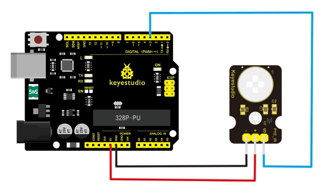
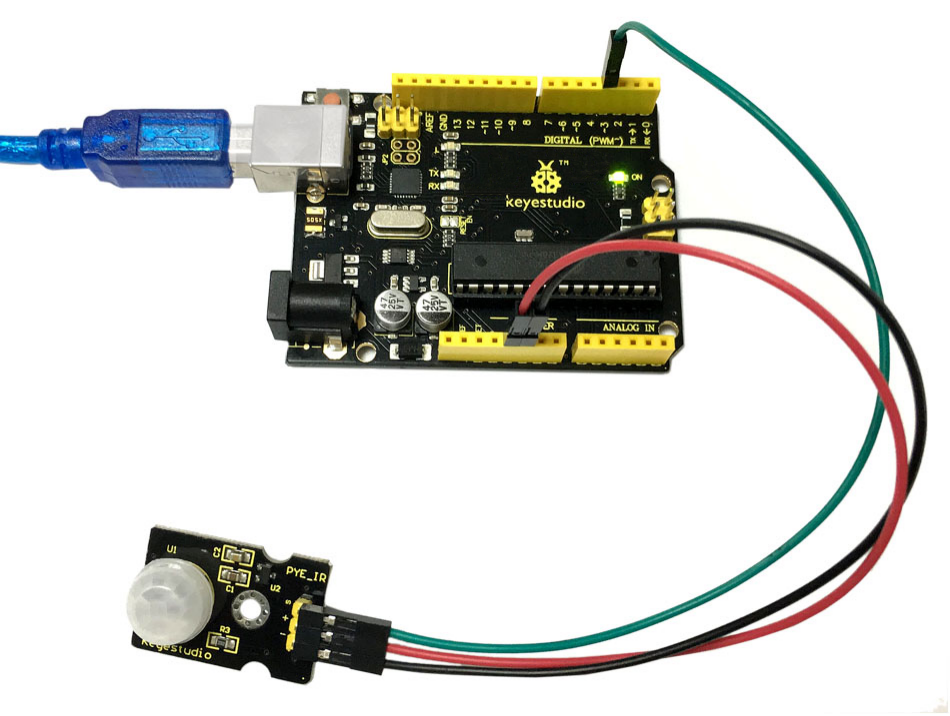
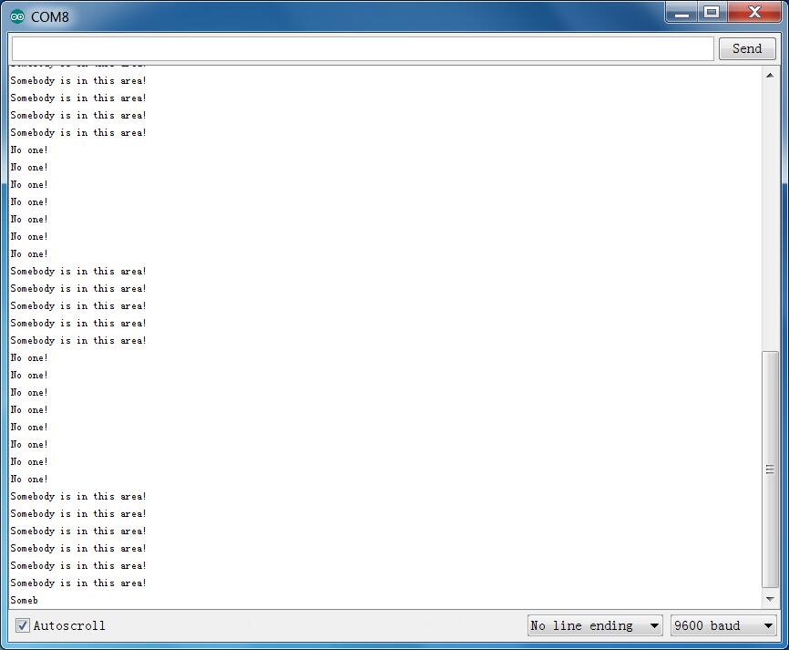

# Lektion 18: PIR-Bewegungssensor

> **Bausatz:** Keyestudio 48-in-1 Sensor Kit  
> **Board:** Keyestudio V4.0 / Arduino Uno-kompatible ATmega328P-Platine


## Beschreibung

Pyroelektrischer Infrarot-Bewegungssensor kann Infrarotsignale einer sich bewegenden Person oder eines sich bewegenden Tieres erfassen und Schaltsignale ausgeben.

Er kann in verschiedenen Situationen zur Erkennung von Körperbewegungen eingesetzt werden.

Konventionelle pyroelektrische Infrarotsensoren benötigen einen pyroelektrischen Infrarot-Detektor, einen speziellen Chip und eine komplexe Peripherie, deshalb sind sie deutlich größer, mit komplexer Schaltung und geringerer Zuverlässigkeit.

Jetzt bringen wir diesen neuen pyroelektrischen Infrarot-Bewegungssensor auf den Markt, speziell für Arduino entworfen.

Er verwendet einen integrierten digitalen pyroelektrischen Infrarot-Körpersensor, mit kleinerer Größe, höherer Zuverlässigkeit, geringerem Stromverbrauch und einfacherer Peripherie.

## Spezifikation

- Eingangsspannung: 3.3 \~ 5V, maximal 6V

- Betriebstrom: 15uA

- Betriebstemperatur: -20 \~ 85 ℃

- Ausgangsspannung: High 3V, Low 0V

- Ausgangsverzögerungszeit (High-Level): Etwa 2,3 bis 3 Sekunden

- Erfassungswinkel: 100 °

- Erfassungsreichweite: 7 Meter

- Ausgangs-LED (wenn Ausgang HIGH ist, leuchtet sie)

- Begrenzungsstrom für Pin: 100mA

- Größe: 30*20mm

- Gewicht: 4g

## Anschlussdiagramm

Zuerst müssen Sie vor dem Anschluss folgende Teile bereitlegen:

- V4.0-Board*1

- PIR-Bewegungssensor*1

- USB-Kabel*1

- Jumper-Kabel*3

Verbinden Sie den S-Pin des Moduls mit Digital 3 des V4.0-Boards, den negativen Pin mit dem GND-Anschluss und den positiven Pin mit dem 5V-Anschluss.



## Beispielcode

Kopieren Sie den folgenden Code in die Arduino-Software.

```c
////////////////////////////////////////////////////////////////////
byte sensorPin = 3;
byte indicator = 13;
void setup()
{
  pinMode(sensorPin,INPUT);
  pinMode(indicator,OUTPUT);
  Serial.begin(9600);
}

void loop()
{
  byte state = digitalRead(sensorPin);
  digitalWrite(indicator,state);
  if(state == 1)Serial.println("Somebody is in this area!");
  else if(state == 0)Serial.println("No one!");
  delay(500);
}
////////////////////////////////////////////////////////////////////
```

## Beispielergebnis

Nachdem die Verkabelung abgeschlossen und die Stromversorgung eingeschaltet wurde und der Code erfolgreich hochgeladen ist: Wenn der Sensor in der Nähe eine Bewegung erkennt, leuchtet die D13-Anzeige auf dem V4.0-Board und "Jemand ist in diesem Bereich!" wird im seriellen Monitor der Arduino-Software angezeigt.

Wenn keine Bewegung erkannt wird, ist die D13-Anzeige auf dem V4.0-Board aus und "Niemand!" wird im seriellen Monitor angezeigt.





---
