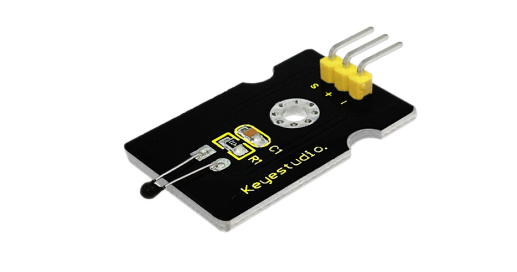
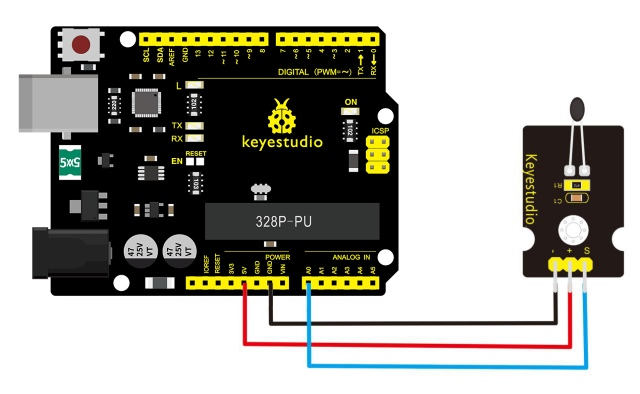
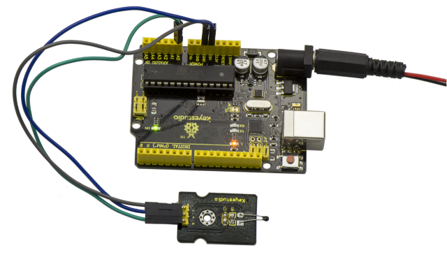
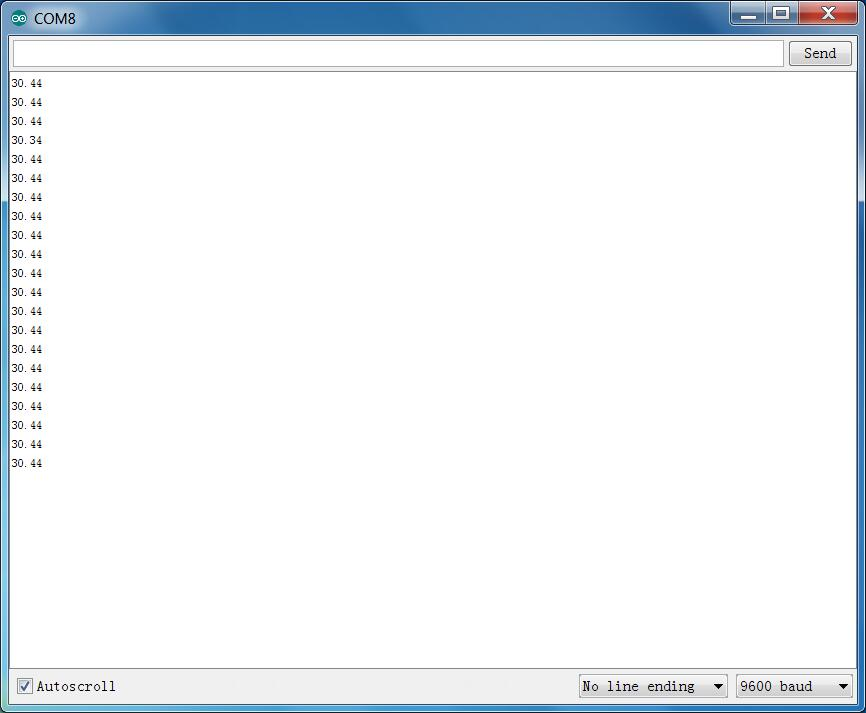

# Les 19: Analoge Temperatuur

> **Kit:** Keyestudio 48-in-1 Sensorkit  
> **Bord:** Keyestudio V4.0 / Arduino Uno-compatibel ATmega328P-bord



## Beschrijving

Deze module is gebaseerd op het werkingsprincipe van een thermistor (weerstand varieert met temperatuursverandering in de omgeving).

Hij kan temperatuurveranderingen in de omgeving detecteren en de gegevens naar de analoge IO van het Arduino-bord sturen.

Alles wat we hoeven te doen is de uitvoer van de sensor omzetten naar graden Celsius met eenvoudige programmering en deze vervolgens op de monitor weergeven.

Het is zowel praktisch als effectief, en wordt daarom veel toegepast in tuinieren, alarmsystemen voor thuis en andere apparaten.

## Specificatie

- Type interface: analoog

- Werks spanning: 5V

- Temperatuurbereik: -55℃～315℃

- Afmeting: 30\*20mm

- Gewicht: 3g

## Aansluitschema

Bereid eerst de volgende onderdelen voor voordat je gaat aansluiten:

- V4.0 Bord\*1

- Analoge temperatuursensor\*1

- USB-kabel\*1

- Jumperdraad\*3

Verbind de S-pin van de module met Analoge A0 van het V4.0-bord, verbind de negatieve pin met de GND-poort en de positieve pin met de 5V-poort.



## Voorbeeldcode

Kopieer en plak onderstaande code in de Arduino-software.

```c
////////////////////////////////////////////////////////////////////
void setup()
{Serial.begin(9600);
}
// the loop routine runs over and over again forever:
void loop()
{int sensorValue = analogRead(A0);
Serial.println(sensorValue);
  delay(1); }
////////////////////////////////////////////////////////////////////
```

De bovenstaande code is alleen voor analoge waarden.

Je kunt zien dat de analoge waarde verandert naarmate de omgevingstemperatuur verandert. Maar dat is niet erg duidelijk.

We lossen dit op met behulp van de volgende formule. Upload vervolgens de onderstaande code naar het Arduino-bord. De waarde die via de seriële poort wordt gelezen, komt ongeveer overeen met de werkelijke temperatuur. Bijvoorbeeld: de temperatuur is nu 30°C.

```c
////////////////////////////////////////////////////////////////////
#include <math.h>
void setup()
{
   Serial.begin(9600);
}
void loop()
{
  double val=analogRead(0);
  double fenya=(val/1023)*5;
  double r=(5-fenya)/fenya*4700;
  Serial.println( 1/(  log(r/10000) /3950 + 1/(25+273.15))-273.15);
  delay(1000);
}
////////////////////////////////////////////////////////////////////
```

## Voorbeeldresultaat



Als de bedrading gereed is en de voeding is aangesloten zoals in de afbeelding, upload je de code naar het bord en open je de seriële monitor van de Arduino IDE; je ziet de huidige temperatuurwaarde.



---
