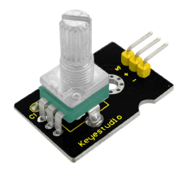
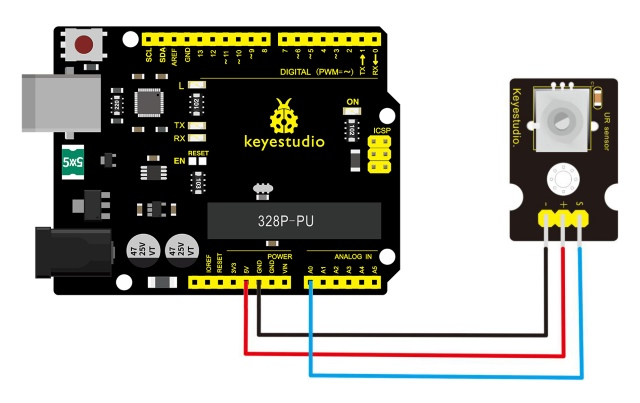
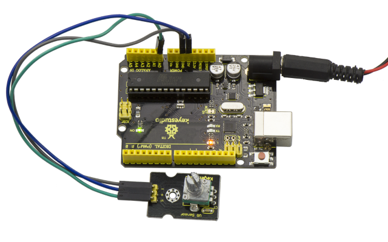
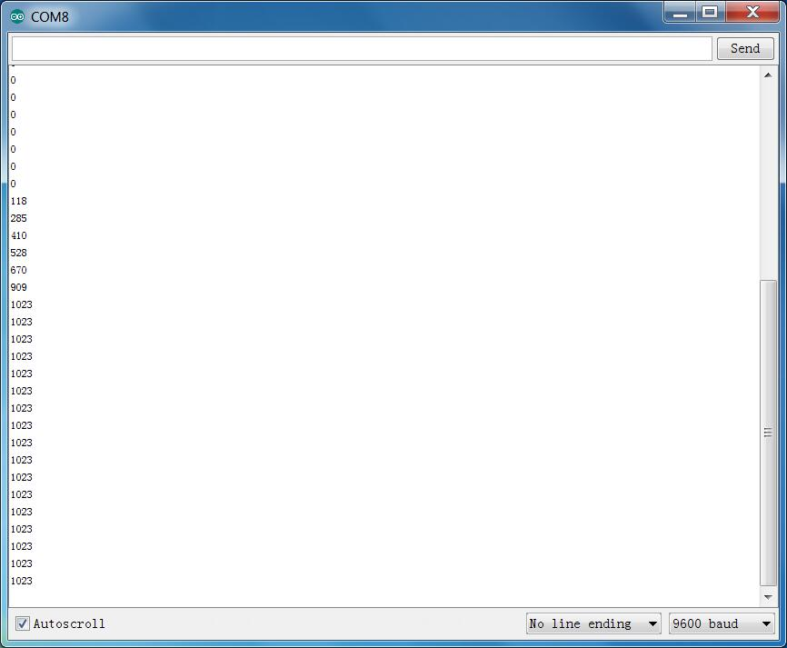

# Lección 20: Rotación Analógica

> **Kit:** Keyestudio 48-en-1 Kit de sensores  
> **Placa:** Keyestudio V4.0 / placa compatible con Arduino Uno (ATmega328P)



## Descripción

Este sensor de rotación analógico es compatible con Arduino. Está basado en un potenciómetro. Su voltaje puede subdividirse en 1024 pasos, y es fácil de conectar al Arduino con nuestro shield de sensores.

Combinado con otros sensores, puedes usarlo para crear proyectos interesantes leyendo el valor analógico desde el puerto IO.

## Especificación

- Tensión de alimentación: 3.3V a 5V

- Interfaz: Analógica

- Tamaño: 30*20mm

- Peso: 8g

## Diagrama de conexión

Conecta el pin S del módulo al pin analógico A0 de la placa V4.0, conecta el pin negativo al puerto GND y el pin positivo al puerto 5V.



## Código de ejemplo

Copia y pega el siguiente código en el software de Arduino.

```c
////////////////////////////////////////////////////////////////////
void setup()
{
  Serial.begin(9600); //Set serial baud rate to 9600 bps
}
void loop()
{
int val;
val=analogRead(0);//Read rotation sensor value from analog 0
Serial.println(val,DEC);//Print the value to serial port
delay(100);
}
////////////////////////////////////////////////////////////////////
```

## Resultado de ejemplo



Una vez hecha la conexión y alimentada la placa, sube correctamente el código, luego abre el Monitor Serie y ajusta la velocidad a 9600 baudios; finalmente verás el valor analógico. Si giras la perilla del sensor de rotación, el valor cambiará entre 0-1023. Se muestra abajo.



---
