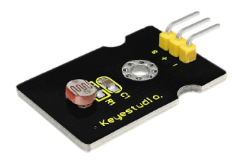
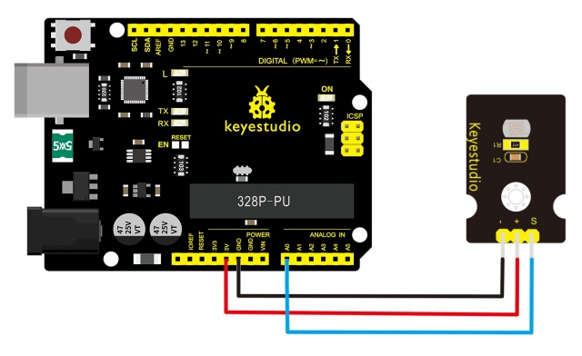
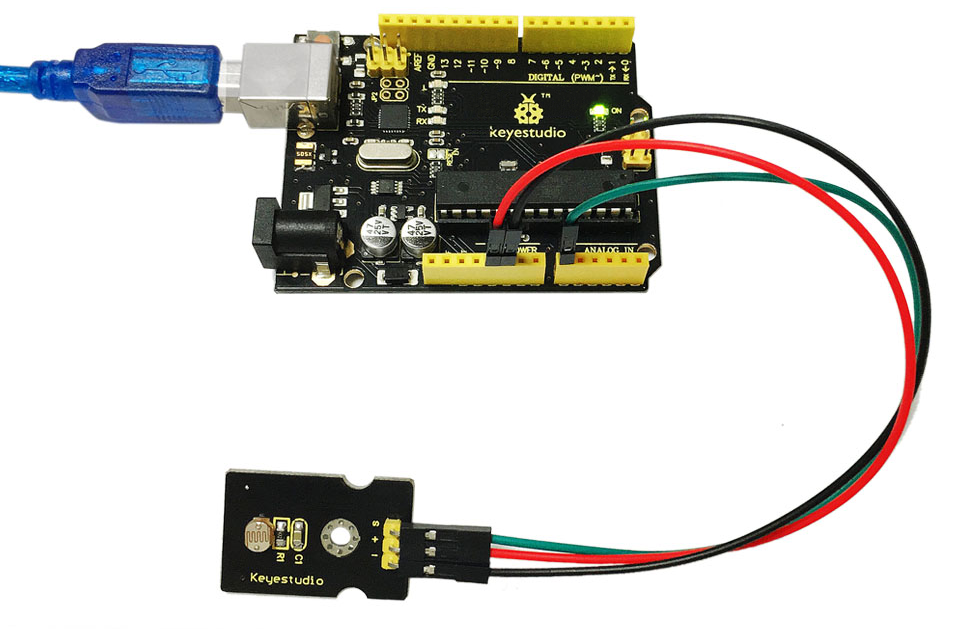
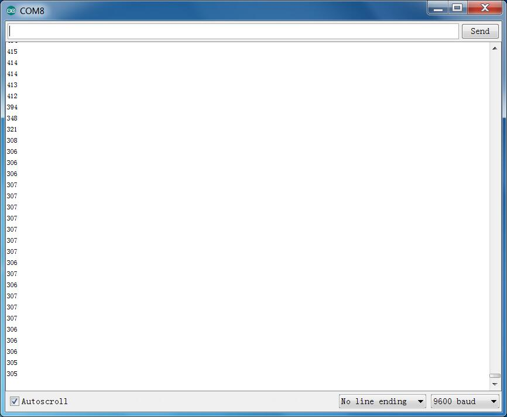

# レッスン21: フォトセル

> **キット：** Keyestudio 48-in-1 センサーキット  
> **ボード：** Keyestudio V4.0 / Arduino Uno互換 ATmega328P ボード



## 説明

フォトセルは日常生活でよく見られ、主に自動スイッチや一般的な電子設計で使用されます。使いやすさと効果を高めるために、対応するモジュールを用意しています。

フォトセルは半導体であり、高感度、応答速度の速さ、スペクトル特性および抵抗値の一貫性を特徴とし、高温多湿などの厳しい環境下でも高い安定性と信頼性を保ちます。

カメラ、ガーデンソーラーライト、芝生用ランプ、コイン検出器、クオーツ時計、音楽ボックス、ギフトボックス、ミニ常夜灯、音光制御スイッチなど、照明の自動制御スイッチ分野で広く使用されています。

## 仕様

- インターフェース: アナログ

- 動作電圧: 5V

- サイズ: 30*20mm

- 重量: 3g

## 接続図

モジュールのSピンをV4.0ボードのAnalog A0に接続し、負極ピンをGNDポートに、正極ピンを5Vポートに接続します。



## サンプルコード

以下のコードをArduinoソフトにコピー＆ペーストしてください。

```c
////////////////////////////////////////////////////////////////////
void setup()
{
  Serial.begin(9600); //Set serial baud rate to 9600 bps
}
void loop()
{
int val;
val=analogRead(0);//Read rotation sensor value from analog 0
Serial.println(val,DEC);//Print the value to serial port
delay(100);
}
////////////////////////////////////////////////////////////////////
```

## 実行結果



配線と電源を接続し、コードをアップロードしたらシリアルモニタを開いてください。センサー上のフォトセルを手で覆うと、アナログ値が低下するのが確認できます。



---
