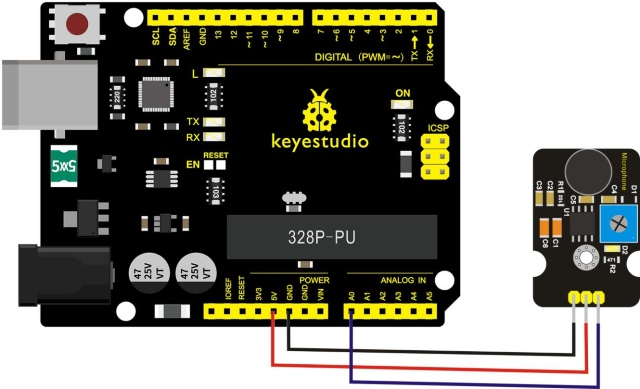
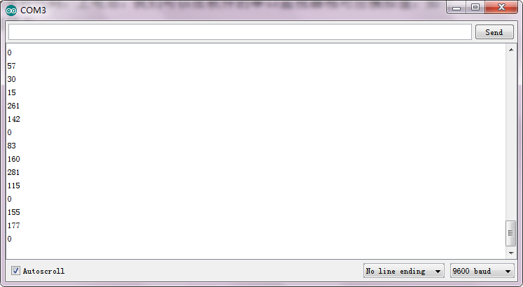

# レッスン22: アナログサウンド

> **キット:** Keyestudio 48-in-1 センサーキット  
> **ボード:** Keyestudio V4.0 / Arduino Uno互換 ATmega328P ボード


## 説明

アナログ音センサーは、周囲の音の大きさ（音量）を検出するのに一般的に使われます。センサーには可変抵抗（ポテンショメータ）が付属しており、これを回して信号の増幅度を調整できます。

音声起動スイッチのような、面白くインタラクティブな作品に利用できます。

## 仕様

- 供給電圧: 3.3V〜5V

- インターフェース: アナログ

- サイズ: 30×20mm

- 重さ: 4g

## 接続図

モジュールのSピンをV4.0ボードのAnalog A0に接続し、負極ピンをGNDポートに、正極ピンを5Vポートに接続します。



## サンプルコード

以下のコードをArduinoソフトウェアにコピー＆ペーストしてください。

```c
////////////////////////////////////////////////////////////////////
int sensorPin =A0 ;
int value = 0;
void setup()
{
 Serial.begin(9600); }
void loop()
{
 value = analogRead(sensorPin);

Serial.println(value, DEC);

delay(50);
}
////////////////////////////////////////////////////////////////////
```

## 実行例

配線と電源を接続し、コードをアップロードしたら、シリアルモニタを開いてボーレートを9600に設定します。アナログ値が表示されます。マイクヘッドに向かって話すと値が増加します。下図参照。



---
