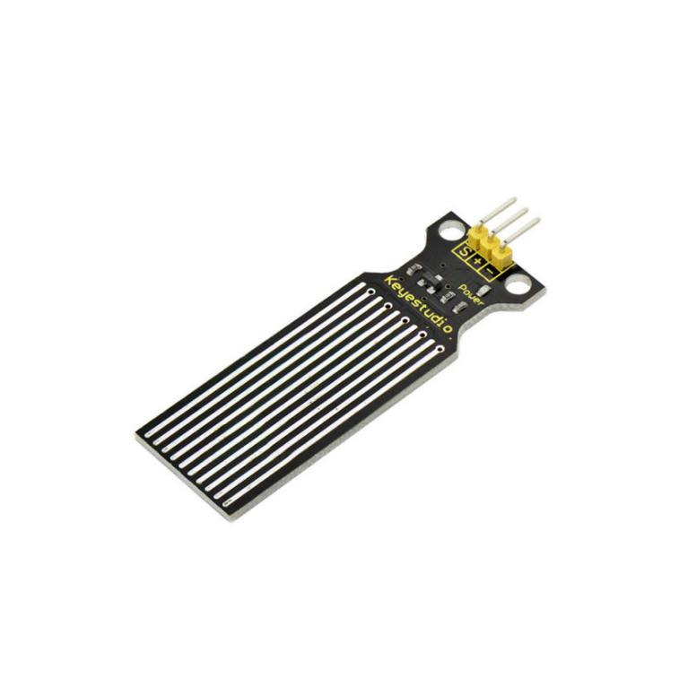
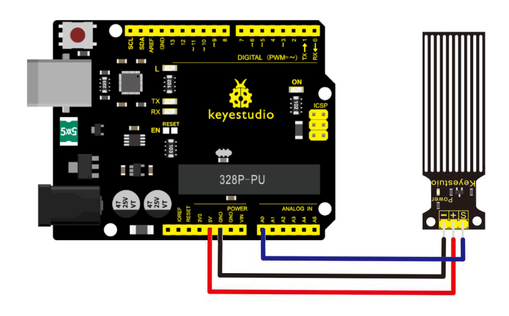
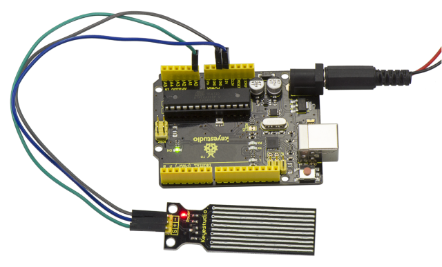
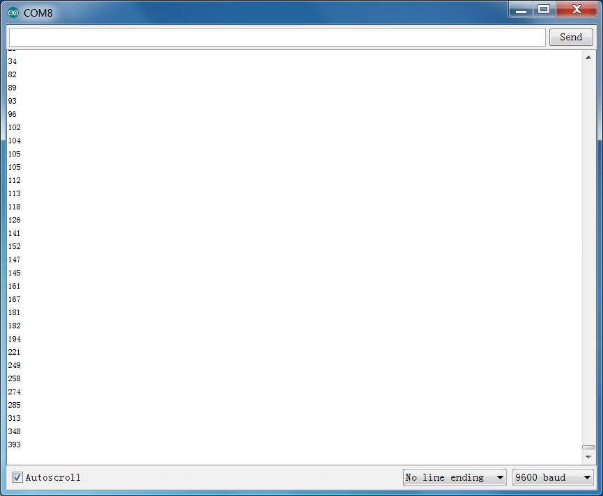

# Lektion 23: Wasserstand

> **Bausatz:** Keyestudio 48-in-1 Sensor Kit  
> **Platine:** Keyestudio V4.0 / Arduino Uno-kompatibles ATmega328P-Board



## Beschreibung

Der Keyestudio-Wassersensor ist einfach zu bedienen, tragbar und kostengünstig und wurde entwickelt, um den Wasserstand und Wassertropfen zu erkennen.

Dieser kleine Sensor kann das Volumen eines Wassertropfens oder die Wassermenge über ein Array von freiliegenden parallelen Leiterbahnen messen.

## Eigenschaften

- sanfte Umwandlung zwischen Wassermenge und analogem Wert;

- hohe Flexibilität, Ausgabe eines grundlegenden Analogwerts;

- geringer Stromverbrauch und hohe Empfindlichkeit;

- direkter Anschluss an Mikroprozessoren oder andere Logikschaltungen, geeignet für verschiedene Entwicklungsboards und Controller wie Arduino, STC-Mikrocontroller, AVR-Mikrocontroller und mehr.

## Spezifikationen

- Betriebsspannung: DC5V

- Betriebsstrom: ﹤20mA

- Sensortyp: Analog

- Erfassungsbereich: 40mm x16mm

- Produktionsverfahren: FR4 doppelseitig verzinnt

- Formdesign: Anti-Rutsch halbmondförmige Vertiefung

- Arbeitstemperatur: 10℃-30℃

- Arbeitsfeuchtigkeit: 10%-90% ohne Kondensation

- Gewicht: 3g

- Abmessungen: 65mm x 20mm x 8mm

## Anschlussdiagramm

Verbinden Sie den S-Pin des Moduls mit Analog A0 des V4.0 Boards, verbinden Sie den negativen Pin mit dem GND-Anschluss und den positiven Pin mit dem 5V-Anschluss.



## Beispielcode

Kopieren Sie den folgenden Code in die Arduino-Software.

```c
////////////////////////////////////////////////////////////////////
    int analogPin = 0; //connect water sensor to analog interface 0
int led = 13; //LED to digital interface 13
int val = 0; //define the initial value of variable ‘val’ as 0
int data = 0; //define the initial value of variable ‘data’ as 0
void setup()
{
pinMode(led, OUTPUT); //define led as output pin
Serial.begin(9600); //set baud rate at 9600
}
void loop()
{
val = analogRead(analogPin); //read and assign analog value to variable ’val’
if(val>700){ //decide whether variable ‘val’ is over 700
digitalWrite(led,HIGH); //turn on LED when variable ‘val’ is over 700
}
else{
digitalWrite(led,LOW); //turn off LED when variable ‘val’ is under 700
}
data = val; //variable ’val’ assigns value to variable ‘data’
Serial.println(data); //print variable ‘data’ by Serial.print
delay(100);
}
////////////////////////////////////////////////////////////////////
```

## Beispielergebnis



Nachdem die obigen Schritte abgeschlossen sind, testen wir den niedrigen Wasserstand und schauen, was passiert?

Laden Sie den Code erfolgreich auf das V4.0 Board hoch, öffnen Sie dann den seriellen Monitor und stellen Sie die Baudrate auf 9600 ein.

Wenn Sie den Sensor auf unterschiedlichen Pegeln ins Wasser tauchen, sehen Sie, wie sich der Wert entsprechend ändert.



Außerdem können Sie einen Alarmwert einstellen und einen Summer anschließen, um einen Alarm auszulösen.

Die LED leuchtet nicht, wenn der Wasserstand den Alarmwert noch nicht erreicht hat. Erreicht der Wasserstand den Alarmwert, wird die LED eingeschaltet und der Summer ertönt, um Alarm zu geben.

---
