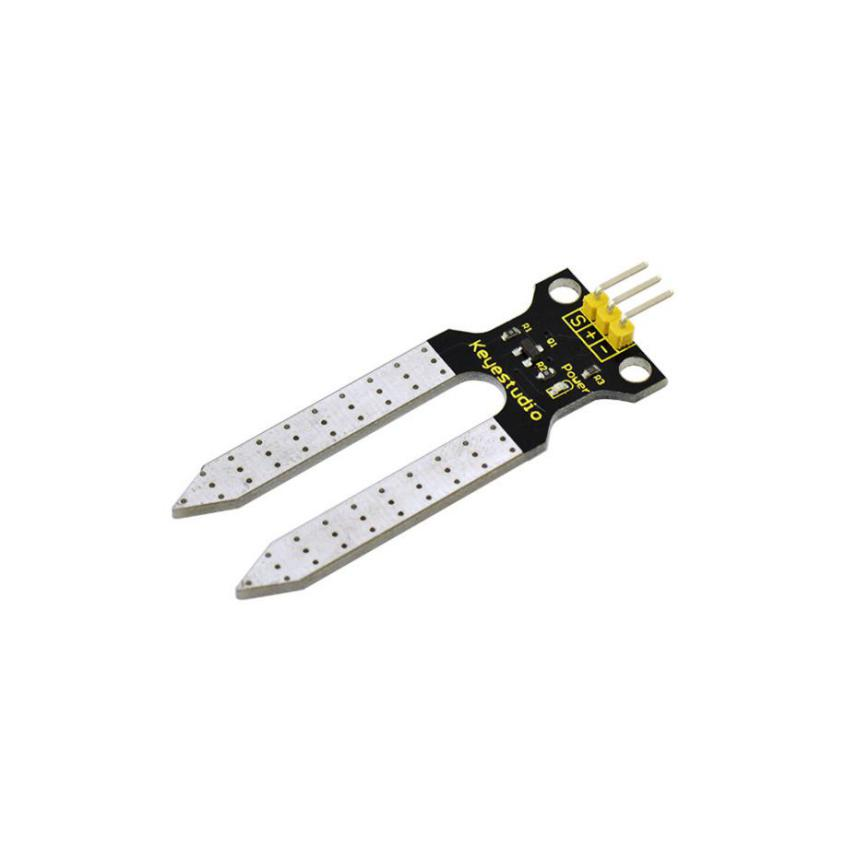
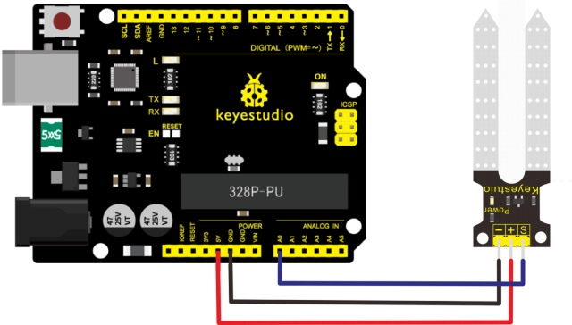
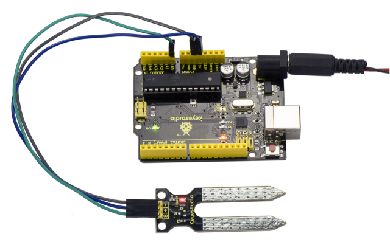
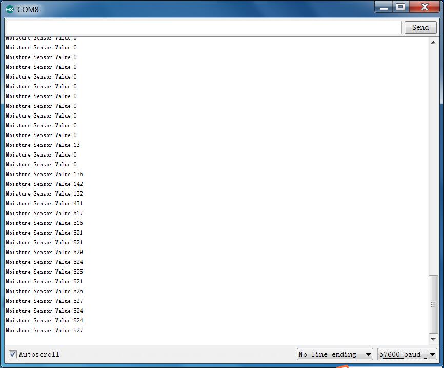

# Leçon 24 : Humidité du sol

> **Kit :** Keyestudio 48-en-1 Sensor Kit  
> **Carte :** Keyestudio V4.0 / Carte compatible Arduino Uno ATmega328P



## Description

Il s'agit d'un capteur d'humidité du sol simple conçu pour détecter l'humidité du sol. Si le sol manque d'eau, la valeur analogique renvoyée par le capteur diminuera ; sinon, elle augmentera.

Si vous utilisez ce capteur pour fabriquer un dispositif d'arrosage automatique, il peut détecter si vos plantes ont soif afin d'éviter qu'elles ne se flétrissent lorsque vous êtes absent.

Combiner ce capteur avec un contrôleur Arduino peut améliorer le bien‑être de vos plantes et rendre votre jardin plus intelligent.

Le module capteur d'humidité du sol n'est pas aussi compliqué que vous pourriez le penser ; si vous devez mesurer l'humidité du sol dans votre projet, ce sera un excellent choix.

Le capteur est équipé de deux sondes à insérer dans le sol. Si le courant traverse le sol, le capteur mesure la résistance en lisant les variations de courant entre les deux sondes, puis convertit la valeur de résistance en teneur en humidité.

Plus l'humidité est élevée (résistance plus faible), plus la conductivité du sol est importante.

La surface du capteur a subi un procédé de métallisation pour prolonger sa durée de vie. Insérez-le dans le sol puis utilisez le convertisseur AD (analogique-numérique) pour lire la valeur. Avec l'aide de ce capteur, la plante peut vous rappeler : j'ai besoin d'eau.

## Spécifications

- Tension d'alimentation: 3.3V ou 5V

- Courant de fonctionnement: ≤ 20mA

- Tension de sortie: 0-2.3V (lorsque le capteur est totalement immergé dans l'eau, la tension sera de 2.3V)  
  Plus l'humidité est élevée, plus la tension de sortie est élevée.

- Type de capteur: Sortie analogique

- Interface: Pin1 - signal, Pin2 - GND, Pin3 - VCC

## Schéma de connexion

Connectez la broche S du module à l'entrée analogique A0 de la carte V4.0, connectez la broche négative au port GND, la broche positive au port 5V.



## Exemple de code

Copiez et collez le code ci-dessous dans l'IDE Arduino.

```c
////////////////////////////////////////////////////////////////////
/*
  # Example code for the moisture sensor
  # Connect the sensor to the A0(Analog 0) pin on the Arduino board
  # the sensor value description
  # 0  ~300     dry soil
  # 300~700     humid soil
  # 700~950     in water
*/
void setup(){
  Serial.begin(57600);
}
void loop(){
  Serial.print("Moisture Sensor Value:");
  Serial.println(analogRead(0));
  delay(100);
}
////////////////////////////////////////////////////////////////////
```

## Exemple de résultat



Une fois le câblage terminé et l'alimentation mise, téléversez correctement le code, puis ouvrez le moniteur série et réglez le débit en bauds sur 57600 ; vous verrez la valeur. Lorsque le capteur détecte l'humidité, la valeur évoluera en conséquence. Voir ci‑dessous.



---
