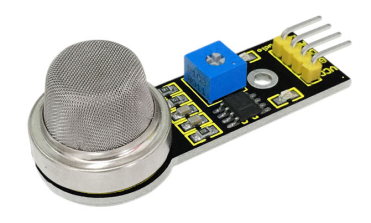
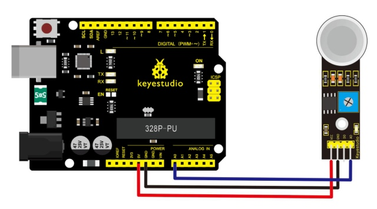
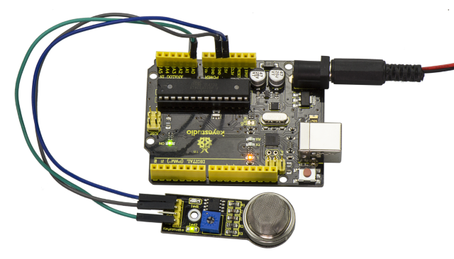
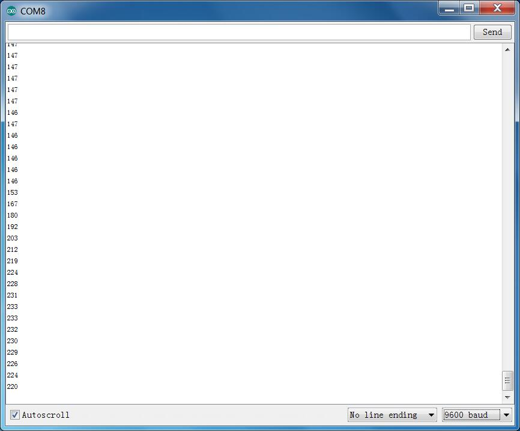

# Lezione 25: Sensore gas analogico

> **Kit:** Keyestudio Kit sensori 48-in-1  
> **Scheda:** Keyestudio V4.0 / scheda compatibile Arduino Uno (ATmega328P)



## Descrizione

Questo sensore di gas analogico MQ2 viene utilizzato negli apparecchi di rilevamento di perdite di gas sia nell'elettronica di consumo che nei mercati industriali. Questo sensore è adatto per rilevare GPL, isobutano, propano, metano, alcol, idrogeno e fumo.

L'ambito di rilevamento di questo sensore è molto ampio, ha un'alta sensibilità e una risposta rapida.

Inoltre, la sensibilità può essere regolata ruotando il potenziometro sul sensore.

## Specifiche

- Alimentazione: 5V

- Tipo di interfaccia: Analogico

- Circuito di pilotaggio semplice

- Stabile e lunga durata

## Schema di collegamento

Collega il pin A0 del modulo all'ingresso Analog A0 della scheda V4.0, collega il pin GND al connettore GND e il pin VCC al connettore 5V.



## Codice di esempio

Copia e incolla il codice seguente nell'IDE Arduino.

```c
////////////////////////////////////////////////////////////////////
//Arduino Sample Code
void setup()
{
  Serial.begin(9600); //Set serial baud rate to 9600 bps
}
void loop()
{
int val;
val=analogRead(0);//Read Gas value from analog 0
Serial.println(val,DEC);//Print the value to serial port
delay(100);
}

////////////////////////////////////////////////////////////////////
```

## Risultato di esempio



Dopo aver completato il cablaggio e alimentato, carica correttamente il codice, quindi apri il monitor seriale e imposta il baud rate a 9600; vedrai il valore analogico. Quando viene rilevato gas, il valore varierà.



---
