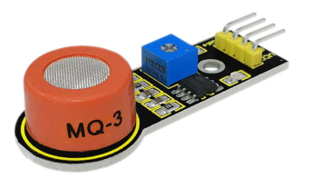
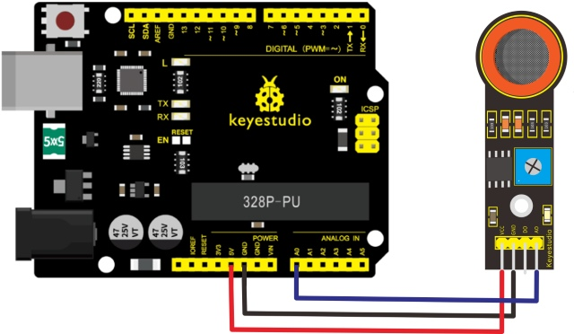
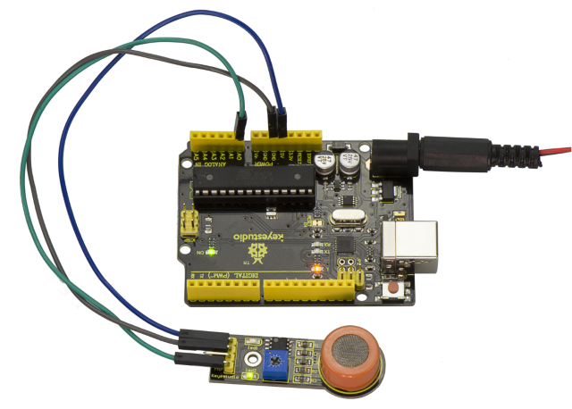
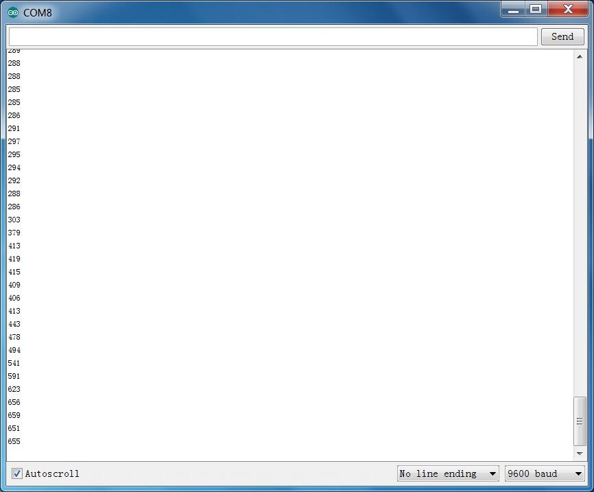

# Les 26: Analoge alcoholsensor

> **Set:** Keyestudio 48-in-1 Sensor Kit  
> **Bord:** Keyestudio V4.0 / compatibel met Arduino Uno ATmega328P-bord



## Beschrijving

Deze analoge MQ-3-sensor is geschikt voor het detecteren van alcohol. Hij kan worden gebruikt in een blaastestproject.

Hij heeft een goede selectiviteit omdat hij een hogere gevoeligheid voor alcohol en een lagere gevoeligheid voor benzine heeft.

De gevoeligheid kan worden aangepast door de potentiometer op de sensor te verdraaien.

## Specificatie

- Voeding: 5V

- Type interface: Analoog

- Eenvoudig stuurcircuit

- Stabiel en lange levensduur

- Snelle reactie en hoge gevoeligheid

## Aansluitschema

Verbind de A0-pin van de module met Analoge A0 van het V4.0-bord, verbind de GND-pin met de GND-aansluiting en de VCC-pin met de 5V-aansluiting.



## Voorbeeldcode

Kopieer en plak de onderstaande code in de Arduino-software.

```c
////////////////////////////////////////////////////////////////////
//Arduino Sample Code
void setup()
{
  Serial.begin(9600); //Set serial baud rate to 9600 bps
}
void loop()
{
int val;
val=analogRead(0);//Read Gas value from analog 0
Serial.println(val,DEC);//Print the value to serial port
delay(100);
}
////////////////////////////////////////////////////////////////////
```

## Voorbeeldresultaat



Na het aansluiten en inschakelen, upload de code correct, open vervolgens de seriële monitor en stel de baudrate in op 9600; je zult de analoge waarde zien. Wanneer alcoholgas wordt gedetecteerd, zal de waarde veranderen.



---
