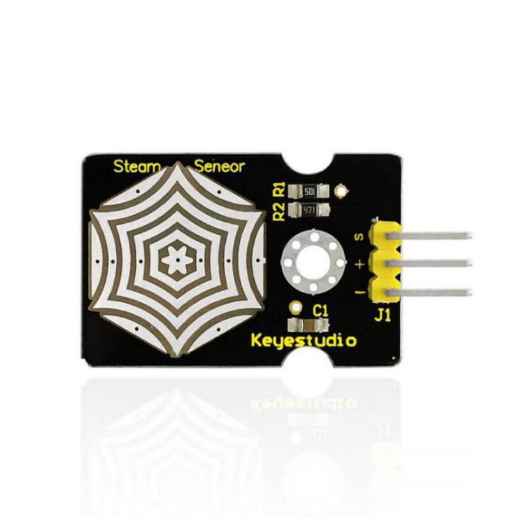
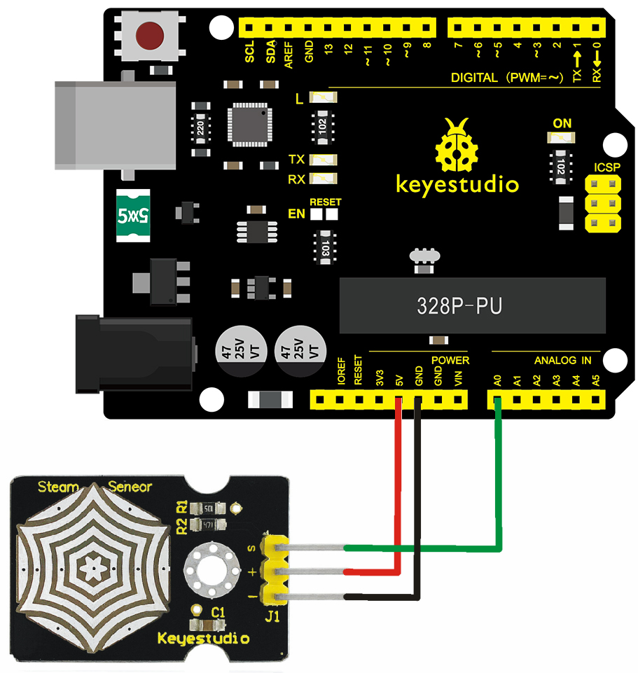
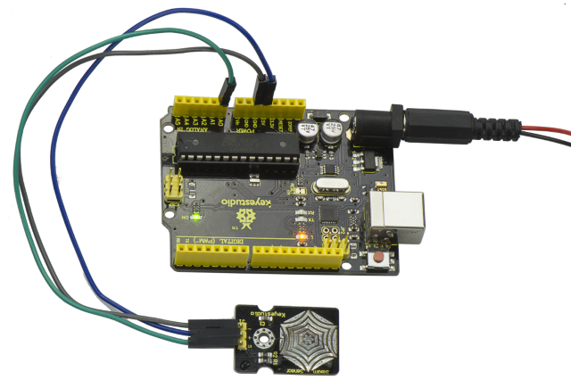

# Lektion 27: Feuchtigkeitssensor

> **Bausatz:** Keyestudio 48-in-1 Sensor Kit  
> **Board:** Keyestudio V4.0 / Arduino-Uno-kompatibles ATmega328P-Board



## Beschreibung

Der Feuchtigkeitssensor ist ein analoger Sensor und kann als einfacher Regenwasser-Detektor und Flüssigkeitsstandsschalter verwendet werden. Wenn die Feuchtigkeit an der Oberfläche dieses Sensors zunimmt, steigt die Ausgangsspannung.

Achtung: Verbindungsteile sind nicht wasserdicht, tauchen Sie sie daher bitte nicht ins Wasser.

## Parameter

- Betriebsspannung: 3,3V oder 5V

- Betriebsstrom: \<20 mA

- Arbeitsbereich der Temperatur: －10℃～＋70℃

- Schnittstellentyp: Analoger Signalausgang

## Pin-Belegung

- S-Pin: für Signal-Ausgang

- Positiver Pin (+): für Stromversorgung (VCC)

- Negativer Pin (-): für Masse (GND)

## Verbindungsdiagramm

Zuerst müssen Sie die folgenden Teile vor der Verbindung vorbereiten:

- V4.0-Board*1

- Feuchtigkeitssensor*1

- USB-Kabel*1

- Jumper-Kabel*3

Verbinden Sie den S-Pin des Moduls mit dem analogen Eingang A0 des V4.0-Boards, verbinden Sie den negativen Pin mit dem GND-Anschluss und den positiven Pin mit dem 5V-Anschluss.



## Beispielcode

Kopieren Sie den folgenden Code in die Arduino-Software.

```c
////////////////////////////////////////////////////////////////////
void setup()
{
Serial.begin(9600); //open serial port, and set baud rate at 9600bps
}
void loop()
{
int val;
val=analogRead(0); //plug vapor sensor into analog port 0
Serial.print("Moisture is ");
Serial.println(val,DEC); //read analog value through serial port printed
delay(100);
}
////////////////////////////////////////////////////////////////////
```

## Beispielergebnis



Beim Erfassen unterschiedlicher Feuchtigkeitsgrade liefert der Sensor unterschiedliche Messwerte. Siehe Abbildung unten.

Aufgrund begrenzter Möglichkeiten können Sie einen Wassertropfen auf den Sensor geben; der Feuchtigkeitswert ändert sich dann im seriellen Monitor der Arduino-Software.


---
