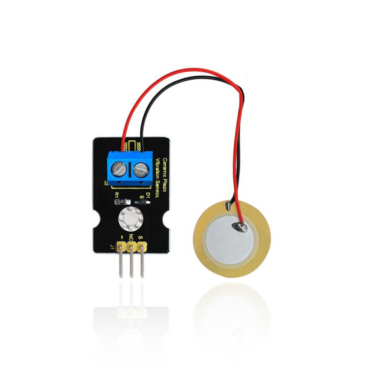
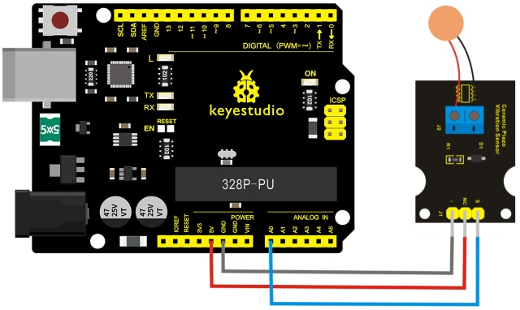
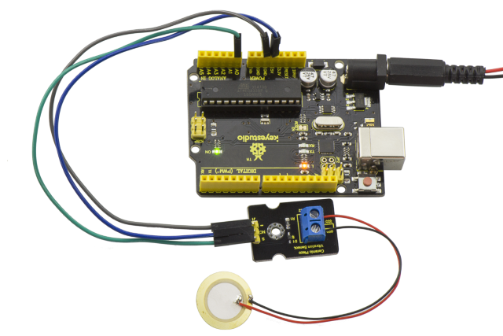
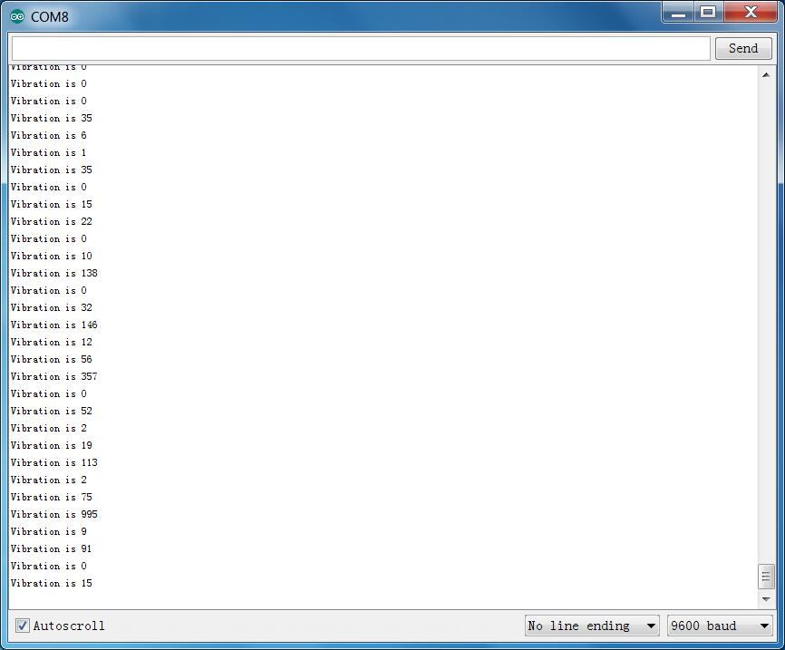

# Lezione 28: Sensore di vibrazione ceramico analogico

> **Kit:** Keyestudio 48-in-1 Kit sensori  
> **Scheda:** Keyestudio V4.0 / scheda compatibile Arduino Uno ATmega328P



## Descrizione

Questo sensore di vibrazione è basato su un chip ceramico piezoelettrico analogico. Sfrutta il processo piezoelettrico: la vibrazione del chip ceramico piezoelettrico genera segnali elettrici. Quando il chip vibra, il terminale di segnale del sensore produrrà segnali elettrici.

Il sensore può essere utilizzato con lo shield sensori dedicato per Arduino; la porta analogica di Arduino è in grado di percepire deboli segnali di vibrazione, permettendo applicazioni interattive legate alla vibrazione, come una batteria elettronica.

Collega il sensore di vibrazione alla porta analogica A0 di Arduino UNO. Vibrando il sensore con diversa intensità, vedrai i diversi valori di uscita visualizzati sul monitor seriale dell'IDE Arduino.

## Specifiche

- Tensione di alimentazione: 3.3V a 5V

- Corrente di lavoro: <1mA

- Intervallo di temperatura di esercizio: －10℃～＋70℃

- Segnale in uscita: segnale analogico

## Schema di collegamento

Per prima cosa, prepara i seguenti componenti prima del collegamento:

- Scheda V4.0\*1

- sensore di vibrazione\*1

- Cavo USB\*1

- Cavi jumper\*3

Collega il pin S del modulo alla porta analogica A0 della scheda V4.0, collega il pin negativo al GND, il pin NC al 5V.



## Codice di esempio

Copia e incolla il codice seguente nell'IDE Arduino.

```c
///////////////////////////////////////////////////////////
void setup()
{
Serial.begin(9600); //Open the serial to set the baud rate as 9600bps
}
void loop()
{
int val;
val=analogRead(0); //Connect the sensor to analog interface A0
Serial.print("Vibration is ");
Serial.println(val,DEC);//Print the analog value read on serial port
delay(100);
}
///////////////////////////////////////////////////////////
```

## Esempio di risultato



Collega come mostrato nello schema sopra e carica il codice, poi apri il monitor seriale e imposta la velocità di trasmissione su 9600.

Vibrando il chip ceramico vedrai i valori cambiare come mostrato nella figura seguente.



---
