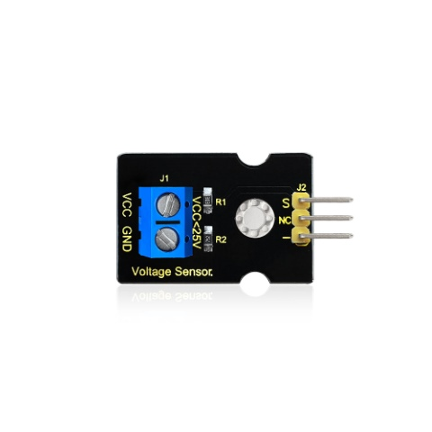
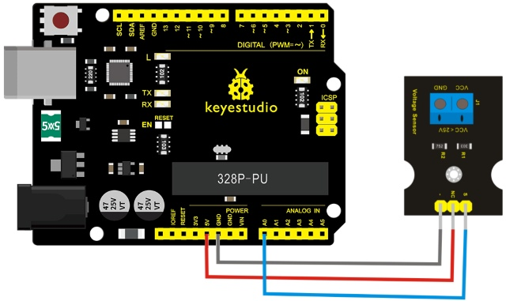
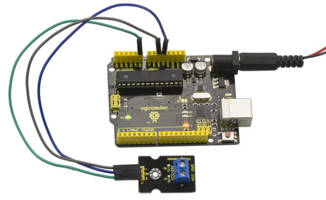
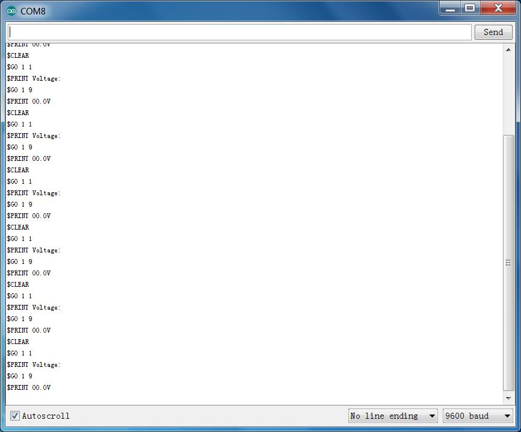

# Lesson 29: Voltage Detection

> **Kit:** Keyestudio 48-in-1 Sensor Kit  
> **Board:** Keyestudio V4.0 / Arduino Uno-compatible ATmega328P board



## Description

Since the electronic products are various, the voltage of the power supply is also different. It is indeed necessary to detect it with a suitable voltage detection module or controller.

The maximum input voltage of the controller’s analog interface is 5V, which means that the voltage greater than 5V will not be detected.

However, this voltage detection module can achieve to detect the voltage greater than 5 V.

It is based on a 5:1 resistive voltage divider. With a 5 V analog reference, the input voltage must not exceed 25 V. With a 3.3 V analog reference, the input voltage must not exceed 16.5 V.

The AVR analog-to-digital converter is 10-bit, so the analog resolution is 0.00489 V (5 V / 1023). With the 5:1 divider, the minimum measurable input increment is approximately 0.02445 V.

When connect this sensor to expansion board using 3Pin wire, it can not only easily detect the magnitude of the voltage power and monitor the electric quantity of battery for interactive media works or robot, but also can combine with IIC LCD1602 LCD module to display the voltage or make a voltage monitor.

## Specification

- Working voltage: 0V-25V DC

- Signal type: analog signal

## Connection Diagram

First, you need to prepare the following parts before connection:

- V4.0 board\*1

- Voltage sensor\*1

- USB Cable\*1

- Jumper wire\*3

Connect the S pin of module to Analog A0 of V4.0 board, connect the negative pin to GND port, NC pin to 5V port.



## Sample Code

```c
////////////////////////////////////////////////////////////////////
int analogpin=0;     // Define analogpin as analog port 0
int val,val5;       //Define variables val,val5
int val2=0;      //Define variables val2
int val3=0;     //Define variables val3
int val4=0;    //Define variables val4

void setup()
{
    Serial.begin(9600);     //Set baud rate of 9600
}
void loop()
{
    int val,val5;
    float val1;
    val=analogRead(analogpin);     //Read the value of the analog port and assign it to the variable val
    val1=val/3.9;
    val5=(int)val1;
    val3=val5/100;
    val2=(val5%100)/10;
    val4=val5%10;
    Serial.print("$CLEAR\r\n");      //clear the screen
    Serial.print("$GO 1 1\r\n");
    Serial.print("$PRINT Voltage:\r\n");
    Serial.print("$GO 1 9\r\n");
    Serial.print("$PRINT ");
Serial.print(val3);        //The serial port prints the value of the variable val3
Serial.print(val2);      //The serial port prints the value of the variable val2
    Serial.print(".");               //The serial port prints out a point"."
    Serial.print(val4);         //The serial port prints the value of the variable val4
    Serial.println("V");          //The serial port prints out capital “ V”
    delay(100);      //delay 0.1 second
}
////////////////////////////////////////////////////////////////////
```

## Example Result



Done as the above wiring, compile and upload the code, powered-on, then open the serial port monitor, it will print out the detected voltage value shown below.



---
