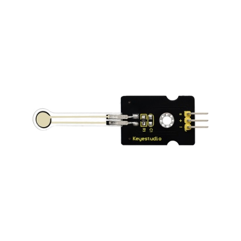
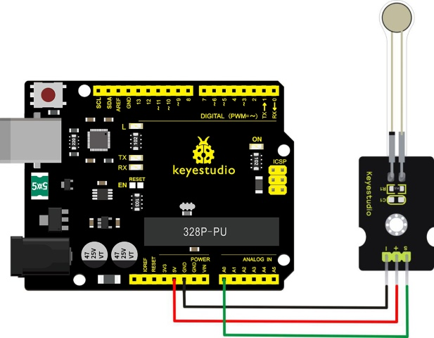
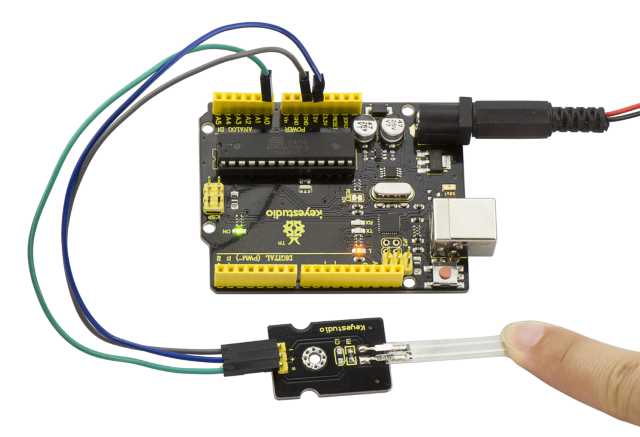
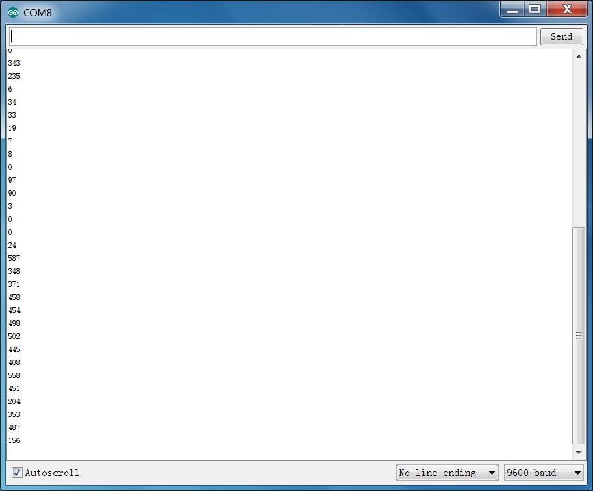

# Leçon 30 : Détection de pression

> **Kit :** Keyestudio 48-in-1 Sensor Kit  
> **Carte :** Keyestudio V4.0 / Arduino Uno-compatible ATmega328P board



## Description

Ce capteur adopte un nouveau matériau nano flexible sensible à la pression avec un tampon en film ultra fin. Il offre des fonctions d'étanchéité et de détection de pression.

Lorsque le capteur détecte une pression extérieure, la résistance du capteur change.

Ainsi, grâce au circuit, il peut convertir le signal de pression qui détecte la variation de pression en un signal électrique de sortie correspondant.

De cette façon, nous pouvons obtenir l'état des variations de pression en détectant les changements de signal.

## Paramètres

- Tension de fonctionnement：DC 3.3V—5V

- Plage：0-10KG

- Épaisseur：＜0.25mm

- Seuil de réponse：＜20g

- Répétabilité：＜±5.8%（50% de charge）

- Précision：±2.5%（intervalle de 85% de la plage）

- Durabilité：＞100 mille fois

- Résistance initiale：＞100MΩ(sans charge)

- Temps de réponse：＜1ms

- Temps de récupération：＜15ms

- Température de fonctionnement：﹣20℃—60℃

## Schéma de connexion

Préparez d'abord les composants suivants avant le branchement.

- Carte V4.0\*1

- Capteur de pression\*1

- Câble USB\*1

- Fils de connexion\*3

Connectez la broche S du module à Analog A0 de la carte V4.0, connectez la broche négative au port GND, la broche positive au port 5V.  


## Code d'exemple

Copiez et collez le code ci-dessous dans le logiciel Arduino.

```c
///////////////////////////////////////////////////////////////
int s_pin = A0;
void setup()
{
  Serial.begin(9600);
  pinMode(s_pin,INPUT);

}

void loop()
{
  Serial.println(analogRead(s_pin));
  delay(500);
}
///////////////////////////////////////////////////////////////
```

## Résultat d'exemple

Après avoir correctement câblé et téléversé le code, ouvrez le moniteur série dans l'IDE Arduino.

Ensuite, appuyez fermement sur le capteur avec la main : la valeur affichée dans le moniteur augmente.





---
