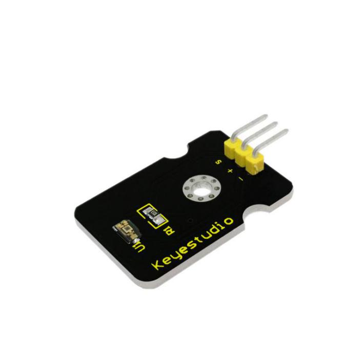
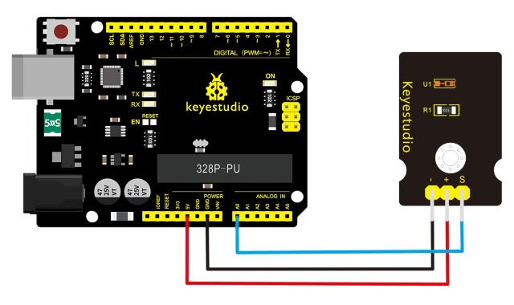
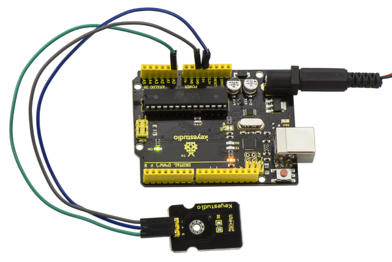
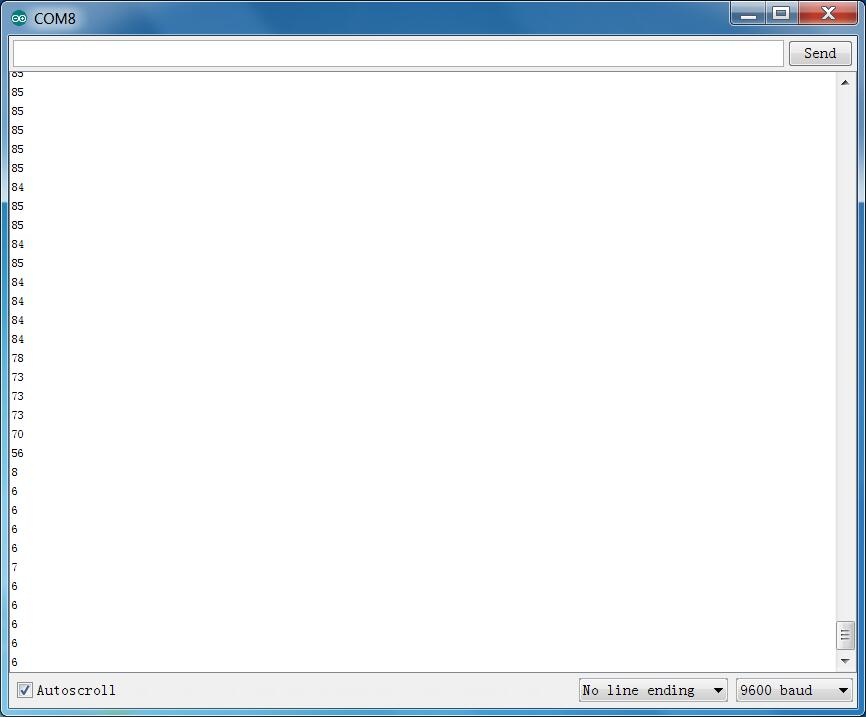

# Les 31: Omgevingslicht

> **Kit:** Keyestudio 48-in-1 Sensor Kit  
> **Bord:** Keyestudio V4.0 / Arduino Uno-compatibel ATmega328P bord



## Beschrijving

Op een gegeven moment wil je wellicht de omgevingshelderheid nauwkeuriger meten dan met je vertrouwde fotoresistor, zonder extra complexiteit aan je project toe te voegen. Als dat moment daar is, haal dan een TEMT6000-omgevingslichtsensor.

De TEMT6000 zou aangepast zijn aan de gevoeligheid van het menselijk oog, maar presteert ondermaats bij weinig licht. Hij werkt echter zeer goed bij het reageren op zeer kleine veranderingen over een groot helderheidsbereik. Omdat hij bedoeld is het menselijk oog te imiteren, reageert hij niet goed op IR- of UV-licht; houd daar rekening mee bij gebruik in je project.

## Specificatie

- Voedingsspanning: +5VDC 50mA

- Grootte: 36.5\*16mm

- Gewicht: 4g

## Aansluitschema

Bereid eerst de volgende onderdelen voor voordat je aansluit.

- V4.0-bord\*1

- TEMT6000-omgevingslichtsensor\*1

- USB-kabel\*1

- Jumperdraad\*3

Dit is een ongelooflijk eenvoudig onderdeel: sluit eenvoudig VCC en GND aan, en de signaalpin op een analoge ingang. Zodra aangesloten geeft de sensor een analoge spanning af die toeneemt bij meer licht. Je kunt hem ook met 3.3V voeden; de uitgangswaarde zal dan gewoon veel lager zijn.



## Voorbeeldcode

Eenvoudiger kan niet: dit geeft alleen de uitleeswaarde van de sensor naar de seriële monitor weer: 0–1023, waarbij 1023 zeer helder is en 0 zeer donker.

```c
///////////////////////////////////////////////////////////////
int temt6000Pin = 0;
void setup() {
 Serial.begin(9600);
}
void loop() {
 int value = analogRead(temt6000Pin);
 Serial.println(value);
 delay(100); //only here to slow down the output so it is easier to read
}
///////////////////////////////////////////////////////////////
```

## Voorbeeldresultaat

Na correct aansluiten en het uploaden van bovenstaande code, open je de seriële monitor van de Arduino-software.



Bedek vervolgens de sensor met je hand of een papiertje; het licht wordt zwakker en je ziet de waarde in de monitor afnemen.



---
