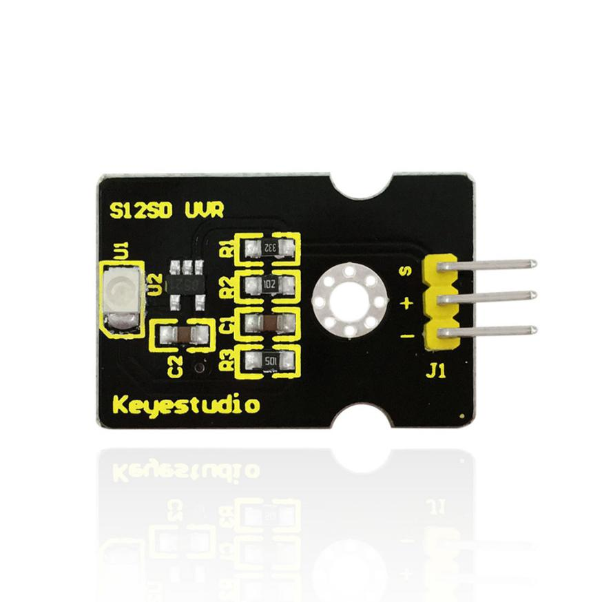
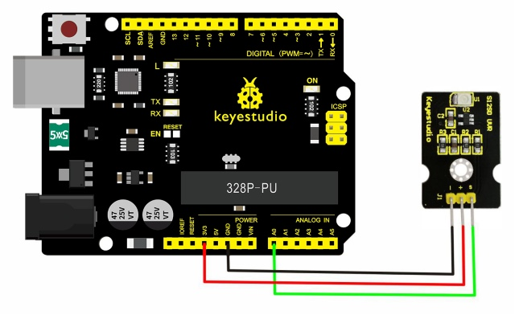
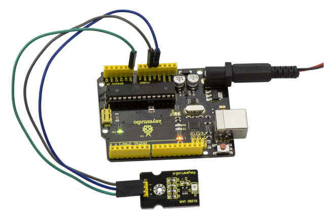
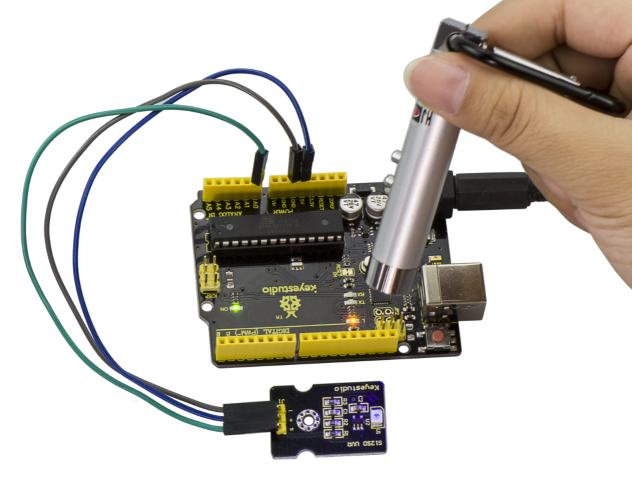
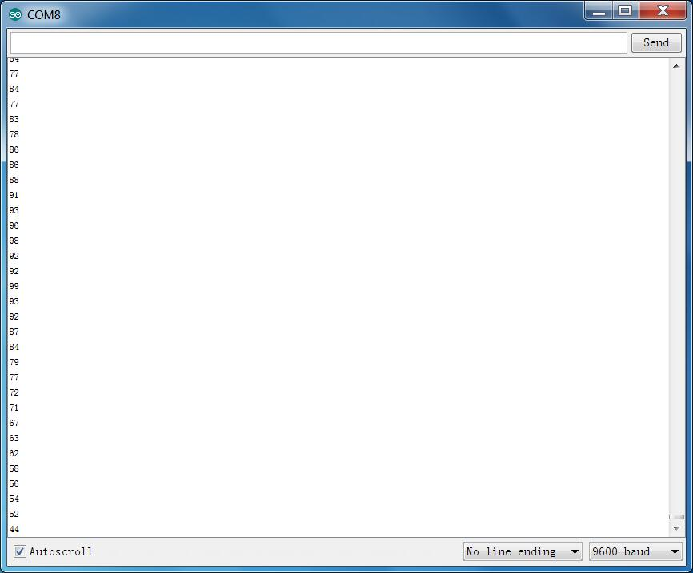

# Lección 32: Luz ultravioleta

> **Kit:** Kit de sensores Keyestudio 48-en-1  
> **Placa:** Keyestudio V4.0 / Placa compatible con Arduino Uno ATmega328P



## Descripción

El sensor ultravioleta Keyestudio GUVA-S12SD se utiliza para detectar la luz ultravioleta. Incluye el GUVA-S12SD aplicado para medir el índice UV en dispositivos inteligentes para vestir, como relojes, teléfonos inteligentes y dispositivos exteriores con detección del índice UV.

También puede utilizarse para monitorear la intensidad de la luz ultravioleta o como detector de llamas UV al desinfectar objetos con luz ultravioleta.

## Parámetros

- Tamaño: 15mm×30mm×0.7mm

- Voltaje de alimentación: 2.5V～5V

- Señal de salida: Señal analógica

- Rango de detección del espectro: 240-370nm

- Región activa: 0.076mm2

- Responsividad: 0.14A/W

- Corriente en oscuridad: 1nA

- Corriente de luz: 101\~125nA Luz UVA, 1mW/cm2

## Diagrama de conexión

Primero necesita preparar las siguientes piezas antes de la conexión.

- Placa V4.0\*1

- GUVA-S12SD 3528 Sensor ultravioleta \*1

- Cable USB\*1

- Cables jumper\*3

Conecte el pin S del módulo a Analog A0 de la placa V4.0, conecte el pin negativo al puerto GND, y el pin positivo al puerto 3V3.



## Código de ejemplo

Copie y pegue el siguiente código en el software de Arduino.

```c
///////////////////////////////////////////////////////////////
/*
  AnalogReadSerial
  Reads an analog input on pin 0, prints the result to the serial monitor.
  Attach the center pin of a potentiometer to pin A0, and the outside pins to +5V and ground.

 This example code is in the public domain.
 */

// the setup routine runs once when you press reset:
void setup() {
  // initialize serial communication at 9600 bits per second:
  Serial.begin(9600);
}

// the loop routine runs over and over again forever:
void loop() {
  // read the input on analog pin 0:
  int sensorValue = analogRead(A0);
  // print out the value you read:
  Serial.println(sensorValue);
  delay(1);        // delay in between reads for stability
}
///////////////////////////////////////////////////////////////
```

## Resultado de ejemplo



Conéctelo correctamente y cargue el código del programa, luego abra el monitor serie; mostrará los datos.

Si ilumina el sensor con luz UV, los datos en el monitor serie cambian como se muestra en la siguiente imagen.





---
