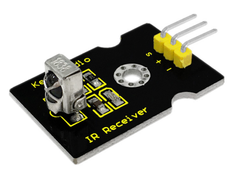
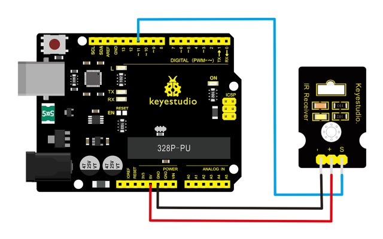
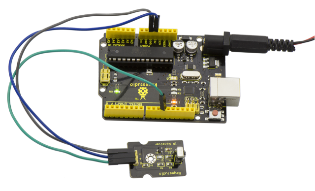
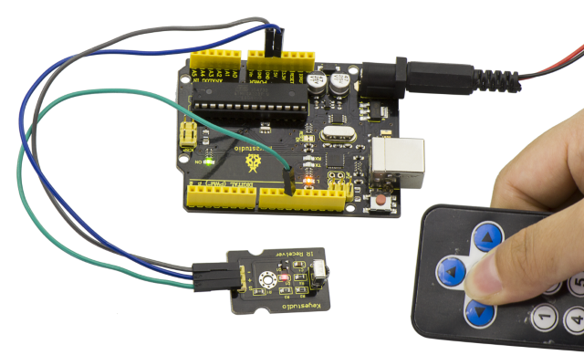

# Lesson 33: Digital IR Receiver

> **Kit:** Keyestudio 48-in-1 Sensor Kit  
> **Board:** Keyestudio V4.0 / Arduino Uno-compatible ATmega328P board



## Description

IR is widely used in remote control. With this IR receiver, Arduino project is able to receive command from any IR remoter controllers if you have the right decoder. Well, it will be also easy to make your own IR controller using IR transmitter.

## Specification

- Power Supply: 5V

- Interface: Digital

- Modulation Frequency: 38Khz

- Module Interface Socket: JST PH2.0

- Size: 30*20mm

- Weight: 4g

## Connection Diagram

Firstly you need to prepare the following parts before connection.

- V4.0 Board\*1

- IR Receiver module\*1

- USB Cable\*1

- Jumper Wire\*3

Connect the S pin of module to Digital 11 of V4.0 board, connect the negative pin to GND port, positive pin to 5V port.



In the sample code below Digital pin 11 is in use, you may either change your wiring or change the sample code to match.

## Sample Code

Copy and paste the code below to Arduino software.

```c
///////////////////////////////////////////////////////////////
#include <IRremote.h>
 int RECV_PIN = 11;
 IRrecv irrecv(RECV_PIN);
 decode_results results;
 void setup()
{
  Serial.begin(9600);
  irrecv.enableIRIn(); // Start the receiver
}
 void loop() {
  if (irrecv.decode(&results)) {
    Serial.println(results.value, HEX);
    irrecv.resume(); // Receive the next value
  }
}

///////////////////////////////////////////////////////////////
```

**Note:** before compiling the code, do remember to place the library into libraries directory of Arduino IDE. Otherwise, compiling will fail.

IR Remote Library Includes some sample codes for sending and receiving.

<https://github.com/shirriff/Arduino-IRremote>

## Example Result



Done wiring and uploading the code, then control the IR receiver module by an infrared remote control, D1 led will flash.



---
