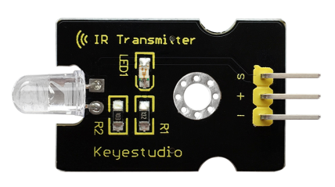
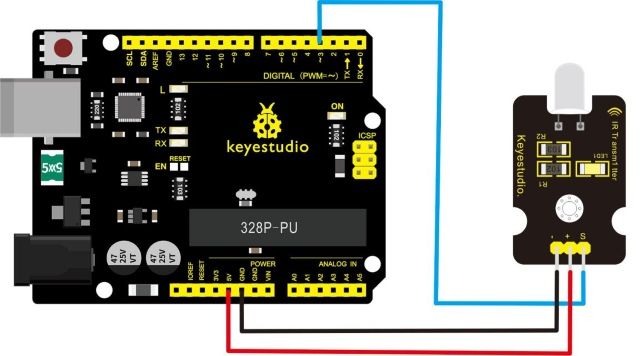
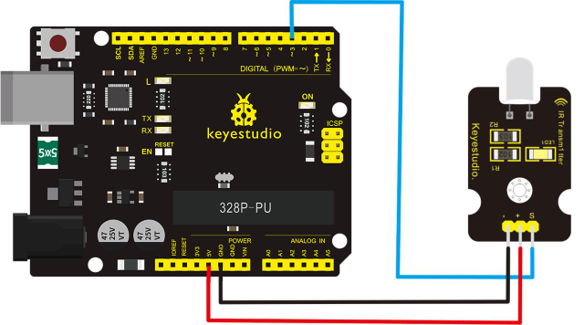
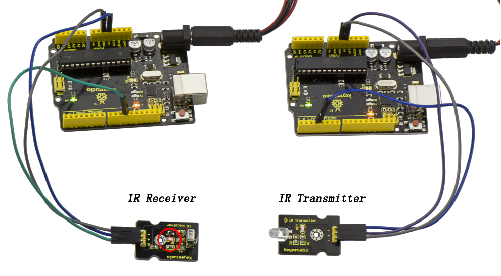

# Lesson 34: Digital IR Transmitter

> **Kit:** Keyestudio 48-in-1 Sensor Kit  
> **Board:** Keyestudio V4.0 / Arduino Uno-compatible ATmega328P board



## Description

IR transmitter module is designed for IR communication, which is widely used for operating the television device from a short line-of-sight distance.

Since infrared (IR) remote control uses light, it requires line of sight to operate the destination device. The signal can, however, be reflected by mirrors, just like any other light sources.

Infrared receivers also tend to have a more or less limited operating angle, which mainly depends on the optical characteristics of the phototransistor.

However, it’s easy to increase the operating angle using a matte transparent object in front of the receiver.

## Specification

- Power Supply: 3-5V

- Infrared center frequency: 850nm-940nm

- Infrared emission angle: about 20 degrees

- Infrared emission distance: about 1.3m (5V 38Khz)

- Interface socket: JST PH2.0

- Mounting hole: inner diameter is 3.2mm, spacing is 15mm

## Connection Diagram

Firstly you need to prepare the following parts before connection.

- V4.0 Board\*1

- IR Transmitter module\*1

- USB Cable\*1

- Jumper Wire\*3

Connect the S pin of module to Digital 3 of V4.0 board, connect the negative pin to GND port, positive pin to 5V port.



## Sample Code 1

```c
int led = 3;
void setup() {
   pinMode(led, OUTPUT);
}
void loop() {
  digitalWrite(led, HIGH);
  delay(1000);
  digitalWrite(led, LOW);
  delay(1000);
}
```

In the darkness of the environment, you are going to see blinking blue light on phone's screen when using camera to shoot the infrared LED.

Upload well the above code to the board, the led on the sensor will blink red light.

In the following, let’s move on to an interactive example between IR receiver and IR transmitter module.

## Infrared Remote/Communication

## Hardware Required

- Arduino R3 x2

- Digital IR Receiver x1

- IR Transmitter Module x1

Note: this experiment needs two microcontroller boards. A breadboard does not replace the second board because it cannot run the receiver sketch.

## Two-board communication setup

## For IR Transmitter

Notice: Arduino-IR remote only supports D3 as transmitter.



## For IR Receiver

Connect the signal pin to D11 port.


## Upload code 2 to the V4.0 connected with IR Transmitter

```c
 #include <IRremote.h>
  IRsend irsend;
 void setup()
 {}
 void loop() {
  irsend.sendRC5(0x0, 8); //send 0x0 code (8 bits)
     delay(200);
  irsend.sendRC5(0x1, 8);
     delay(200); }
```

## Upload code 3 to the V4.0 connected with IR Receiver

```c
#include <IRremote.h>
 const int RECV_PIN = 11;
 const int LED_PIN = 13;
 IRrecv irrecv(RECV_PIN);
 decode_results results;
 void setup()
 {Serial.begin(9600);
   irrecv.enableIRIn(); // Start the receiver
 }
  void loop()
 {if (irrecv.decode(&results))
   { if ( results.bits > 0 )
     {

       int state;
       if ( 0x1 == results.value )
       {
         state = HIGH;
       }
       else
       {
         state = LOW;
       }
       digitalWrite(LED_PIN, state);
     }
  irrecv.resume();        // prepare to receive the next value
   }}
```

## Result

When IR Receiver module receives the infrared signal from IR Transmitter, D1 led on the IR Receiver module will blink.

When IR Receiver module receives the infrared signal from IR Transmitter, D1 led on the IR Receiver module will blink.



---
