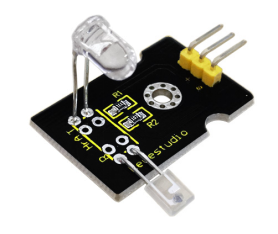
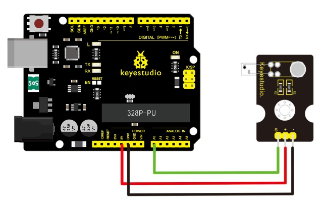
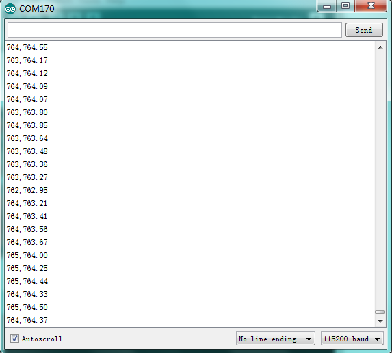
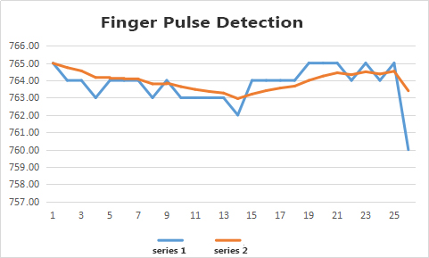

# Lezione 35: Monitor della frequenza cardiaca

> **Kit:** Keyestudio 48-in-1 Sensor Kit  
> **Scheda:** Keyestudio V4.0 / scheda compatibile Arduino Uno ATmega328P



## Descrizione

Questo modulo utilizza un LED a infrarossi ultra-chiaro e un fototransistor per rilevare il battito nel tuo dito. Il LED rosso lampeggerà in sincronismo con il tuo battito.

Principio di funzionamento

Illumina con il LED brillante un lato del dito mentre il fototransistor sull'altro lato rileva la quantità di luce trasmessa. La resistenza del fototransistor varierà leggermente man mano che il sangue pulsa attraverso il dito.

## Schema di collegamento

Prima di tutto è necessario preparare i seguenti componenti prima di effettuare il test.

- Scheda V4.0\*1

- Modulo pulsazioni\*1

- Cavo USB\*1

- Cavi jumper\*3

Collega il pin Signal del modulo ad Analog A0 della scheda V4.0, il pin positivo alla porta 5V, il pin negativo alla porta GND.



## Codice di esempio

Copia e incolla il codice seguente nell'ambiente Arduino.

```c
///////////////////////////////////////////////////////////////
int ledPin = 13;
int sensorPin = 0;
double alpha = 0.75;
int period = 20;
double change = 0.0;
void setup()
{
pinMode(ledPin, OUTPUT);
Serial.begin(115200);
}
void loop()
{
static double oldValue = 0;
static double oldChange = 0;
int rawValue = analogRead(sensorPin);
double value = alpha * oldValue + (1 - alpha) * rawValue;
Serial.print(rawValue);
Serial.print(",");
Serial.println(value);
oldValue = value;
delay(period);
}
///////////////////////////////////////////////////////////////
```

## Risultato di esempio

Collegalo bene come nel diagramma sopra, quindi carica correttamente il codice sulla scheda e clicca l'icona del Monitor seriale nell'angolo in alto a destra dell'IDE Arduino. Imposta la velocità di trasmissione (baud rate) su 115200: vedrai i dati visualizzati nel monitor.

Puoi copiare e incollare i dati in Excel; alla fine verrà generato il grafico corrispondente mostrato qui sotto.





---
