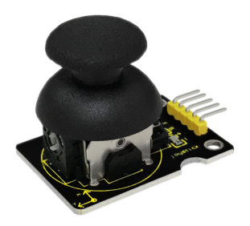
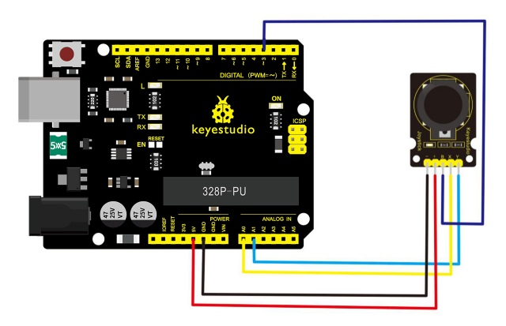
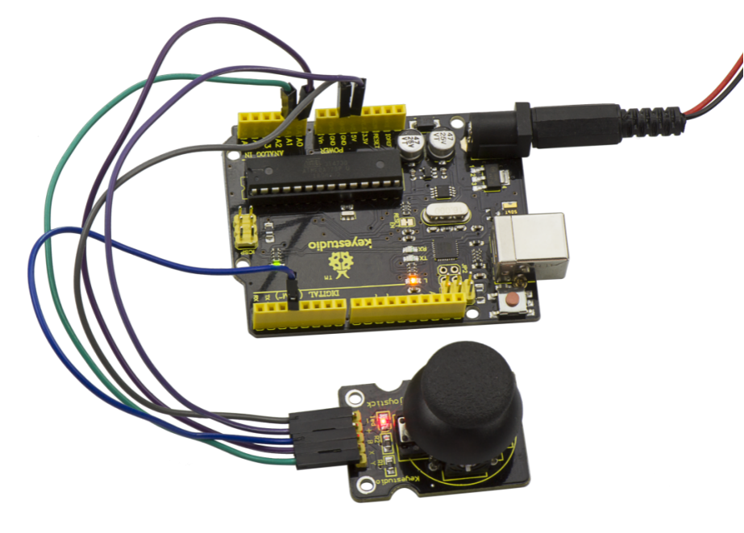
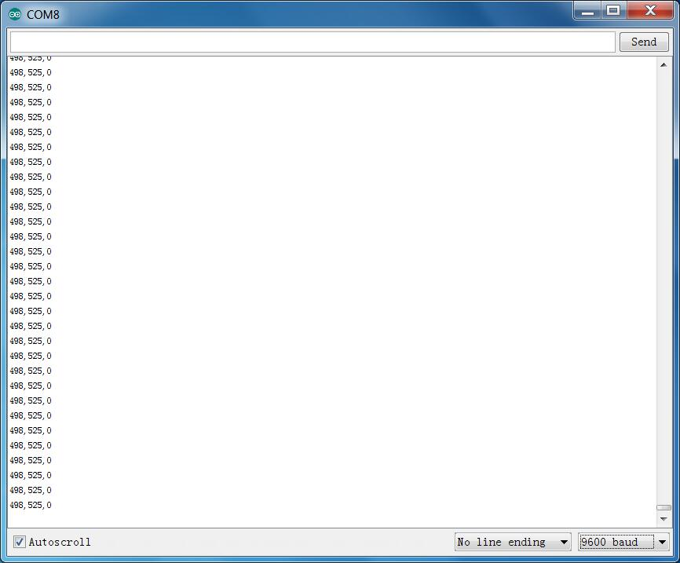

# Les 36: Joystick

> **Set:** Keyestudio 48-in-1 sensorkit  
> **Bord:** Keyestudio V4.0 / Arduino Uno-compatibele ATmega328P-bord



## Beschrijving

Veel robotprojecten hebben een joystick nodig. Deze module biedt een betaalbare oplossing. Door eenvoudig verbinding te maken met twee analoge ingangen staat de robot onder jouw commando's met X- en Y-besturing. Hij heeft ook een schakelaar die op een digitale pin is aangesloten.

## Specificatie

- Voedingsspanning: 3.3V tot 5V

- Interface: Analoog x2, Digitaal x1

- Afmetingen: 40*28mm

- Gewicht: 12g

## Aansluitschema

Bereid eerst de volgende onderdelen voor voordat je ze aansluit.

- V4.0-bord\*1

- Joystick-module\*1

- USB-kabel\*1

- Jumperdraad\*5

Verbind de Y-pin van de module met Analoge A1 van het V4.0-bord, verbind de X-pin met Analoge A0, de B-pin met Digitaal 3; verbind de negatieve pin met de GND-poort en de positieve pin met de 5V-poort.



## Voorbeeldcode

Kopieer en plak de onderstaande code in de Arduino-software.

```c
///////////////////////////////////////////////////////////////
int JoyStick_X = 0; //x
int JoyStick_Y = 1; //y
int JoyStick_Z = 3; //key
  void setup()
{
  pinMode(JoyStick_Z, INPUT);
  Serial.begin(9600); // 9600 bps
}
void loop()
{
  int x,y,z;
  x=analogRead(JoyStick_X);
  y=analogRead(JoyStick_Y);
  z=digitalRead(JoyStick_Z);
  Serial.print(x ,DEC);
  Serial.print(",");
  Serial.print(y ,DEC);
  Serial.print(",");
  Serial.println(z ,DEC);
  delay(100);
}
///////////////////////////////////////////////////////////////
```

## Voorbeeldresultaat



Als de bedrading correct is en je de code hebt geüpload, open dan de seriële monitor in de Arduino-software en stel de baudrate in op 9600; je ziet dan de waarden zoals hieronder. Als je de joystick naar beneden / omhoog / links / rechts duwt, zullen de gegevens veranderen.



---
