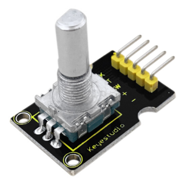
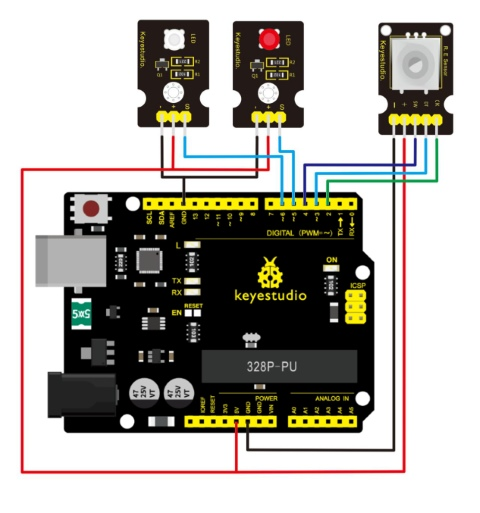
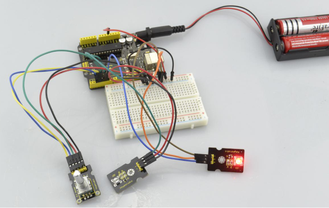

# Lesson 37: Rotary Encoder

> **Kit:** Keyestudio 48-in-1 Sensor Kit  
> **Board:** Keyestudio V4.0 / Arduino Uno-compatible ATmega328P board



## Introduction

The rotary encoder can count the pulse outputting times during the process of rotation in positive and reverse direction.

This rotating counting is unlimited, not like potential counting. It can be restored to initial state to count from 0.

## Specification

- Power Supply: 5V

- Interface: Digital

- Size: 30\*20mm

- Weight: 7g

## Connection Diagram



As seen in the diagram, we connect rotary encoder module and two LED modules to the breadboard and V4.0 board.

Use the rotary encoder module to control two LED modules on and off.

## Sample Code

```c
///////////////////////////////////////////////////////////////
const int interruptA = 0;
const int interruptB = 1;
int CLK = 2;     // PIN2
int DAT = 3;     // PIN3
int BUTTON = 4;  // PIN4
int LED1 = 5;    // PIN5
int LED2 = 6;    // PIN6
int COUNT = 0;

void setup()
 {
  attachInterrupt(interruptA, RoteStateChanged, FALLING);
 // attachInterrupt(interruptB, buttonState, FALLING);
  pinMode(CLK, INPUT);
  digitalWrite(2, HIGH);  // Pull High Resistance
  pinMode(DAT, INPUT);
  digitalWrite(3, HIGH);  // Pull High Resistance

pinMode(BUTTON, INPUT);
  digitalWrite(4, HIGH);  // Pull High Resistance
  pinMode(LED1, OUTPUT);
  pinMode(LED2, OUTPUT);
   Serial.begin(9600);
 }

void loop()
{
  if  (!(digitalRead(BUTTON)))
    {
     COUNT = 0;
     Serial.println("STOP COUNT = 0");
     digitalWrite(LED1, LOW);
     digitalWrite(LED2, LOW);
     delay (2000);
    }
     Serial.println(COUNT);
}

//-------------------------------------------
void RoteStateChanged() //When CLK  FALLING READ DAT
{
 if  (digitalRead(DAT)) // When DAT = HIGH IS FORWARD
   {
    COUNT++;
    digitalWrite(LED1, HIGH);
    digitalWrite(LED2, LOW);
    delay(20);
   }
 else                   // When DAT = LOW IS BackRote
   {
    COUNT--;
    digitalWrite(LED2, HIGH);
    digitalWrite(LED1, LOW);
    delay(20);
   }
}
///////////////////////////////////////////////////////////////
```

## Example Result

Wiring well and uploading the above code, you can rotate the encoder module to randomly control two LED modules on and off. When you rotate the encoder module, one LED module is turned on first but another one is off.

If you continue to rotate the encoder module, one LED module becomes off while another one is turned on, repeatedly.



---
