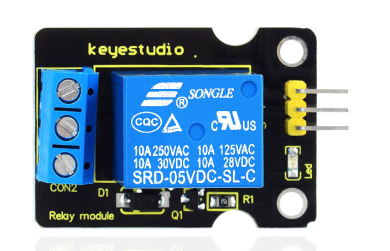
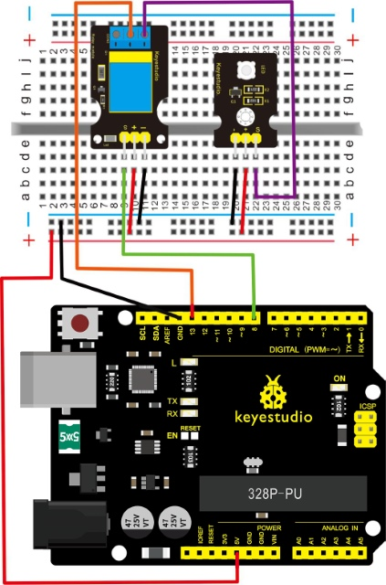
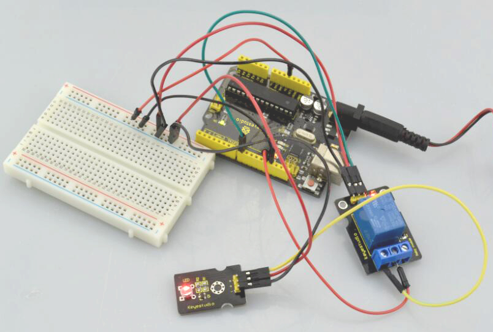

# Lektion 38: Einzelrelais

> **Bausatz:** Keyestudio 48-in-1 Sensor Kit  
> **Platine:** Keyestudio V4.0 / Arduino Uno-kompatible ATmega328P-Platine



## Einführung

Dieses Einzelrelais-Modul kann in interaktiven Projekten verwendet werden. Das Modul verwendet ein hochwertiges SONGLE 5V-Relais. Es kann auch zum Steuern von Beleuchtung, elektrischen Geräten und anderer Ausrüstung verwendet werden.

Das modulare Design macht die Verwendung mit einer Arduino-Platine einfach. Es kann über einen digitalen I/O-Anschluss gesteuert werden, zum Beispiel Magnetventile, Lampen, Motoren und andere Geräte mit hohem Strom oder hoher Spannung.

## Spezifikation

- Typ: Digital

- Nennstrom: 10A (NO) 5A (NC)

- Maximale Schaltspannung: 150VAC 24VDC

- Digitales Interface

- Steuersignal: TTL-Pegel

- Nennbelastung: 8A 150VAC (NO), 10A 24VDC (NO), 5A 250VAC (NO/NC), 5A 24VDC (NO/NC)

- Maximale Schaltleistung: AC1200VA DC240W (NO), AC625VA DC120W (NC)

- Kontakt-Schaltzeit: 10ms

## Anschlussdiagramm

Zuerst müssen Sie vor dem Anschluss die folgenden Teile vorbereiten.

- V4.0 Platine\*1

- Relaismodul\*1

- LED-Modul \*1

- Steckbrett \*1

- USB-Kabel\*1

- Jumperkabel\*9

Hier verwenden wir das Einzelrelais-Modul, um ein LED-Modul ein- oder auszuschalten.

Beim Relaismodul verbinden Sie den Signal-Pin mit dem digitalen Port 8 der V4.0-Platine, dann verbinden Sie seinen positiven Pin mit der Anodenreihe des Steckbretts und führen diese Reihe zum 5V-Anschluss der V4.0-Platine. Verbinden Sie seinen negativen Pin mit der Kathodenreihe des Steckbretts und führen diese Reihe zum GND-Anschluss der V4.0-Platine.

Beim LED-Modul verbinden Sie den Signal-Pin mit einem Klemmenanschluss des Relaismoduls, ein anderer Klemmenanschluss des Relais ist mit dem digitalen Port 13 der V4.0-Platine verbunden. Verbinden Sie seinen positiven Pin mit der Anodenreihe, den negativen Pin mit der Kathodenreihe des Steckbretts.



## Beispielcode

Kopieren Sie den folgenden Code in die Arduino-Software.

```c
///////////////////////////////////////////////////////////////
 int Relay = 8;
  void setup()
{
  pinMode(13, OUTPUT);         //Set Pin13 as output
  digitalWrite(13, HIGH);     //Set Pin13 High
  pinMode(Relay, OUTPUT);     //Set Pin3 as output
}
void loop()
{
          digitalWrite(Relay, HIGH);   //Turn off relay
          delay(2000);
          digitalWrite(Relay, LOW);    //Turn on relay
          delay(2000);
}
///////////////////////////////////////////////////////////////
```

## Beispielergebnis



Dieses Relaismodul ist bei HIGH-Pegel aktiv.

Verdrahten Sie alles ordentlich, schalten Sie die Stromversorgung ein und laden Sie dann den obigen Code auf die Platine hoch. Sie werden sehen, dass das Relais für zwei Sekunden eingeschaltet ist (NO geschlossen, NC geöffnet), dann für zwei Sekunden ausgeschaltet ist (NC geschlossen, NO geöffnet), und dies wiederholt sich zyklisch.

Wenn das Relais eingeschaltet ist, leuchtet die externe LED. Ist das Relais ausgeschaltet, ist die externe LED aus.

---
