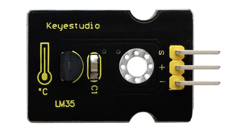
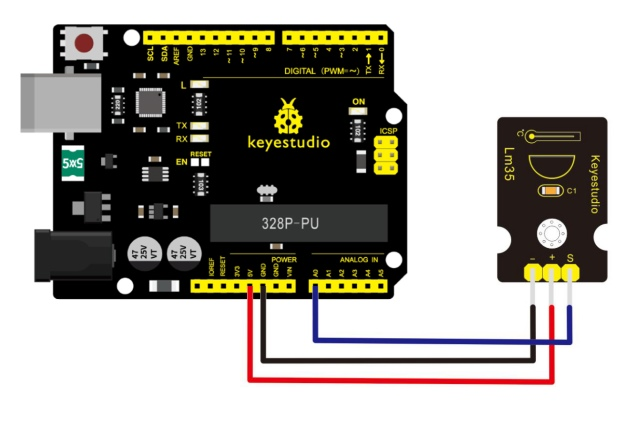
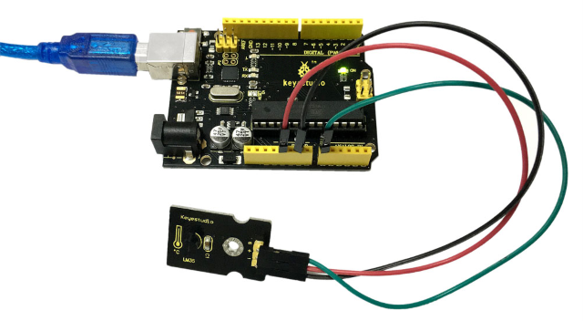
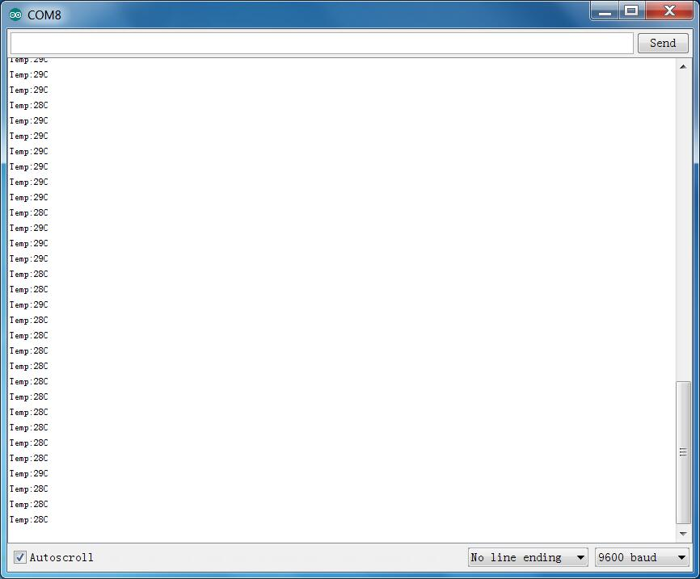

# Leçon 39 : Température linéaire

> **Kit :** Kit de capteurs Keyestudio 48-en-1  
> **Carte :** Keyestudio V4.0 / carte compatible Arduino Uno ATmega328P



## Introduction

Le capteur de température linéaire LM35 est basé sur la puce de température LM35. Il peut être utilisé pour détecter la température ambiante de l'air.

Ce capteur offre une plage de fonctionnement de 0 degré Celsius à 100 degrés Celsius. La sensibilité est de 10 mV par degré Celsius. La tension de sortie est proportionnelle à la température.

Ce type de capteur est couramment utilisé pour la mesure de la température. Les capteurs de température comprennent les thermocouples, les sondes à résistance de platine, les thermistances et les puces semi‑conductrices de température.

La puce est couramment utilisée dans les thermocouples de mesure de haute température.

La sonde à résistance de platine est utilisée pour des mesures jusqu'à 800 degrés Celsius, tandis que la thermistance et le capteur de température à semi‑conducteur conviennent pour mesurer des températures d'environ 100–200 degrés ou moins. Dans ces applications, un capteur de température à semi‑conducteur simple offre une bonne linéarité et une grande sensibilité.

Le capteur de température linéaire LM35 peut être facilement connecté à un shield Arduino.

## Spécification

- Sensibilité : 10 mV par degré Celsius
- Plage de fonctionnement : 0 degré Celsius à 100 degrés Celsius
- Taille : 30 × 20 mm
- Poids : 3 g

## Schéma de connexion

Tout d'abord vous devez préparer les éléments suivants avant le test.

- Carte V4.0\*1
- Capteur de température LM35\*1
- Câble USB\*1
- Fils de connexion\*3

Ensuite, suivez le schéma de câblage : connectez la broche de signal du capteur au port A0 de la carte V4.0, la broche négative au port GND et la broche positive au port 5V.



## Exemple de code

Copiez et collez le code ci‑dessous dans le logiciel Arduino.

```c
///////////////////////////////////////////////////////////////
void setup()
{
    Serial.begin(9600);//Set Baud Rate to 9600 bps
}
 void loop()
{  int val;
    int dat;
    val=analogRead(0);//Connect LM35 on Analog 0
    dat=(500 * val) /1024;;
    Serial.print("Temp:"); //Display the temperature on Serial monitor
    Serial.print(dat);
    Serial.println("C");
    delay(500);
}
///////////////////////////////////////////////////////////////
```

## Exemple de résultat



Câblez comme sur le schéma ci‑dessus et téléversez correctement le code sur la carte, puis ouvrez le moniteur série et réglez la vitesse de transmission sur 9600 bauds.

Vous verrez la valeur de température actuelle affichée ci‑dessous. La valeur peut légèrement varier selon l'emplacement et la météo.



---
