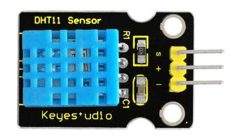
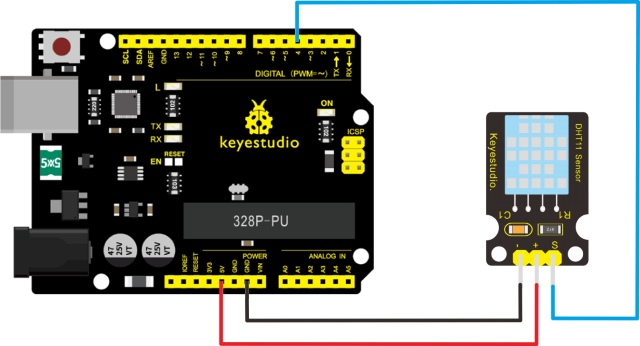
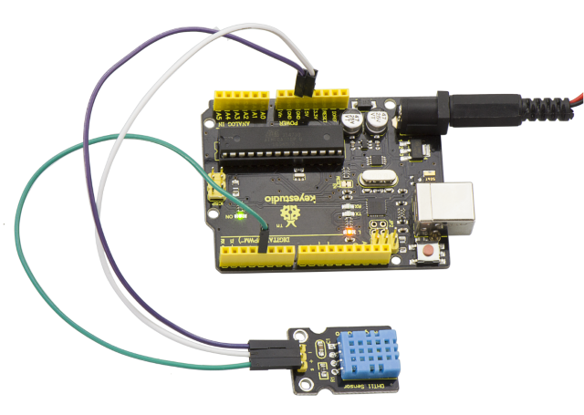
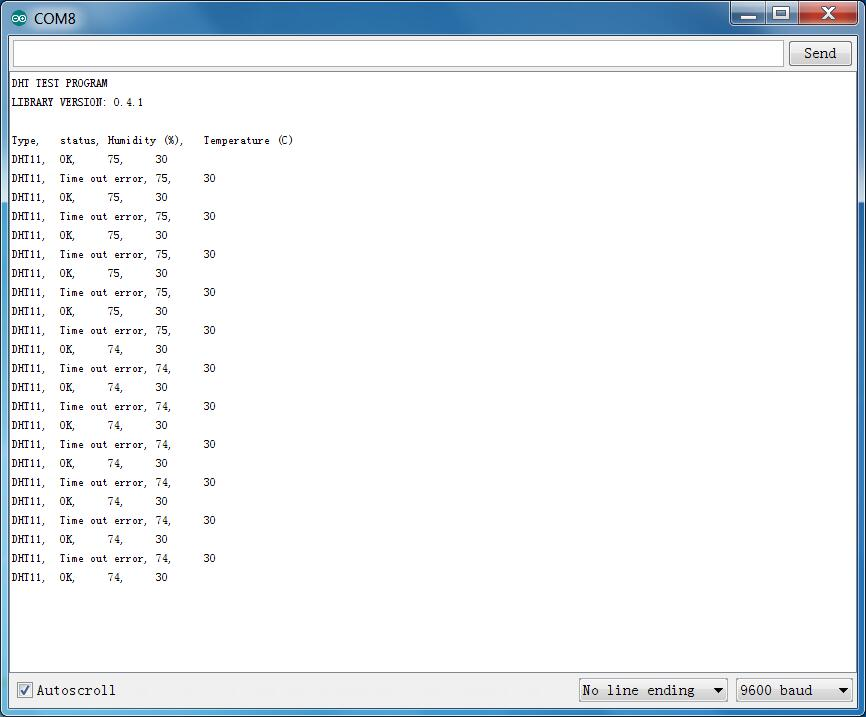

# Lesson 40: Temperature and Humidity Display

> **Kit:** Keyestudio 48-in-1 Sensor Kit  
> **Board:** Keyestudio V4.0 / Arduino Uno-compatible ATmega328P board



## Introduction

This DHT11 sensor features calibrated digital signal output with the temperature and humidity sensor complex. Its technology ensures high reliability and excellent long-term stability.

A high-performance 8-bit microcontroller is connected on the sensor. This sensor includes a resistive element and a sense of wet NTC temperature measuring devices.

It has advantages of excellent quality, fast response, anti-interference ability and high cost performance.

Each DHT11 sensor features extremely accurate calibration data of humidity calibration chamber. The calibration coefficients stored in the OTP program memory, internal sensors detect signals in the process, and we should call these calibration coefficients.

The single-wire serial interface system is integrated to make it quick and easy. Qualities of small size, low power, and 20-meter signal transmission distance make it a wide applied application or even the most demanding one.

## Specification

- Supply Voltage: +5 V

- Temperature range: 0-50 °C error of ± 2 °C

- Humidity: 20-90% RH ± 5% RH error

- Interface: Digital

## Connection Diagram

Firstly you need to prepare the following parts before testing.

- V4.0 Board\*1

- DHT11 sensor\*1

- USB Cable\*1

- Jumper Wire\*3

Then follow the wiring diagram, connect the Signal pin of sensor to Digital 4 port of V4.0 board, negative pin to GND port, positive pin to 5V port.



## Sample Code

Please download the [DHT11Lib](https://github.com/RobTillaart/Arduino/tree/master/libraries/DHTlib) firstly. Or [visit the website](http://playground.arduino.cc/Main/DHTLib)

Copy and paste the code below to Arduino software.

```c
#include <dht.h>

dht DHT;
#define DHT11_PIN 4

void setup() {
  Serial.begin(9600);
  Serial.println(F("DHT11 test"));
  Serial.print(F("DHTlib version: "));
  Serial.println(DHT_LIB_VERSION);
  Serial.println(F("Status,Humidity (%),Temperature (C)"));
}

void loop() {
  const int status = DHT.read11(DHT11_PIN);

  switch (status) {
    case DHTLIB_OK:
      Serial.print(F("OK, "));
      break;
    case DHTLIB_ERROR_CHECKSUM:
      Serial.print(F("Checksum error, "));
      break;
    case DHTLIB_ERROR_TIMEOUT:
      Serial.print(F("Timeout error, "));
      break;
    default:
      Serial.print(F("Unknown error, "));
      break;
  }

  Serial.print(DHT.humidity, 1);
  Serial.print(F(", "));
  Serial.println(DHT.temperature, 1);
  delay(2000);
}
```

## Example Result

Wire it up well and upload the above code to V4.0 board.



Then open the serial monitor and set the baud rate as 9600, finally you will see the current temperature and humidity value.



---
