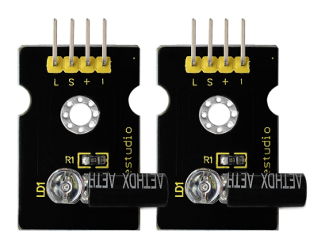
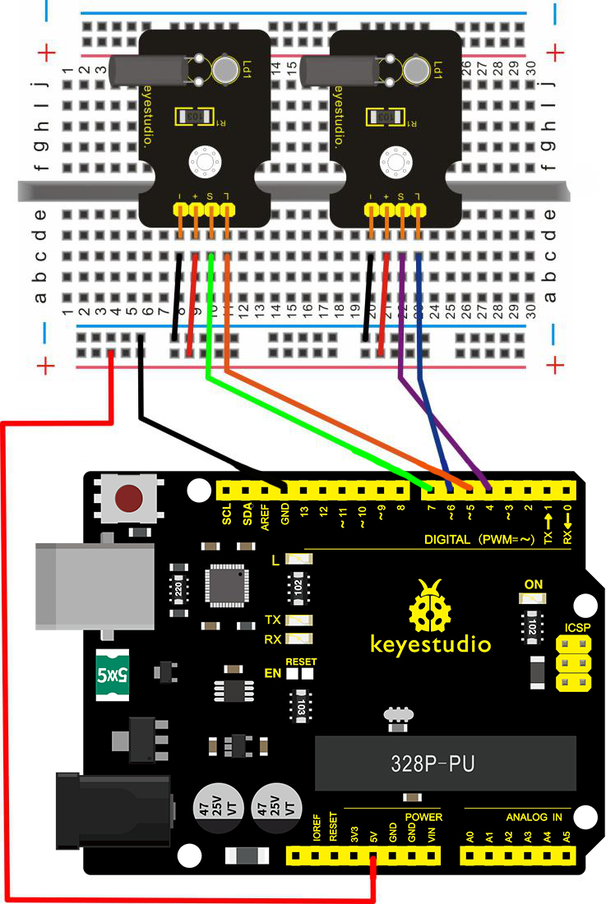
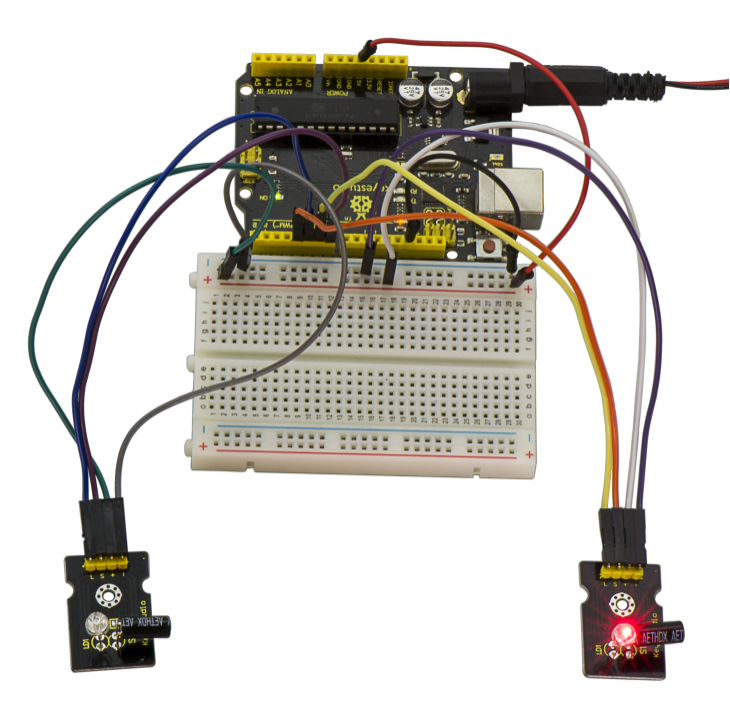
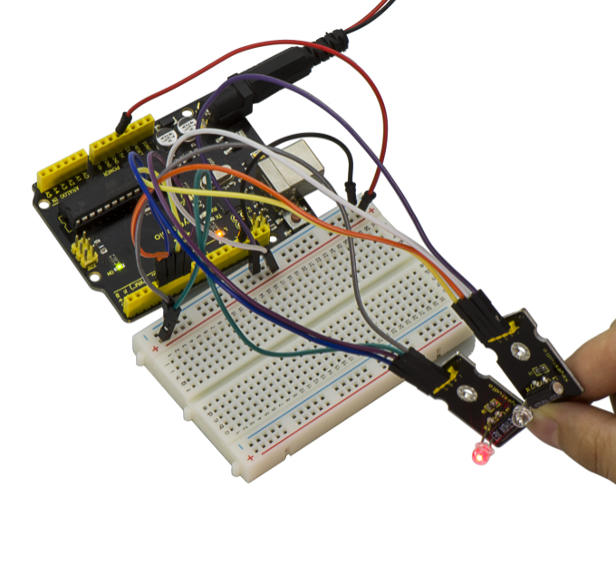

# Leçon 41: Gobelet lumineux magique

> **Kit:** Keyestudio 48-in-1 Sensor Kit  
> **Carte:** Keyestudio V4.0 / carte compatible Arduino Uno ATmega328P



## Introduction

Le module de gobelet lumineux magique peut interagir avec ARDUINO. Le principe est basé sur la gradation par PWM.

L'interrupteur à mercure sur le module peut fournir un signal numérique et déclencher la régulation PWM. La luminosité des deux modules sera modifiée simultanément via le programme, et vous verrez finalement l'effet où deux ensembles de gobelets « versent » la lumière.

## Spécification

- Tension d'alimentation: 3.3V à 5V

- Interface: Numérique

## Schéma de connexion



## Exemple de code

Copiez et collez le code ci-dessous dans le logiciel Arduino.

```c
///////////////////////////////////////////////////////////////
int LedPinA = 5;
int LedPinB = 6;
int ButtonPinA = 7;
int ButtonPinB = 4;
int buttonStateA = 0;
int buttonStateB = 0;
int brightnessA = 0;
int brightnessB= 255;
void setup()
{
Serial.begin(9600);
pinMode(LedPinA, OUTPUT);
pinMode(LedPinB, OUTPUT);

pinMode(ButtonPinA, INPUT);
pinMode(ButtonPinB, INPUT);
}
void loop()
{
buttonStateA = digitalRead(ButtonPinA);
if (buttonStateA == HIGH && brightnessA != 255)
{
brightnessA ++;
}
if (buttonStateA == LOW && brightnessA != 0)
{
brightnessA --;
}
analogWrite(LedPinB, brightnessA);
Serial.print(brightnessA);

Serial.print("   ");
buttonStateB = digitalRead(ButtonPinB);
if (buttonStateB == HIGH && brightnessB != 0)
{
brightnessB --;
}
if (buttonStateB == LOW && brightnessB != 255)
{
brightnessB++;
}
analogWrite(LedPinA, brightnessB);
Serial.println(brightnessB);
delay(5);
}
///////////////////////////////////////////////////////////////
```

## Exemple de résultat



Câblez comme dans le schéma ci‑dessus et téléversez correctement le code sur la carte ; vous verrez qu'un gobelet s'allume tandis que l'autre est éteint. Lorsque vous inclinez ces deux gobelets du même côté, l'un s'éclaire progressivement tandis que l'autre s'éteint progressivement.



---
