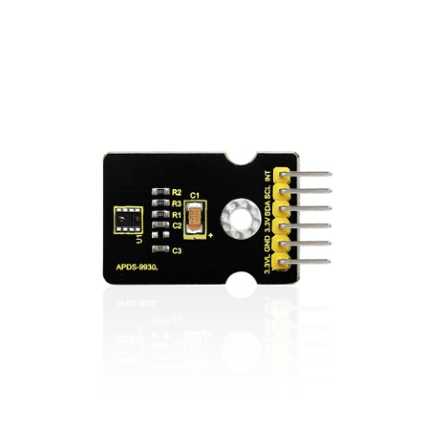
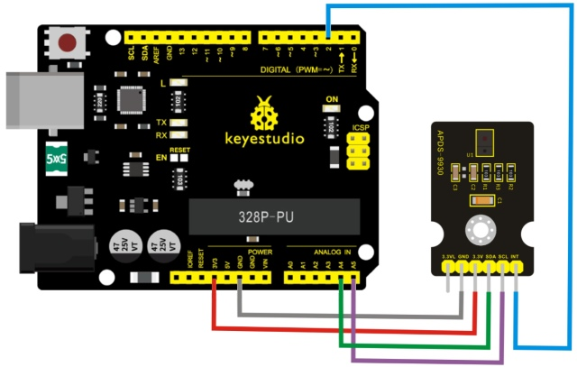
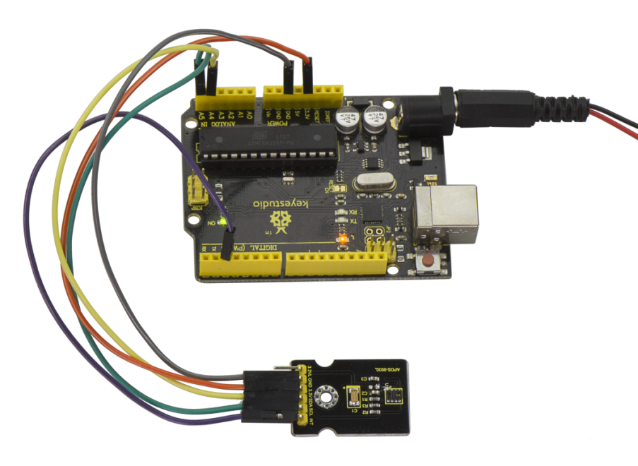
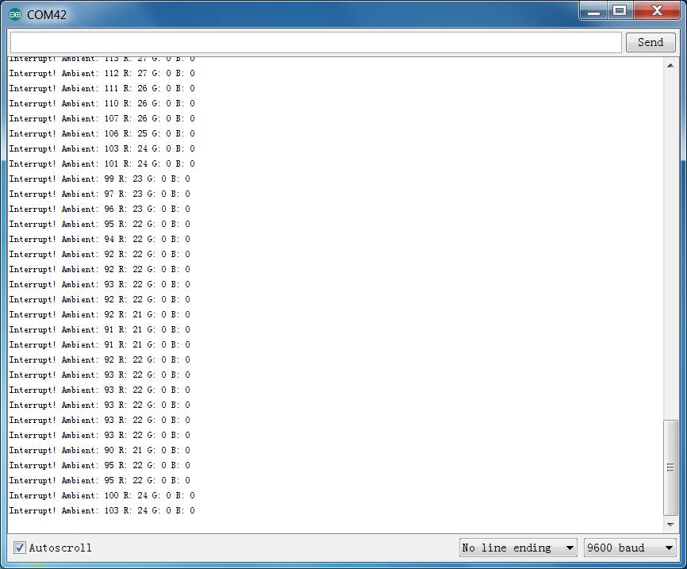

# Lesson 42: Attitude Sensor

> **Kit:** Keyestudio 48-in-1 Sensor Kit  
> **Board:** Keyestudio V4.0 / Arduino Uno-compatible ATmega328P board

| [← Previous lesson](lesson-41-magical-light-cup.md) | [Course index](../README.md) | [Next lesson →](lesson-43-optical-proximity-detection.md) |
| --- | --- | --- |



## Introduction

**Compatibility notice.** The component list labels this board as APDS-9930, but the following legacy example targets an APDS-9960 and uses `SparkFun_APDS9960`. Check the IC marking on the actual module before uploading this sketch; do not use this example with an APDS-9930 board. APDS-9930 in a single 8 pin package can provide the ambient light sensor which is compatible with I2C interface and infrared LED proximity sensor.

The proximity sensor which is completely adjusted can detect 100mm object, and exempt the factory calibration requirements of terminal equipment as well as sub-components.

From the bright sunlight to the dark room, proximity sensor’s proximity detection function can operate well.

This module added micro optical lens can provide infrared energy efficient transmission and reception, which can reduce the overall power consumption.

In addition, its internal state machine can make the device into a low power mode, bringing a very low average power consumption.

## Parameters

- Working Voltage：DC 3.3-3.8V

- Output Current：0-20mA

- Temperature Range：-40℃—85℃

## Features

1. Optical module integrated with ALS, infrared LED and proximity detector;

2. Up to 16-bit resolution;

3. High sensitivity of operation in the back of dark glass;

4. 0.01lux low lumen performance;

5. Proximity detection, fully calibrated to 100 mm detection;

6. Integrate infrared LED and synchronous LED driver;

7. Eliminate factory calibration for proximity sensors;

8. Programmable waiting timer, waiting state’s power consumption- 90μA (typical value);

9. Programmable range is from 2.7milliseconds to 8 seconds;

10. Compatible with I2C interface, up to 400kHz (I2C fast mode);

11. Dedicated interruption pin;

12. Sleep mode power - 2.2μA (typical value).

## Connection Diagram

Firstly you need to prepare the following parts:

- V4.0 Board\*1

- Attitude sensor\*1

- USB Cable\*1

- Jumper Wire\*5

Connect the INT pin of sensor to Digital 2 port of V4.0 board, SCL pin to Analog A5 port, SDA pin to Analog A4 port; Connect 3V3 pin to 3V3 port, GND pin to GND port.



## Sample Code

**IMPORTANT**: The APDS-9960 can only accept 3.3V!

## Hardware Connections

| Arduino Pin | APDS-9960 Board | Function  |
| :---------: | :-------------: | :-------: |
|    3.3V     |       VCC       |   Power   |
|     GND     |       GND       |  Ground   |
|     A4      |       SDA       | I2C Data  |
|     A5      |       SCL       | I2C Clock |
|     D2      |       INT       | Interrupt |
|     D13     |        -        |    LED    |

**Resources:** Include Wire.h and SparkFun_APDS-9960.h

**Development environment specifics**: Written in Arduino 1.0.5

Copy and paste the code below to Arduino software.

```c
#include <Wire.h>
#include <SparkFun_APDS9960.h>

// Pins
#define APDS9960_INT    2  // Needs to be an interrupt pin
#define LED_PIN         13 // LED for showing interrupt

// Constants
#define LIGHT_INT_HIGH  1000 // High light level for interrupt
#define LIGHT_INT_LOW   10   // Low light level for interrupt

// Global variables
SparkFun_APDS9960 apds = SparkFun_APDS9960();
uint16_t ambient_light = 0;
uint16_t red_light = 0;
uint16_t green_light = 0;
uint16_t blue_light = 0;
int isr_flag = 0;
uint16_t threshold = 0;

void setup() {
  // Set LED as output
  pinMode(LED_PIN, OUTPUT);
  pinMode(APDS9960_INT, INPUT);
  // Initialize Serial port
  Serial.begin(9600);
  Serial.println();
  Serial.println(F("-------------------------------------"));
  Serial.println(F("SparkFun APDS-9960 - Light Interrupts"));
  Serial.println(F("-------------------------------------"));
  // Initialize interrupt service routine
  attachInterrupt(0, interruptRoutine, FALLING);
  // Initialize APDS-9960 (configure I2C and initial values)
  if ( apds.init() ) {
    Serial.println(F("APDS-9960 initialization complete"));
  } else {
    Serial.println(F("Something went wrong during APDS-9960 init!"));
  }
  // Set high and low interrupt thresholds
  if ( !apds.setLightIntLowThreshold(LIGHT_INT_LOW) ) {
    Serial.println(F("Error writing low threshold"));
  }
  if ( !apds.setLightIntHighThreshold(LIGHT_INT_HIGH) ) {
    Serial.println(F("Error writing high threshold"));
  }
  // Start running the APDS-9960 light sensor (no interrupts)
  if ( apds.enableLightSensor(false) ) {
    Serial.println(F("Light sensor is now running"));
  } else {
    Serial.println(F("Something went wrong during light sensor init!"));
  }
  // Read high and low interrupt thresholds
  if ( !apds.getLightIntLowThreshold(threshold) ) {
    Serial.println(F("Error reading low threshold"));
  } else {
    Serial.print(F("Low Threshold: "));
    Serial.println(threshold);
  }
  if ( !apds.getLightIntHighThreshold(threshold) ) {
    Serial.println(F("Error reading high threshold"));
  } else {
    Serial.print(F("High Threshold: "));
    Serial.println(threshold);
  }
  // Enable interrupts
  if ( !apds.setAmbientLightIntEnable(1) ) {
    Serial.println(F("Error enabling interrupts"));
  }
  // Wait for initialization and calibration to finish
  delay(500);
}
void loop() {
  // If interrupt occurs, print out the light levels
  if ( isr_flag == 1 ) {

    // Read the light levels (ambient, red, green, blue) and print
    if (  !apds.readAmbientLight(ambient_light) ||
          !apds.readRedLight(red_light) ||
          !apds.readGreenLight(green_light) ||
          !apds.readBlueLight(blue_light) ) {
      Serial.println("Error reading light values");
    } else {
      Serial.print("Interrupt! Ambient: ");
      Serial.print(ambient_light);
      Serial.print(" R: ");
      Serial.print(red_light);
      Serial.print(" G: ");
      Serial.print(green_light);
      Serial.print(" B: ");
      Serial.println(blue_light);
    }
    // Turn on LED for a half a second
    digitalWrite(LED_PIN, HIGH);
    delay(500);
    digitalWrite(LED_PIN, LOW);

    // Reset flag and clear APDS-9960 interrupt (IMPORTANT!)
    isr_flag = 0;
    if ( !apds.clearAmbientLightInt() ) {
      Serial.println("Error clearing interrupt");
    }
  }
}
void interruptRoutine() {
  isr_flag = 1;
}
```

Note: before compiling the code, do remember to place the library into libraries directory of Arduino IDE. Otherwise, compiling will fail.

## Example Result



After uploading the code, open the serial monitor and set the baud rate to 9600.



---

| [← Previous lesson](lesson-41-magical-light-cup.md) | [Course index](../README.md) | [Next lesson →](lesson-43-optical-proximity-detection.md) |
| --- | --- | --- |
