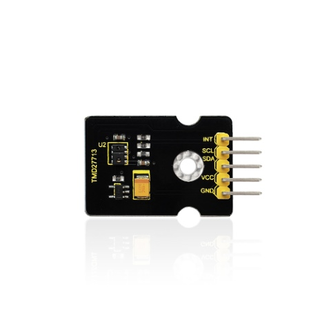
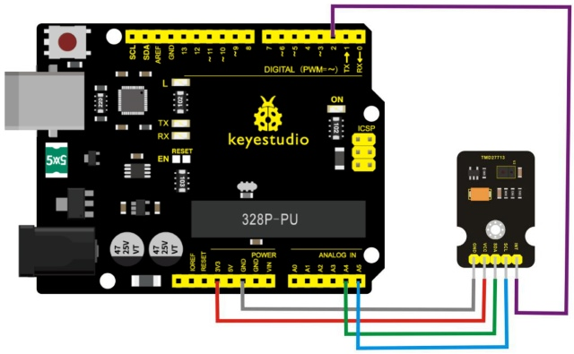
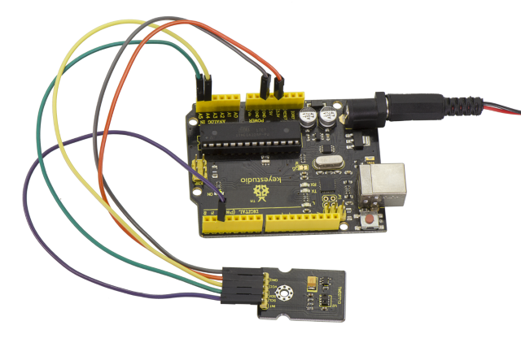
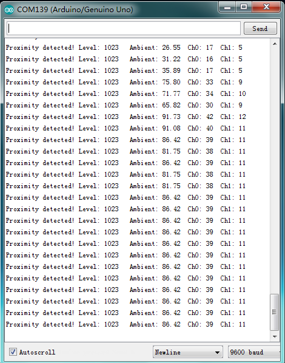

# Leçon 43 : Détection de proximité optique

> **Kit :** Keyestudio 48-en-1 Kit de capteurs  
> **Carte :** Keyestudio V4.0 / carte compatible Arduino Uno ATmega328P



## Introduction

**Avis de compatibilité.** Le texte d'origine identifie ce module comme TMD27713, tandis que le sketch ci‑dessous cible APDS-9930. Confirmez le marquage du CI et utilisez une bibliothèque correspondante avant de téléverser.

C'est un capteur triple intégrant un capteur de lumière ambiante, un capteur de proximité et une LED infrarouge.

D'une part, il sert à détecter la luminosité ambiante actuelle (ALS). Il peut, en fonction de la luminosité ambiante, ajuster automatiquement la luminosité du rétroéclairage par le biais d'un réglage logiciel. Cette méthode permet d'adoucir la luminosité du rétroéclairage pour protéger la vue et d'obtenir un effet d'économie d'énergie.

D'autre part, nous parlons ici de la fonction capteur de proximité (PROX). Le capteur intègre un émetteur/récepteur et réduit la taille du design ; de plus, le design et l'installation n'ont plus de fortes contraintes d'espace, et la structure est relativement simple.

## Paramètres

- Tension de fonctionnement：DC 3.3V

- Distance de détection：100mm

- Mode de communication：Communication IIC

- Plage de température：-30℃ to 85℃

## Schéma de connexion

Tout d'abord, vous devez préparer les pièces suivantes :

- Carte V4.0\*1

- Capteur TMD27713\*1

- Câble USB\*1

- Fils de connexion\*5

Connectez la broche INT du capteur au port numérique 2 de la carte V4.0, la broche SCL au port analogique A5, la broche SDA au port analogique A4 ; connectez la broche VCC au port 3V3 et la broche GND au port GND.



## Exemple de code

Teste les capacités d'interruption de proximité de l'APDS-9930.

Configure l'APDS-9930 via I2C et attend une interruption externe basée sur des conditions de proximité hautes ou basses. Approchez la main du capteur et regardez la LED sur la broche 13.

## Connexions matérielles

**IMPORTANT** : L'APDS-9930 n'accepte que du 3.3V !

| Broche Arduino | Carte APDS-9930 | Fonction  |
| :-------------: | :-------------: | :-------: |
|    3.3V     |       VCC       | Alimentation   |
|     GND     |       GND       |  Masse   |
|     A4      |       SDA       | Données I2C  |
|     A5      |       SCL       | Horloge I2C |
|      2      |       INT       | Interruption |
|     13      |        -        |    LED    |

**Ressources** : Inclure Wire.h et APDS9930.h

**Spécificités de l'environnement de développement** : Écrit sous Arduino 1.0.5

Copiez et collez le code ci‑dessous dans le logiciel Arduino.

```c
#include <Wire.h>
#include <APDS9930.h>

// Pins
#define APDS9930_INT    2  // Needs to be an interrupt pin
#define LED_PIN         13 // LED for showing interrupt

// Constants
#define PROX_INT_HIGH   600 // Proximity level for interrupt
#define PROX_INT_LOW    0  // No far interrupt

// Global variables
APDS9930 apds = APDS9930();
float ambient_light = 0; // can also be an unsigned long
uint16_t ch0 = 0;
uint16_t ch1 = 1;
uint16_t proximity_data = 0;
volatile bool isr_flag = false;

void setup() {

  // Set LED as output
  pinMode(LED_PIN, OUTPUT);
  pinMode(APDS9930_INT, INPUT);

  // Initialize Serial port
  Serial.begin(9600);
  Serial.println();
  Serial.println(F("------------------------------"));
  Serial.println(F("APDS-9930 - ProximityInterrupt"));
  Serial.println(F("------------------------------"));

  // Initialize interrupt service routine
  attachInterrupt(digitalPinToInterrupt(APDS9930_INT), interruptRoutine, FALLING);

  // Initialize APDS-9930 (configure I2C and initial values)
  if (apds.init()) {
    Serial.println(F("APDS-9930 initialization complete"));
  }
  else {
    Serial.println(F("Something went wrong during APDS-9930 init!"));
  }

  // Adjust the Proximity sensor gain
  if (!apds.setProximityGain(PGAIN_2X)) {
    Serial.println(F("Something went wrong trying to set PGAIN"));
  }

  // Set proximity interrupt thresholds
  if (!apds.setProximityIntLowThreshold(PROX_INT_LOW)) {
    Serial.println(F("Error writing low threshold"));
  }
  if (!apds.setProximityIntHighThreshold(PROX_INT_HIGH)) {
    Serial.println(F("Error writing high threshold"));
  }

  // Start running the APDS-9930 proximity sensor (interrupts)
  if (apds.enableProximitySensor(true)) {
    Serial.println(F("Proximity sensor is now running"));
  }
  else {
    Serial.println(F("Something went wrong during sensor init!"));
  }

  // Start running the APDS-9930 light sensor (no interrupts)
  if (apds.enableLightSensor(false)) {
    Serial.println(F("Light sensor is now running"));
  }
  else {
    Serial.println(F("Something went wrong during light sensor init!"));
  }

#ifdef DUMP_REGS
  /* Register dump */
  uint8_t reg;
  uint8_t val;

  for (reg = 0x00; reg <= 0x19; reg++) {
    if ((reg != 0x10) && \
      (reg != 0x11))
    {
      apds.wireReadDataByte(reg, val);
      Serial.print(reg, HEX);
      Serial.print(": 0x");
      Serial.println(val, HEX);
    }
  }
  apds.wireReadDataByte(0x1E, val);
  Serial.print(0x1E, HEX);
  Serial.print(": 0x");
  Serial.println(val, HEX);
#endif

}

void loop() {

  // If interrupt occurs, print out the proximity level
  if (isr_flag) {

    // Read proximity level and print it out
    if (!apds.readProximity(proximity_data)) {
      Serial.println("Error reading proximity value");
    }
    else {
      Serial.print("Proximity detected! Level: ");
      Serial.print(proximity_data);
      Serial.print("   ");
    }
    apds.readAmbientLightLux(ambient_light);
    // Read the light levels (ambient, red, green, blue)
    if (!apds.readAmbientLightLux(ambient_light) ||
      !apds.readCh0Light(ch0) ||
      !apds.readCh1Light(ch1)) {
      Serial.println(F("Error reading light values"));
    }
    else {
      Serial.print(F("Ambient: "));
      Serial.print(ambient_light);
      Serial.print(F("  Ch0: "));
      Serial.print(ch0);
      Serial.print(F("  Ch1: "));
      Serial.println(ch1);
    }

    // Turn on LED for a half a second
    digitalWrite(LED_PIN, HIGH);
    delay(300);
    digitalWrite(LED_PIN, LOW);

    // Reset flag and clear APDS-9930 interrupt (IMPORTANT!)
    isr_flag = false;
    if (!apds.clearProximityInt()) {
      Serial.println("Error clearing interrupt");
    }

  }
}

void interruptRoutine() {
  isr_flag = true;
}
```

Remarque : avant de compiler le code, n'oubliez pas de placer la bibliothèque dans le répertoire libraries de l'IDE Arduino. Sinon, la compilation échouera.

## Exemple de résultat



Testé avec Arduino-1.8.2. Ensuite, ouvrez le moniteur série : vous pouvez voir les données comme montré sur l'image ci‑dessous.



---
