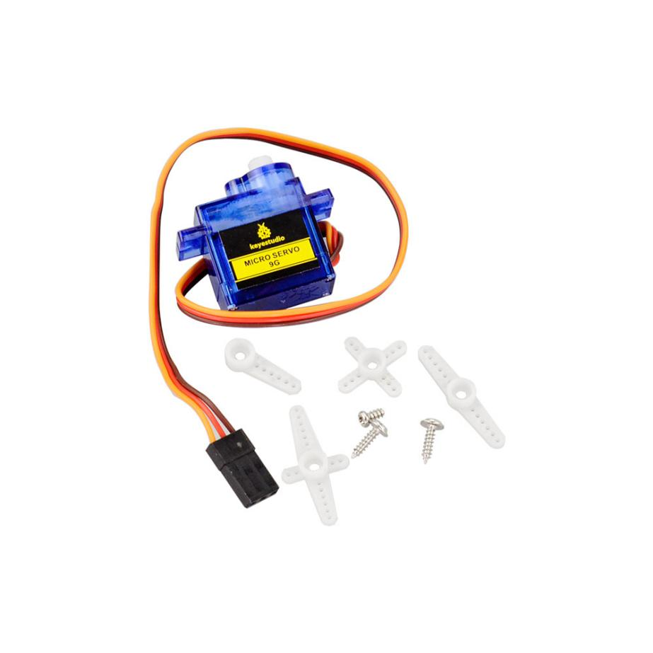
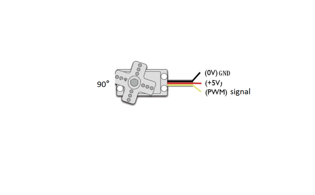
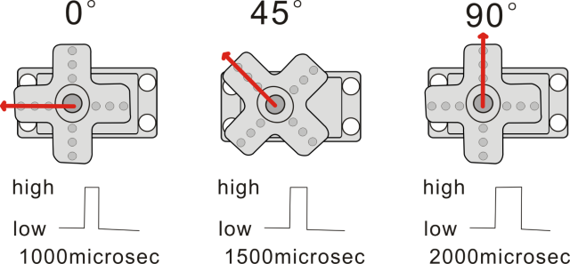
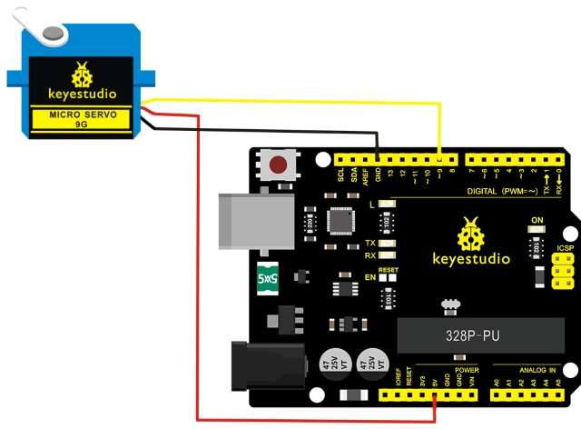
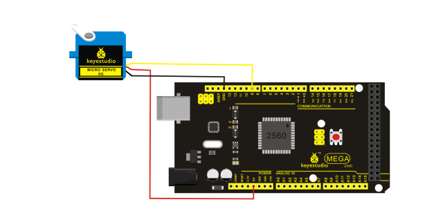
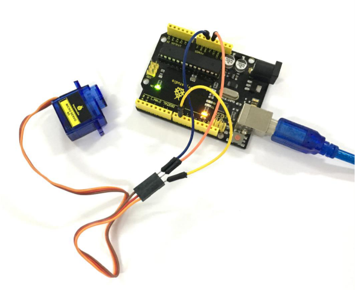
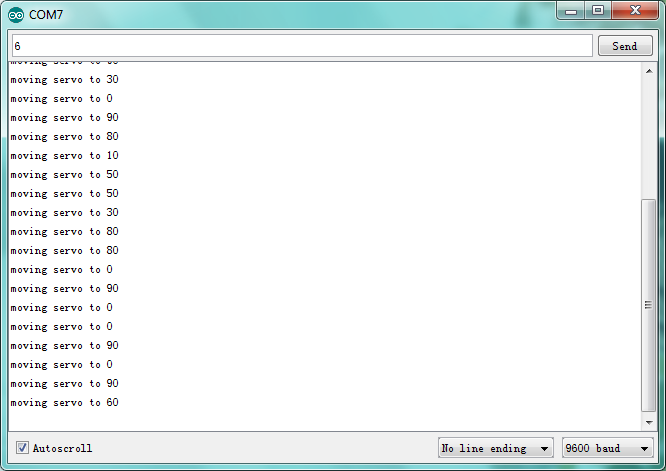

# Lección 45: Micro Servo

> **Kit:** Keyestudio Kit de sensores 48 en 1  
> **Placa:** Keyestudio V4.0 / placa compatible Arduino Uno ATmega328P



## Introducción

El servomotor es un actuador giratorio de control de posición. Principalmente consta de carcasa, placa de circuito, motor sin núcleo, engranaje y sensor de posición.

Incluido con su servomotor encontrará una variedad de soportes blancos que se conectan al eje de su servo. Puede elegir colocar cualquier soporte que desee para el circuito. Servirá como ayuda visual, facilitando ver la rotación del servo.

El servo tiene tres conexiones, distinguidas por líneas marrón, roja y naranja (según la marca pueden variar los colores). La línea marrón es GND, la roja es alimentación 5V, la naranja es el terminal de señal (señal PWM).



El ángulo de rotación del servo se controla regulando el ciclo de trabajo de la señal PWM (Modulación por Ancho de Pulso). El ciclo estándar de la señal PWM está fijado en 20 ms (50 Hz), y el ancho de pulso se distribuye entre 1 ms y 2 ms. El ancho de pulso corresponde al ángulo de rotación (0°～90°) del servo.



A continuación, aprendamos cómo controlar un servomotor.

En este experimento, solo necesita un servomotor y varios cables jumper.

## Diagrama de Conexión

Conexión para V4.0 :



Conexión para 2560 R3:



Conecte el motor al pin digital 9.

Compile un programa para controlar que el motor gire al ángulo solicitado y muestre el ángulo en la pantalla.

## Programa de ejemplo

Hay dos formas de controlar un servomotor con Arduino.

Una es usar un puerto digital común del Arduino para producir una onda cuadrada con distinto ciclo de trabajo para simular la señal PWM y usar esa señal para controlar la posición del motor.

Otra forma es usar directamente la función Servo del Arduino para controlar el motor.

De esta manera, el programa será más sencillo pero solo puede controlar motores de dos contactos para la función servo; solo se pueden usar los pines digitales 9 y 10. La capacidad de conducción del Arduino es limitada. Por lo tanto, si necesita controlar más de un motor, necesitará alimentación externa.

## Método 1

## Programa de ejemplo A

```c
//////////////////////////////////////////////////////////
int servopin=9;// select digital pin 9 for servomotor signal line
int myangle;// initialize angle variable
int pulsewidth;// initialize width variable
int val;
void servopulse(int servopin,int myangle)// define a servo pulse function
{
pulsewidth=(myangle*11)+500;// convert angle to 500-2480 pulse width
digitalWrite(servopin,HIGH);// set the level of servo pin as “high”
delayMicroseconds(pulsewidth);// delay microsecond of pulse width
digitalWrite(servopin,LOW);// set the level of servo pin as “low”
delay(20-pulsewidth/1000);
}
void setup()
{
pinMode(servopin, OUTPUT);
Serial.begin(9600);
Serial.println("servo=o_seral_simple ready" ) ;
}
void loop()// convert number 0 to 9 to corresponding 0-180 degree angle, LED blinks corresponding number of time
{
val=Serial.read();// read serial port value
if(val>='0'&&val<='9')
{
val=val-'0';// convert characteristic quantity to numerical variable
val=val*(180/9);// convert number to angle
Serial.print("moving servo to ");
Serial.print(val,DEC);
Serial.println();
for(int i=0;i<=50;i++) // giving the servo time to rotate to commanded position
{
servopulse(servopin,val);// use the pulse function
}
}
}
//////////////////////////////////////////////////////////
```

## Método 2

Veamos primero la función servo incorporada de Arduino y algunas sentencias comunes.

1\. **attach（interfaz）** —— selecciona el pin para el servo; solo se pueden usar los pines 9 o 10.

2\. **write（angle）** —— se usa para controlar el ángulo de rotación del servo; puede establecerse entre 0° y 180°.

3\. **read（）** —— se utiliza para leer el ángulo del servo; considérelo como una función para leer el valor establecido por write().

4\. **attached（）** —— determina si el parámetro del servo está asignado al pin del servo.

5\. **detach（）** —— desconecta el servo y el pin, y el pin (pin digital 9 o 10) puede usarse como puerto PWM.

**Nota:** la forma escrita de las sentencias anteriores es "nombre_variable_servo.sentencia_especifica()", p. ej. myservo.attach(9).

Aún así, conecte el servo al pin 9.

## Programa de ejemplo B

```c
#include <Servo.h>// define a header file. Special attention here, you can call the servo function directly from Arduino's software menu

Servo myservo;// define servo variable name
void setup()
{
myservo.attach(9);// select servo pin(9 or 10)
}
void loop()
{
myservo.write(90);// set rotating angle of the motor
}
```

## Resultado de ejemplo



Conéctelo correctamente, suba el Programa A a la placa, luego abra el monitor serie del software de Arduino, ajuste la velocidad de transmisión a 9600 baudios, y en la barra superior introduzca un número y haga clic en “Enviar”; verá que el servo gira al ángulo correspondiente y el ángulo se mostrará en el monitor. Se muestra a continuación.

Al alimentar y subir correctamente el Programa B a la placa, el primer servo girará al ángulo de 90 grados.



---
