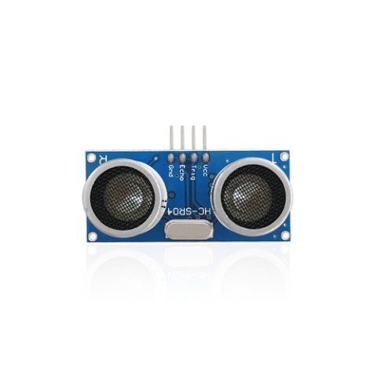
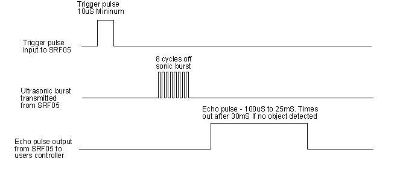
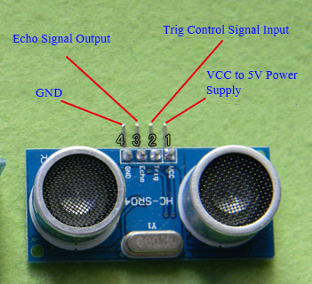
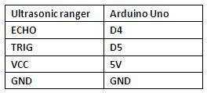
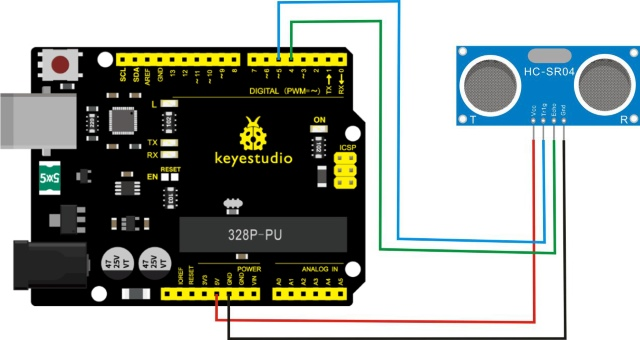
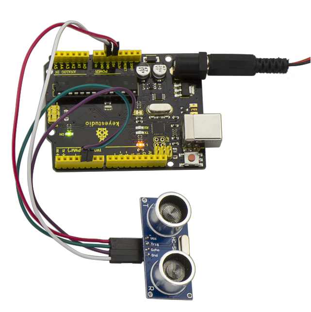
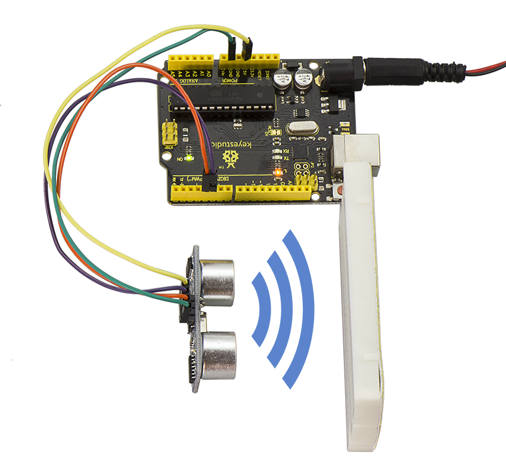
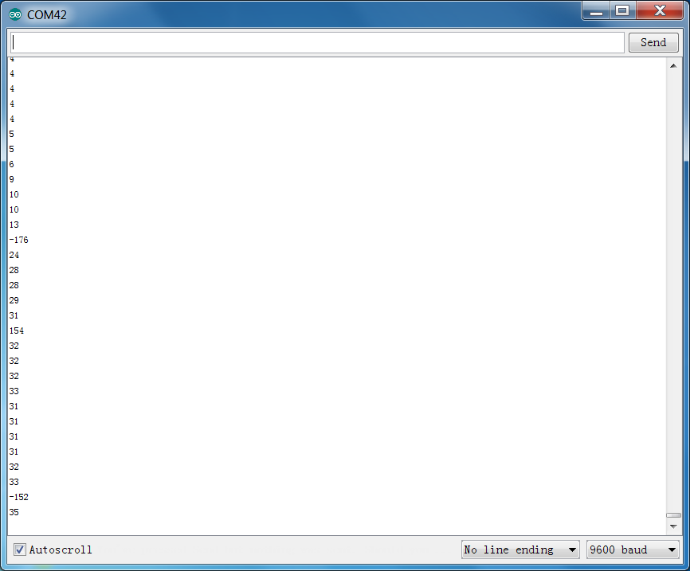

# Lesson 46: Ultrasonic Ranger

> **Kit:** Keyestudio 48-in-1 Sensor Kit  
> **Board:** Keyestudio V4.0 / Arduino Uno-compatible ATmega328P board

| [← Previous lesson](lesson-45-micro-servo.md) | [Course index](../README.md) | [Next lesson →](lesson-47-lcd-display.md) |
| --- | --- | --- |



## Description

As the ultrasonic has strong directivity, slow energy consumption and far spread distance in the media, so it is commonly used in the measurement of distance, such as range finder and position measuring instrument.

Ultrasonic detector module can provide 2cm-450cm non-contact sensing distance, and its ranging accuracy is up to 3mm, very good to meet the normal requirements.

The module includes an ultrasonic transmitter and receiver as well as the corresponding control circuit.

## Working Schematics

The HC-SR04 measurement sequence is shown below:



1\. First pull down the TRIG, and then trigger it with at least 10us high level signal;

2\. After triggering, the module will automatically transmit eight 40KHZ square waves, and automatically detect whether there is a signal to return.

3\. If there is a signal returned back, through the ECHO to output a high level, the duration time of high level is actually the time from emission to reception of ultrasonic.
$$
Test Distance = High Level Duration * 340m/s * 0.5
$$

## Parameters

- Working voltage: 5 V DC

- Working current：15mA

- Detecting range：2-450cm

- Detecting angle：15 degrees

- Input trigger pulse：10us TTL Level

- Output echo signal： output TTL level signal(HIGH)，proportional to range.

## Pinout Diagram



## Connection Diagram

First, you need to prepare the following components:

- V4.0 board\*1

- Ultrasonic sensor\*1

- USB Cable\*1

- Jumper wire\*4

Next, please refer to the following connection table:



Note: D4、D5 are the digital pin 4 and pin 5.

You can refer to the connection diagram shown below:



After connecting well, you can use it to measure the distance, displaying the distance value on the monitor.

## Test Code

Copy and paste the test code below to Arduino software

```c
///////////////////////////////////////////////////////////////////////////////
int inputPin=4; // define ultrasonic signal receiver pin ECHO to D4
int outputPin=5; // define ultrasonic signal transmitter pin TRIG to D5
 void setup()
{
Serial.begin(9600);
pinMode(inputPin, INPUT);
pinMode(outputPin, OUTPUT);

}
void loop()
{
digitalWrite(outputPin, LOW); delayMicroseconds(2);
digitalWrite(outputPin, HIGH); // Pulse for 10μ s to trigger ultrasonic detection
delayMicroseconds(10);
digitalWrite(outputPin, LOW);
int distance = pulseIn(inputPin, HIGH); // Read receiver pulse time
distance= distance/58; // Transform pulse time to distance
Serial.println(distance); //Output distance
delay(50);
}
///////////////////////////////////////////////////////////////////////////////
```

## Example Result



After upload well the code to V4.0 board, then open the serial monitor. When place an object in front of the ultrasonic sensor (from near and far), it will detect the distance of object. The value will be displayed on the monitor shown below.





---

| [← Previous lesson](lesson-45-micro-servo.md) | [Course index](../README.md) | [Next lesson →](lesson-47-lcd-display.md) |
| --- | --- | --- |
