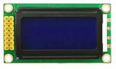
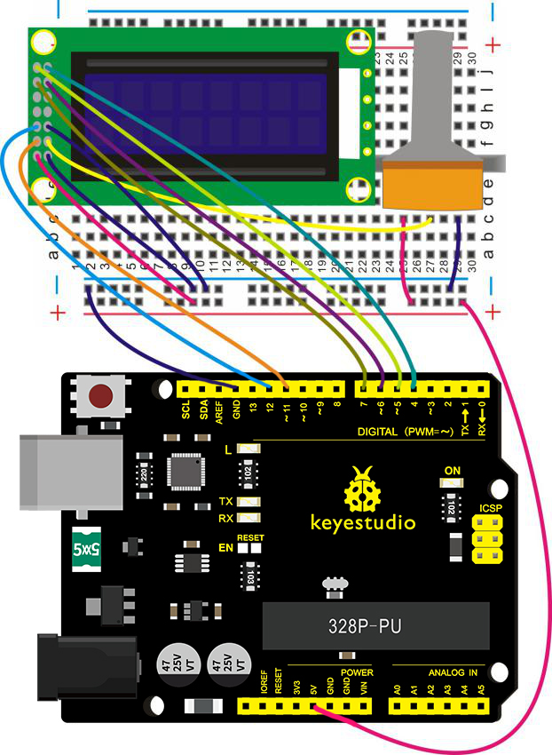
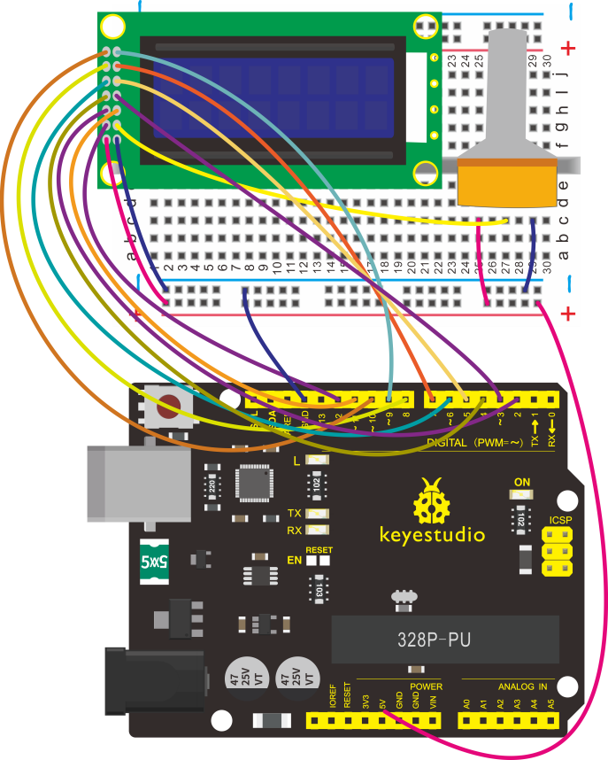
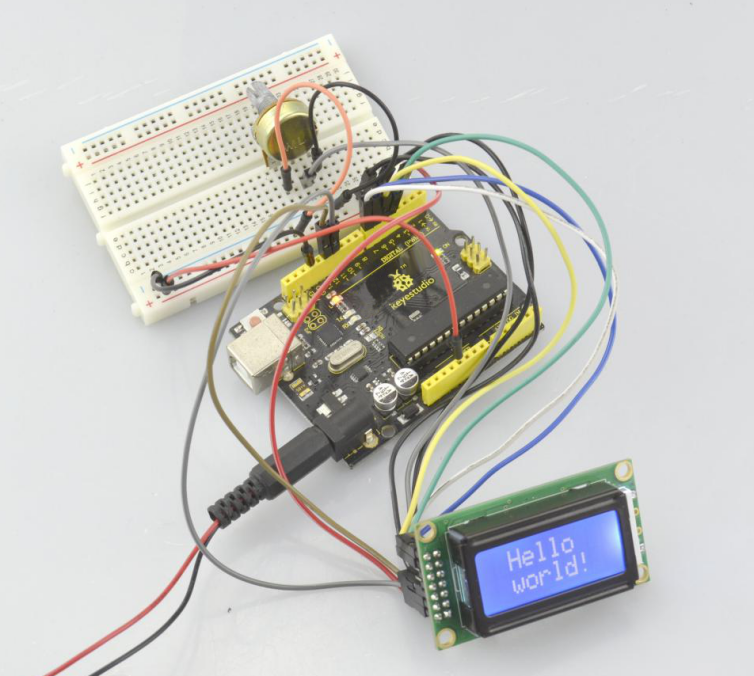
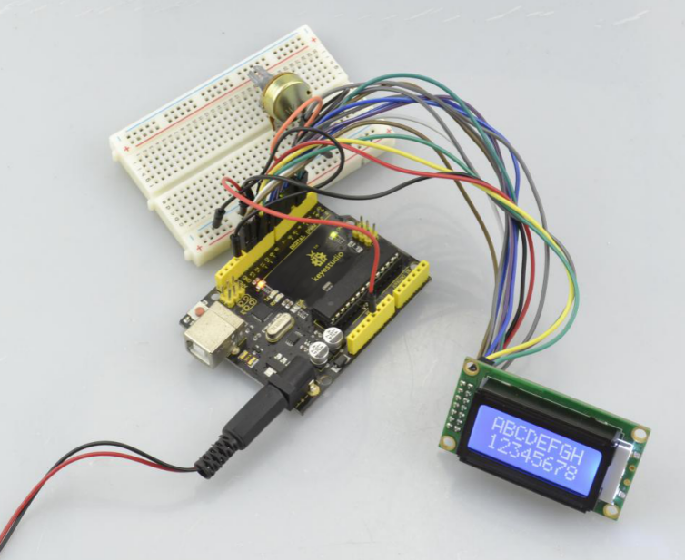

# Leçon 47 : Afficheur LCD

> **Kit :** Keyestudio 48-in-1 Sensor Kit  
> **Carte :** Keyestudio V4.0 / carte compatible Arduino Uno ATmega328P



## Description

Dans ce projet, nous allons piloter cet écran LCD 0802 pour afficher du texte avec la carte V4.0.

La capacité d'affichage du LCD est de 8x2 caractères, et la tension de fonctionnement de la puce est de 4,5～5,5V.

Il existe deux méthodes de connexion pour afficher du texte sur l'écran 0802 : connexion 4 bits et connexion 8 bits.

Vous pouvez vous référer aux explications ci‑dessous.

## Explication des interfaces

| **Interface** | **Broche** | **Explication**                                              |
| :-----------: | :-----: | ------------------------------------------------------------ |
|       1       |   VSS   | Masse d'alimentation logique                                  |
|       2       |   VDD   | Alimentation logique                                           |
|       3       |   V0    | Tension réglable du LCD, à connecter au point milieu du potentiomètre 10K |
|       4       |   RS    | Données\\ Option de commande                                  |
|       5       |   RW    | Lecture\\Écriture (option)                                    |
|       6       |    E    | Active la lecture\\écriture, actif à HIGH, le front descendant verrouille les données |
|       7       |   DB0   | Broche d'entrée/sortie de données                             |
|       8       |   DB1   | Broche d'entrée/sortie de données                             |
|       9       |   DB2   | Broche d'entrée/sortie de données                             |
|      10       |   DB3   | Broche d'entrée/sortie de données                             |
|      11       |   DB4   | Broche d'entrée/sortie de données                             |
|      12       |   DB5   | Broche d'entrée/sortie de données                             |
|      13       |   DB6   | Broche d'entrée/sortie de données                             |
|      14       |   DB7   | Broche d'entrée/sortie de données                             |
|      15       |  LED-A  | borne positive de l'alimentation du rétroéclairage            |
|      16       |  LED-K  | borne négative de l'alimentation du rétroéclairage            |

## Matériel requis

Vous devez d'abord préparer les composants suivants :

- Carte V4.0 × 1
- LCD 0802 × 1
- Potentiomètre rotatif × 1
- Plaque d'essai (breadboard) × 1
- Câble USB × 1
- Fils de connexion (jumpers), selon besoin
- Fils Dupont, selon besoin

## Schéma de connexion

## Connexion 4 bits



## Connexion 8 bits



## Code source

## Pour la connexion 4 bits

```C
//////////////////////////////////////////////////////////
#include <LiquidCrystal.h>
// initialize the library with the numbers of the interface pins
LiquidCrystal lcd(11, 12, 6, 7, 4, 5);

void setup() {
  // set up the LCD's number of columns and rows:
  lcd.begin(8, 2);
  // Print a message to the LCD.
  lcd.setCursor(0, 0);
  lcd.print(" Hello");
  lcd.setCursor(0, 1);
  lcd.print(" world!");
}

void loop() {
}
//////////////////////////////////////////////////////////
```

## Pour la connexion 8 bits

```C
#include <LiquidCrystal.h>

// RS, RW, Enable, D0, D1, D2, D3, D4, D5, D6, D7
LiquidCrystal lcd(12, 11, 2, 3, 4, 5, 6, 7, 8, 9, 10);

void setup() {
  lcd.begin(8, 2);
  lcd.clear();
  lcd.setCursor(0, 0);
  lcd.print("ABCDEFGH");
  lcd.setCursor(0, 1);
  lcd.print("12345678");
}

void loop() {
  // The 8-bit display remains static after setup.
}
```

## Exemple de résultat

Une fois le câblage effectué et l'alimentation mise, téléversez le code ci‑dessus sur la carte, réglez le rétroéclairage du LCD en tournant le potentiomètre ; vous verrez finalement les caractères s'afficher sur l'écran LCD.

Si vous utilisez la connexion 4 bits, vous devriez voir le LCD afficher "Bonjour" sur la première ligne, et "monde !" sur la seconde, comme indiqué ci‑dessous.



Si vous utilisez la connexion 8 bits, d'autres caractères s'afficheront sur le LCD, comme montré ci‑dessous.



---
