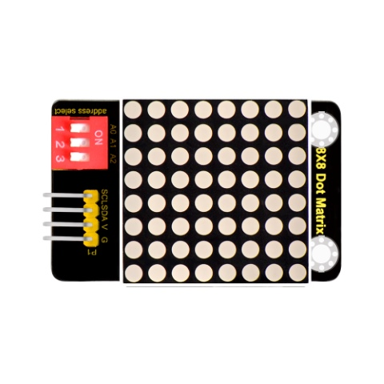
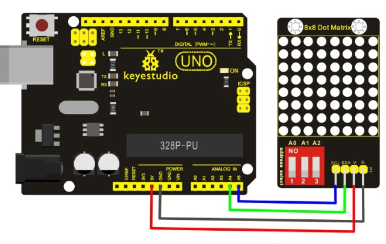
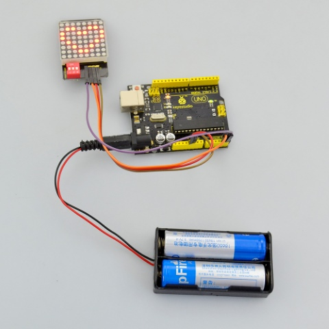
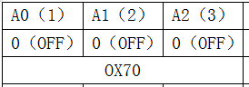
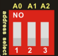
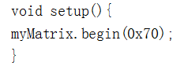
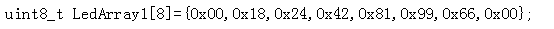
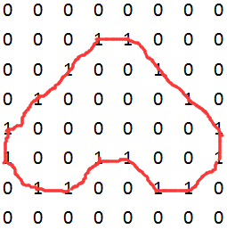

# レッスン48：ドットマトリクス

> **キット：** Keyestudio 48-in-1 Sensor Kit  
> **ボード：** Keyestudio V4.0 / Arduino Uno互換 ATmega328P ボード



## はじめに

単一のLEDより良いものは何でしょう？たくさんのLEDです！小さなディスプレイを作る楽しい方法のひとつが8x8マトリクスの使用です。このモジュールはHT16K33チップを使用して8x8ドットマトリクスを駆動します。

マイコンのI2C通信ポートを使ってドットマトリクスを制御するだけで済むため、マイコンのポート資源を節約できます。マトリクスモジュールはピンピッチ2.54mmの4ピンヘッダを備えています。

ジャンパー線でモジュールを制御ボードに接続して通信できます。

また、3つのDIPスイッチが付属しており、スイッチを切り替えてI2C通信アドレスを選択できます。

## アドレス設定は下図のようになります

|   0x70   |          |          |      |   0x71   |          |          |      |   0x72   |          |          |
| :------: | :------: | :------: | ---- | :------: | :------: | :------: | ---- | :------: | :------: | :------: |
| A0（1）  | A1（2）  | A2（3）  |      | A0（1）  | A1（2）  | A2（3）  |      | A0（1）  | A1（2）  | A2（3）  |
| 0（OFF） | 0（OFF） | 0（OFF） |      | 1（ON）  | 0（OFF） | 0（OFF） |      | 0（OFF） | 1（ON）  | 0（OFF） |
|          |          |          |      |          |          |          |      |          |          |          |
| **0x73** |          |          |      | **0x74** |          |          |      | **0x75** |          |          |
| A0（1）  | A1（2）  | A2（3）  |      | A0（1）  | A1（2）  | A2（3）  |      | A0（1）  | A1（2）  | A2（3）  |
| 1（ON）  | 1（ON）  | 0（OFF） |      | 0（OFF） | 0（OFF） | 1（ON）  |      | 1（ON）  | 0（OFF） | 1（ON）  |
|          |          |          |      |          |          |          |      |          |          |          |
| **0x76** |          |          |      | **0x77** |          |          |      |          |          |          |
| A0（1）  | A1（2）  | A2（3）  |      | A0（1）  | A1（2）  | A2（3）  |      |          |          |          |
| 0（OFF） | 1（ON）  | 1（ON）  |      | 1（ON）  | 1（ON）  | 1（ON）  |      |          |          |          |

## 技術仕様

- インターフェース：4ピンヘッダ

- 動作電圧：DC 4.5V-5.5V

- アドレス選択用の3つのDIPスイッチ付き

- 寸法：52mm\*34mm\*11mm

- 重量：13.2g

## 接続ガイド

SCLピンをAnalog A5ポートに、SDAピンをAnalog A4ポートに接続します；VCCピンを5Vポートに、GNDピンをGNDポートに接続します。



## テスト用コード

ライブラリをダウンロード：

```C
#include <Wire.h>
#include "Adafruit_LEDBackpack.h"
#include "Adafruit_GFX.h"
#ifndef _BV
#define _BV(bit) (1<<(bit))
#endif
Adafruit_LEDBackpack matrix = Adafruit_LEDBackpack();
uint8_t counter = 0;
void setup() {
  Serial.begin(9600);
  Serial.println("HT16K33 test");
  matrix.begin(0x70);  // pass in the address
}
void loop() {
  // paint one LED per row. The HT16K33 internal memory looks like
  // a 8x16 bit matrix (8 rows, 16 columns)
  for (uint8_t i=0; i<8; i++) {
// draw a diagonal row of pixels

    matrix.displaybuffer[i] = _BV((counter+i) % 16) | _BV((counter+i+8) % 16)  ;
  }
  // write the changes we just made to the display
  matrix.writeDisplay();
  delay(100);
 counter++;
  if (counter >= 16) counter = 0;
}
```

注意：コンパイルする前に、Matrixライブラリのフォルダをディレクトリ \\Arduino\\libraries に配置することを忘れないでください。そうしないと、コードのコンパイルに失敗します。

例えば： **C:\\Program Files\\Arduino\\libraries**

## テスト結果

コードをボードにアップロードし終え、電源を入れると、8\*8マトリクスにハートの画像が表示されるはずです。下図参照。



## 設定方法

1. 通信アドレスを設定します。アドレス表を参照してください。

コードは以下のように設定されています。







1. 表示画像を設定します

コード内で表示する画像を設定できます。以下のコード例を参照してください。



マトリクスモジュールを次のように配置します：


次に、0x00,0x18,0x24,0x42,0x81,0x99,0x66,0x00 を2進数に変換します：

- `0x00` は `0 0 0 0 0 0 0 0` に対応します。

- `0x18` は `0 0 0 1 1 0 0 0` に対応します。

- `0x24` は `0 0 1 0 0 1 0 0` に対応します。

- `0x42` は `0 1 0 0 0 0 1 0` に対応します。

- `0x81` は `1 0 0 0 0 0 0 1` に対応します。

- `0x99` は `1 0 0 1 1 0 0 1` に対応します。

- `0x66` は `0 1 1 0 0 1 1 0` に対応します。

- `0x00` は `0 0 0 0 0 0 0 0` に対応します。

最初の16進数はLEDの第1列を制御します。

2番目の値は第2列を制御し、同様に続きます。

これらの設定は、各8ビットの16進値をその2進表現に変換します。

数字の0はLEDオフ、数字の1はLEDオンを意味します。

最初に変換された数はLEDの第1行のオン／オフを制御し、以下同様です。



---
